# SmartLocker - Smart locker rental system

<div align="center">


-007396?style=for-the-badge&logo=java&logoColor=white)


**Rent a locker on the web: pick a slot on a map, pay from a wallet, open it with a PIN, an RFID card, a phone (NFC tap) or a fingerprint.
A real ESP32 box talks to the server through an API with its own key per box.**

*PRJ301 course project (FALL2026). Bản tiếng Việt: [README.md](./README.md).*

</div>

---

## Contents

1. [What the system is made of](#what-the-system-is-made-of)
2. [Features](#features)
3. [Screenshots](#screenshots)
4. [Install and run](#install-and-run)
5. [The ESP32 box](#the-esp32-box)
6. [Pricing and rules](#pricing-and-rules)
7. [Flows](#flows)
8. [Testing](#testing)
9. [Deploying to the Internet](#deploying-to-the-internet)
10. [Architecture and source](#architecture-and-source)
11. [Security and known limits](#security-and-known-limits)
12. [Research paper](#research-paper)
13. [Related documents](#related-documents)

---

## What the system is made of

| Part | Technology | Role |
|---|---|---|
| Web | Java 8, Servlet/JSP (MVC2), Tomcat 9 | Locker map, booking, wallet, staff pages, API for the boxes |
| Database | SQL Server | Every money and time rule lives in stored procedures |
| Box | ESP32, PN532, AS608, keypad, LCD, servos | Takes PIN, card, fingerprint and phone tap; the server decides whether to open |
| Map | Leaflet vendored in the repo, Mapbox when a token is set | Without Internet the pins still show over a plain grid |
| Alerts | Fixed rules (`RuleEngine`) and a Weka model (`RiskScorer`) | Rules decide, the model only adds a risk score |

The pages use no CDN, the visible text is Vietnamese, and there are light and dark themes.

## Features

### Users

- **The map is the home page.** Visitors can browse it without signing in. Sign-in and sign-up are popups on the map; there are no separate pages.
- **Areas, banks, slots.** 5 areas in VNU-HCM, refreshed every 10 seconds. "Find a locker near me" sorts areas by distance; the position is only used in the browser.
- **Three slot sizes:** S 20x20x20, M 40x40x40, L 60x60x60 cm.
- **Plans:** 2 hours, 4 hours, Full day, or Custom 1-23 hours / 1-7 days.
- **Four ways to open, same price, no deposit:** 6-digit PIN, RFID card, phone tap, fingerprint.
- **Clear booking.** A popup states the amount taken now, the balance left, the cancel rules and the late fee. After booking, the wallet must keep at least 10,000 VND to cover late fees.
- **Cancel.** Full refund in the first 5 minutes, then 50% until the 15-minute hold ends.
- **Automatic check-in.** When the 15-minute hold ends, the booking starts by itself and can no longer be cancelled. The slot stays locked for its owner. If it was never opened by the due time plus the grace period, the booking ends as `NO_SHOW`, the slot is free, no late fee is charged and nothing is refunded; 3 of these in 7 days block booking for a while.
- **Open many times in one booking.** The first time stores the items (CHECK_IN). After that the box asks `A: Mo tu` / `B: Tra tu`: key A opens the slot and the booking goes on; key B collects the items and ends the booking.
- **Extend** up to 3 times, at the hourly rate of the slot size.
- **Overdue.** A slot never frees itself because the items are still inside. After the grace period the slot locks, each late hour is charged, the wallet may go negative and the box refuses to open (`OVERDUE_UNPAID`) until the debt is paid. After 48 hours the booking goes to staff with an alert.
- **Wallet.** Top up with a VietQR code; staff approve before the money is added.
- **My locker.** PIN (show/hide), card or fingerprint enrollment code, countdowns, extension, debt, number of openings, history, e-mail reminder 15 minutes before the due time.
- **RFID cards.** Enroll at the box with a 6-digit code, report lost, replace. A card scan by an owner with a real e-mail address must be confirmed by e-mail or on the map.
- **Phone page** `/k/{device_code}`: scan the QR code on the box and type the PIN, or tap the phone on the reader and press "Mở tủ của tôi".

### Staff

| Role | Main rights |
|---|---|
| OPERATOR | Staff map, remote open, top-up approval, areas, banks, slots, plans, cards, bookings, users |
| TECHNICIAN | Alerts, maintenance tickets, sensor calibration, slot and device status |
| AUDITOR | Read only, checks the hash chain of the audit log |
| ADMIN | Everything, including roles and permissions |

The **Dashboard** shows slot status, use per area, devices, alerts, bookings per hour and 7-day revenue (revenue for ADMIN and OPERATOR only).
The **Sensor data** page ("Dữ liệu cảm biến") lists the open/close sessions the boxes sent, with search, filters by box and date, sorting and paging.

### Devices

- **One API key per box.** The server stores only its SHA-256; `device_id` comes from the key, never from the request body.
- **One box manages many banks.** The servo moves only for the physical slot; other slots only report on the LCD.
- **Heartbeat.** A box silent for more than 90 seconds goes OFFLINE and its banks cannot be booked.
- **Wrong-guess lockout.** 5 wrong guesses within 5 minutes on one channel (the box or the phone page) lock that channel for 2 minutes.

---

## Screenshots

Taken from the running app with demo data; no real personal data.

| Locker map (visitor) | Map on a phone |
|---|---|
| 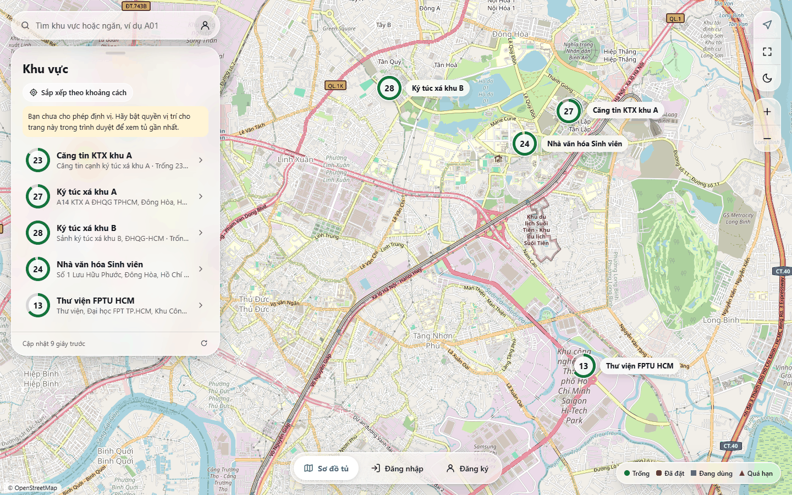 | 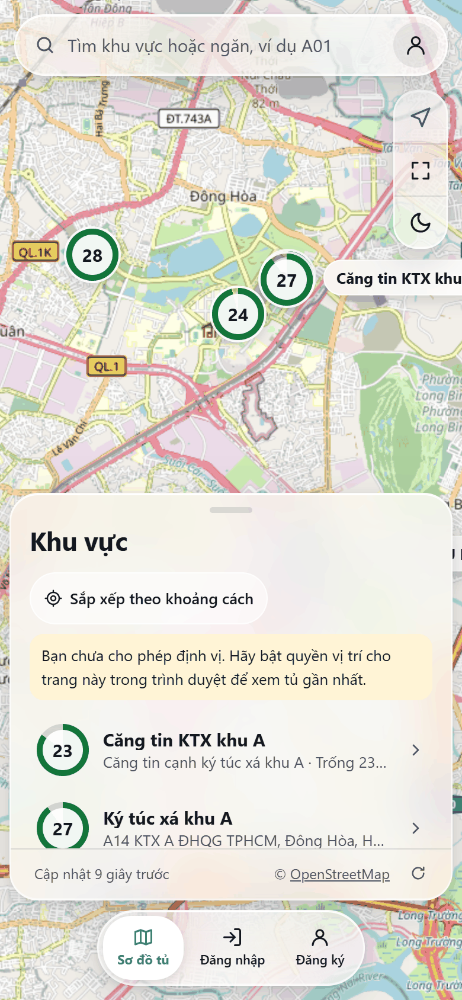 |

| One area: banks and locked overdue slots | Slot card: plans and four ways to open |
|---|---|
| 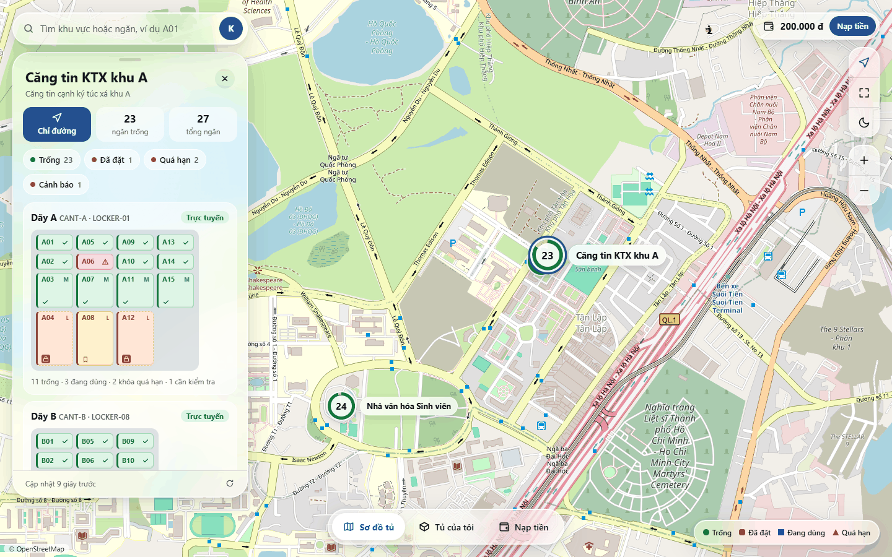 | 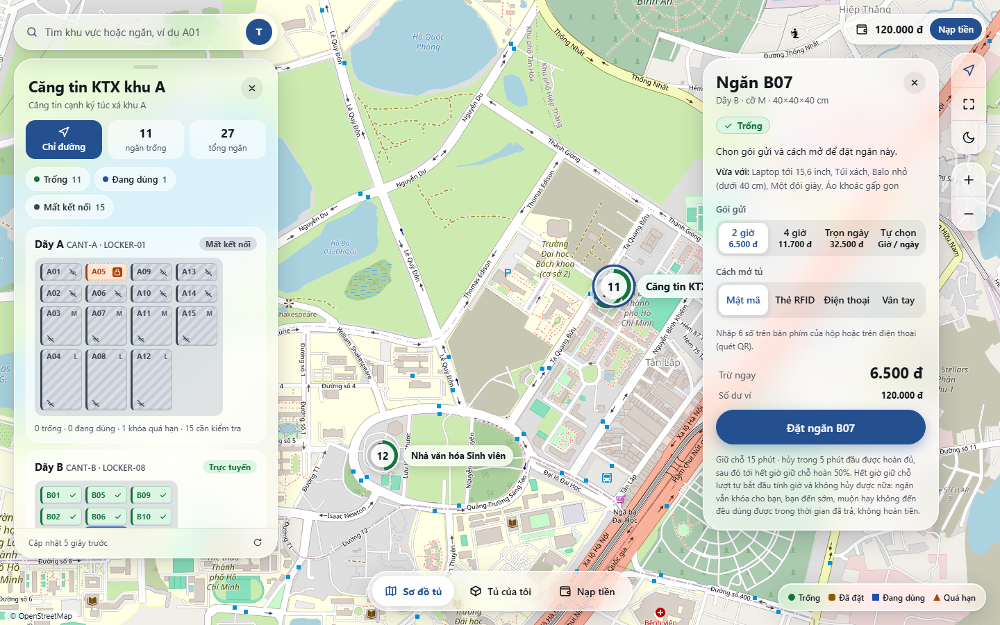 |

| Custom by hours | Custom by days |
|---|---|
| 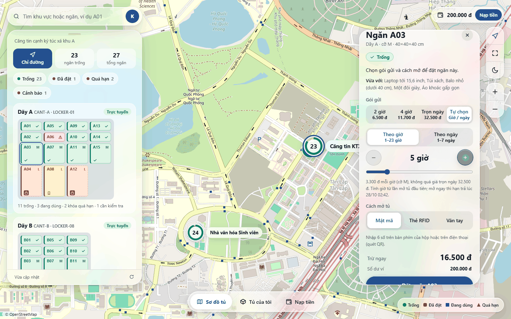 | 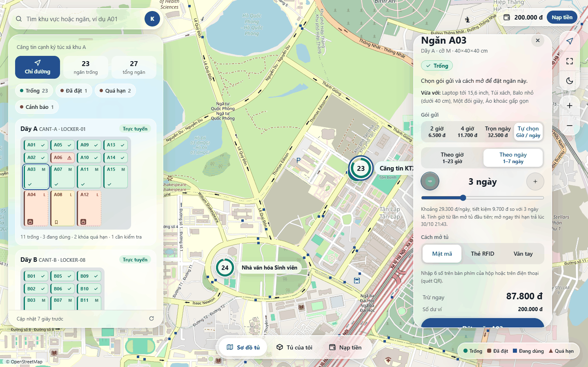 |

| Booking confirmation | My locker: PIN and cancel countdown |
|---|---|
| 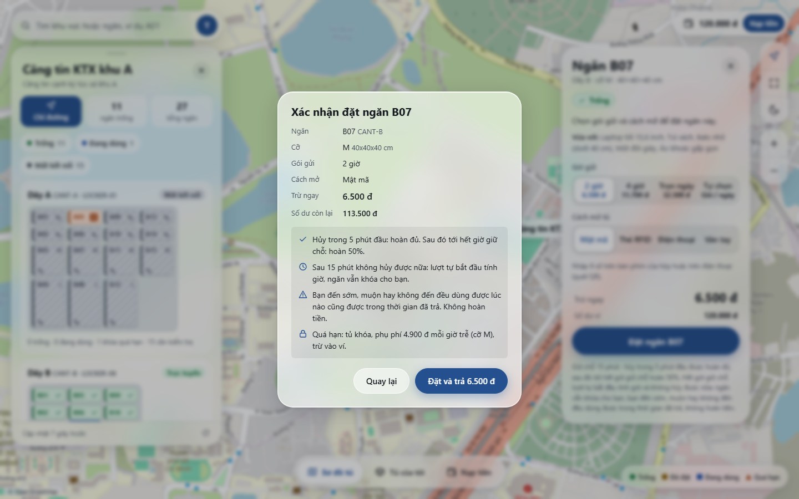 | 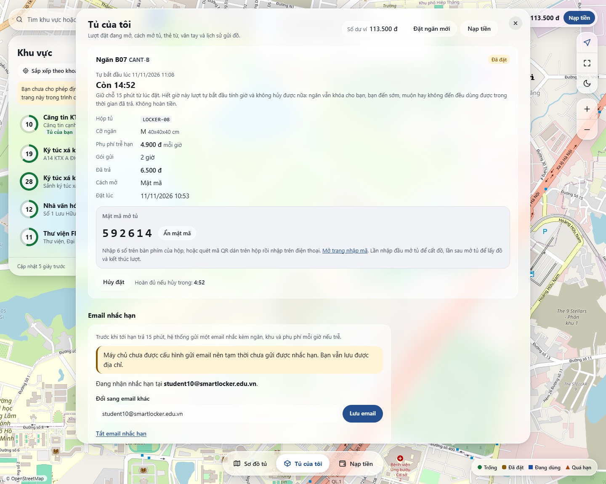 |

| My locker: in use, extend | My locker: overdue, locked, in debt |
|---|---|
| 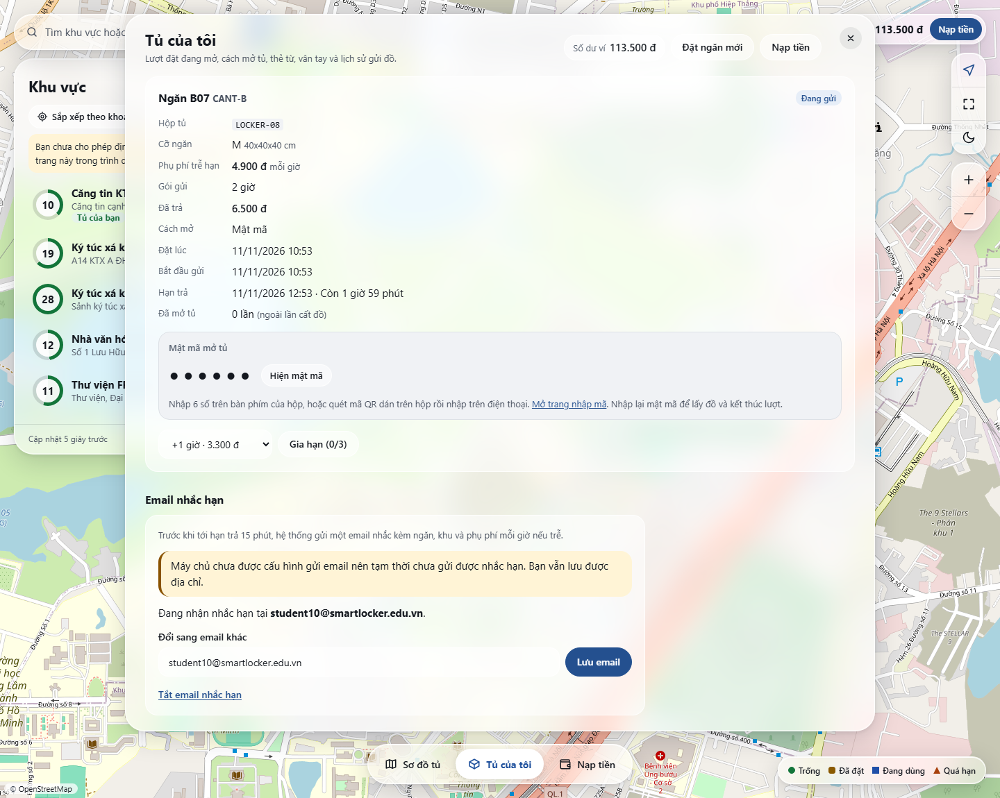 | 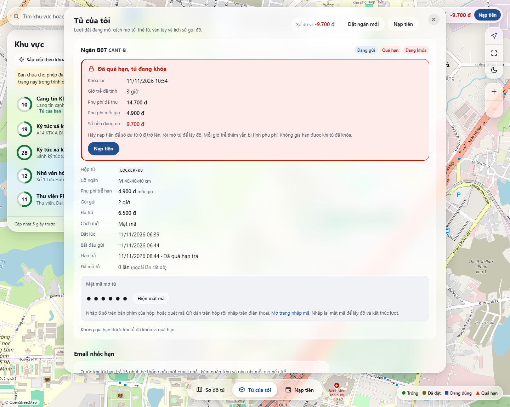 |

| Staff dashboard | Sensor data |
|---|---|
| 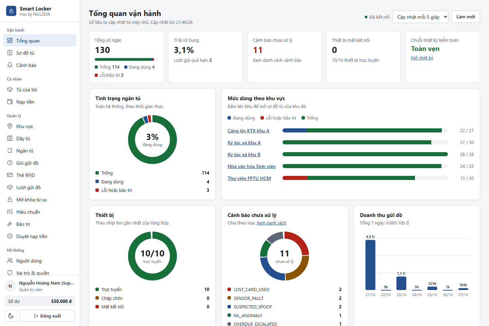 | 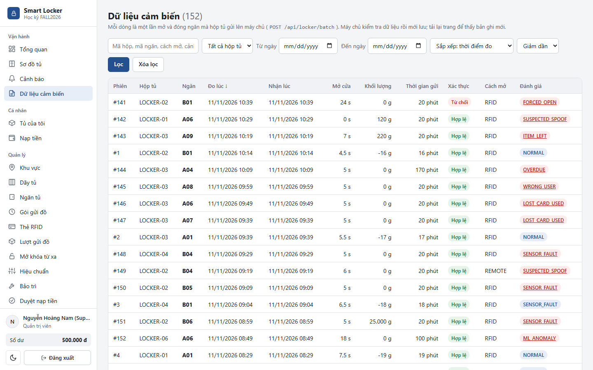 |

| Alert escalated after 48 hours | Alert list |
|---|---|
| 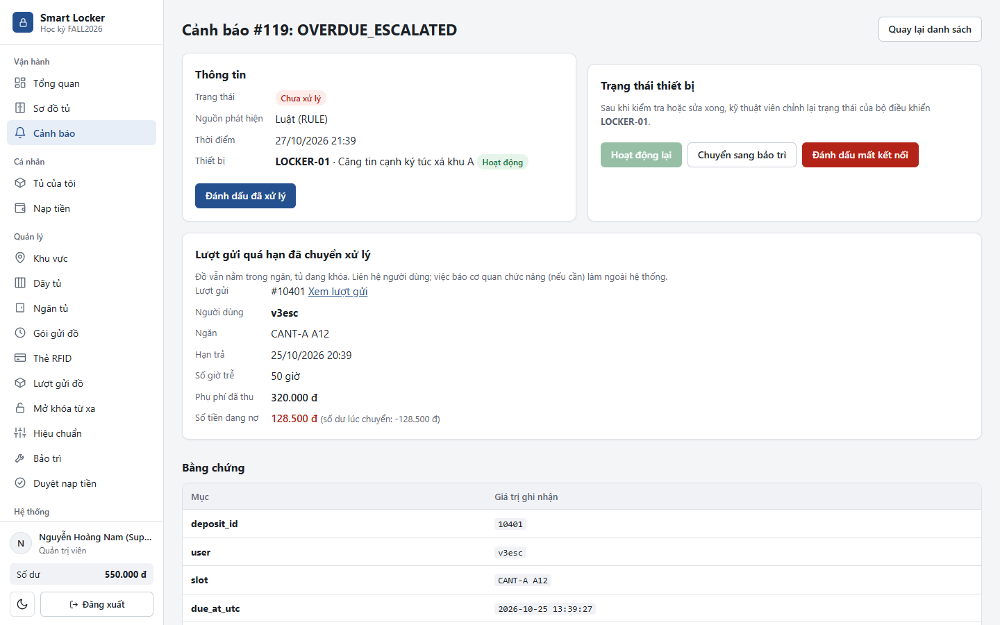 | 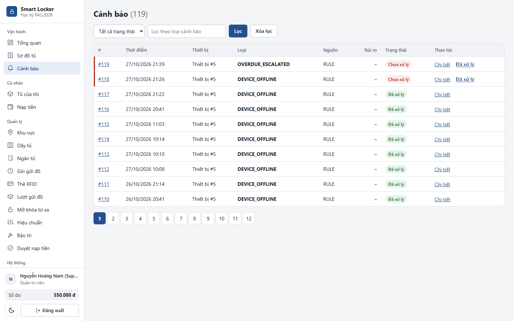 |

| Banks: real box and slot with a real lock | Phone page to open a slot |
|---|---|
| 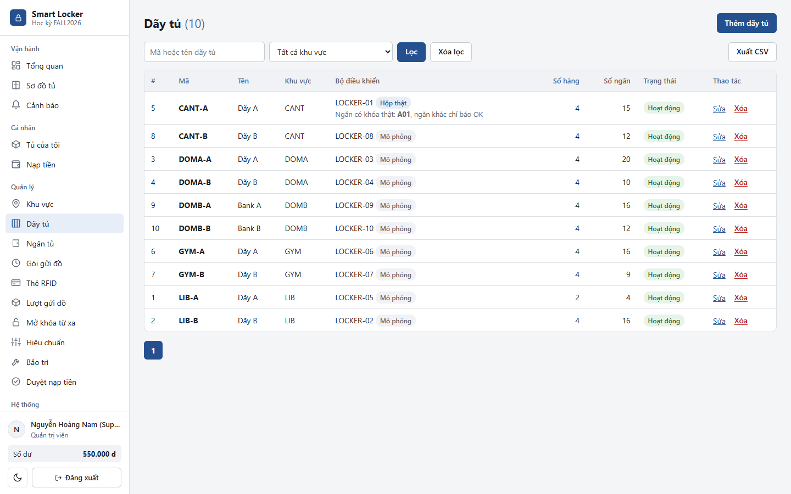 | 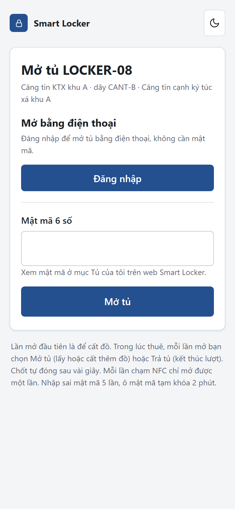 |

---

## Install and run

You need JDK 8, Apache Tomcat 9, SQL Server 2019/2022 with `sqlcmd`, and Git Bash for the `.sh` scripts. NetBeans is optional. Postman runs also need Node.js and `npm install -g newman`.

### 1. Create the database

One command (it **drops and recreates** the database `PRJ301_LOCKER`):

```powershell
powershell -ExecutionPolicy Bypass -File .\run_demo_db.ps1
```

It runs files `01` to `05` below. Defaults are `localhost`, `sa`, `12345`.

| File | Content |
|---|---|
| `sql/01_schema.sql` | Database, tables, views, triggers, `Audit_Append`, base permissions |
| `sql/02_data_v1.sql` | Demo data, scenario procedures, wallet and top-up |
| `sql/03_v2_v3.sql` | Open methods, lockout, `Device_Authorize`, `AppConfig`, sizes S/M/L, prices, Custom, cancel, overdue, reminders, VNU-HCM areas |
| `sql/04_phone.sql` | Open method `PHONE`, NFC tap tokens, no card deposit |
| `sql/05_auto_checkin.sql` | Automatic check-in when the hold ends |
| `sql/demo_box.sql` | Picks the real box, the banks it manages and the servo slot (run separately, see [The ESP32 box](#the-esp32-box)) |
| `sql/upgrade_main_2026-11.sql` | Upgrades a running database, used when [deploying](#deploying-to-the-internet) |
| `sql/test_setup.sql`, `test_overdue.sql`, `test_cleanup.sql` | Postman data, overdue demo, test data cleanup |

When running single files again:

- Always use `sqlcmd -I -b -f 65001`. Files with Vietnamese text must keep the UTF-8 BOM.
- Do not run `02` alone on a database that went through `03`; rebuild with `run_demo_db.ps1`. After `03`, run `04` and `05` again. After `04`, run `05` again.
- `03_v2_v3.sql` resets the key of `LOCKER-01` to the public sample key. Before plugging in a real box, create your own key (stored in `config/device-keys.local.properties`, not committed):

  ```powershell
  powershell -ExecutionPolicy Bypass -File scripts\set-device-key.ps1
  ```

### 2. Build and run

**NetBeans:** Clean and Build, then Run on Tomcat 9.

**Git Bash:** the first time, create `conf/Catalina/localhost/SmartLocker.xml` in the Tomcat folder (use your repo path):

```xml
<Context docBase="C:\path-to-repo\build\web" reloadable="false">
  <CookieProcessor className="org.apache.tomcat.util.http.Rfc6265CookieProcessor" sameSiteCookies="lax" />
</Context>
```

The command below then compiles into `build/web` and asks Tomcat to reload. If your machine differs from the defaults, set `TOMCAT` (the Tomcat folder) and `JAVAC` (the path of `javac`).

```bash
sh scripts/build-dev.sh
```

Wait about 15 seconds, then open <http://localhost:8080/SmartLocker/>.

The default database connection is `localhost:1433`, `sa` / `12345`. Change it with the environment variables `DB_URL`, `DB_USER`, `DB_PASSWORD`.

Two optional features: copy the `.example` file in `config/` to a `.local.properties` file and fill it in.

| File | Effect when present |
|---|---|
| `config/mail.local.properties` | Sends due reminders and card confirmations; without it, mail is off |
| `config/mapbox.local.properties` | Uses Mapbox (`pk.*`); without it, Leaflet |

### 3. Demo accounts

Common password: `123456`.

| Role | Accounts | Cannot sign in |
|---|---|---|
| ADMIN | `admin`, `admin_ops`, `admin_lib`, `admin_doma`, `admin_cant`, `admin_gym`, `sysadmin1`, `manager1`, `manager2` | `sysadmin2` |
| OPERATOR | `operator1` ... `operator4` (one area each) | `operator5` ... `operator22` |
| TECHNICIAN | `tech1` ... `tech22` | `tech20`, `tech22` |
| AUDITOR | `auditor1` ... `auditor16` | `auditor15`, `auditor16` |
| END_USER | `student1` ... `student28`, `user1` | `locked1`, `student27`, `student28` |

Some demo accounts already have a booking. To try a new one, use an account without an open booking, for example `student10`.

---

## The ESP32 box

The demo has **one real ESP32 box** (`LOCKER-01`) with **one slot with a servo**. It manages every slot of the banks attached to it. Any of those slots works as a booking, but the `UNLOCK` reply has a `physical` flag:

- `true`: the physical slot, the servo opens the door.
- `false`: another slot, the servo stays still and the LCD only reports the result.

The other banks belong to demo boxes (`"demo":true`) whose heartbeat the server simulates, so they are always online.

**Picking the banks of the real box:** edit the 4 variables at the top of `sql/demo_box.sql` and run it in the app's database. By default the box manages bank `LIB-A`, servo slot `A01`.

```sql
DECLARE @device_code   NVARCHAR(30)  = N'LOCKER-01';
DECLARE @banks         NVARCHAR(400) = N'LIB-A';     -- several banks: comma separated
DECLARE @physical_bank NVARCHAR(20)  = N'LIB-A';
DECLARE @physical_slot NVARCHAR(20)  = N'A01';       -- both NULL: every slot moves the servo
```

Banks of one box must have different slot codes. When the real box is off, its banks go OFFLINE after 90 seconds; to test in a browser only, book on a demo bank such as `CANT-B`.

**Firmware** is `firmware/SmartLocker_Online` (version 4.1, board ESP32 Dev Module). Copy `secrets.example.h` to `secrets.h` and fill in the Wi-Fi, the server address and the box key. Full guide (Vietnamese): [firmware/SmartLocker_Online/README.md](./firmware/SmartLocker_Online/README.md).

| Device | ESP32 pins |
|---|---|
| PN532 (cards and NFC tap, I2C, address 0x24) | SDA 21, SCL 22 |
| LCD 1602 I2C (address 0x27) | SDA 21, SCL 22 |
| AS608 (fingerprint) | TX → 35, RX → 15 |
| Bolt servo | 32 |
| Drawer servo | 2 (plug its signal wire in after the upload) |
| SRF05 | TRIG 5, ECHO 18 (through a voltage divider) |
| Keypad 4x4 | Rows 13, 14, 25, 26; columns 33, 19, 23, 27 |

At the box: `0-9` + `#` sends a PIN; `B` + enrollment code enrolls a card; `C` + enrollment code enrolls a fingerprint; `D` shows the IP and server status.

**Phone tap:** the PN532 emulates an NFC tag holding the link `/k/LOCKER-01?n=<token>`. The token comes with the heartbeat, changes every minute and after each opening, and lasts 5 minutes. A tap opens the box's page; the signed-in owner presses "Mở tủ của tôi". In each loop the PN532 alternates between reading cards and emulating the tag. Some iPhones cannot read the emulated tag; use the QR code then.

`firmware/SmartLocker_Local` is a hardware test without network and still uses an RC522 reader.

---

## Pricing and rules

Price = plan price × size factor (S 100%, M 130%, L 169%), rounded up to 100 VND. Amounts are in VND.

| Plan (grace) | S | M | L |
|---|---:|---:|---:|
| 2 hours (10 minutes) | 5,000 | 6,500 | 8,500 |
| 4 hours (10 minutes) | 9,000 | 11,700 | 15,300 |
| Full day (30 minutes) | 25,000 | 32,500 | 42,300 |
| Hourly rate (extension, Custom by hours) | 2,500 | 3,300 | 4,300 |
| Late fee per hour (150% of the hourly rate) | 3,800 | 4,900 | 6,400 |

**Custom** is computed again by the server; the page only displays it:

- By hours (1-23): `min(hourly rate × N, full-day price)`.
- By days (1-7): `full-day price × N × factor`. Factor 100% for 1 day, 90% for 2-6 days, 80% for 7 days, rounded up to 100 VND.

| Custom | S | M | L |
|---|---:|---:|---:|
| 3 hours | 7,500 | 9,900 | 12,900 |
| 9 hours | 22,500 | 29,700 | 38,700 |
| 10-23 hours | 25,000 | 32,500 | 42,300 |
| 2 days | 45,000 | 58,500 | 76,100 |
| 3 days | 67,500 | 87,800 | 114,100 |
| 6 days | 135,000 | 175,500 | 228,200 |
| 7 days | 140,000 | 182,000 | 236,600 |

| Rule | Value | `AppConfig` key |
|---|---|---|
| Hold | 15 minutes | `HOLD_MIN` |
| Full refund on cancel | first 5 minutes | `CANCEL_FREE_MIN` |
| Late cancel, until the hold ends | 50% back, rounded down to 100 VND | `CANCEL_LATE_REFUND_PCT` |
| Minimum balance after booking | 10,000 VND | `BOOKING_BUFFER` |
| Reminder e-mail before the due time | 15 minutes | `DUE_REMINDER_MIN` |
| Escalation to staff | 48 hours | `ESCALATE_HOURS` |

The numbers live in `AppConfig`, `SlotSize` and `StoragePlan`, and `util.Pricing` computes exactly what SQL does. To change a number, change both and run `PricingDatabaseIntegrationTest`.

---

## Flows

### Book, store and collect

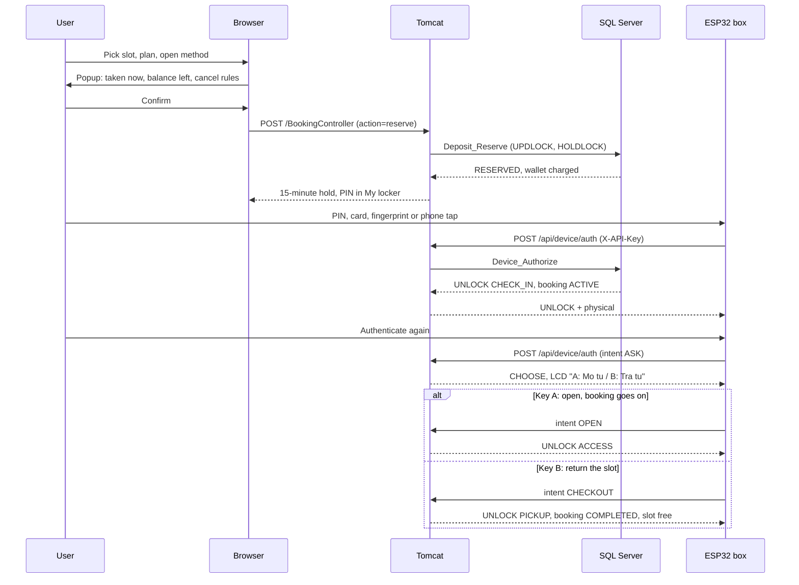

### Overdue

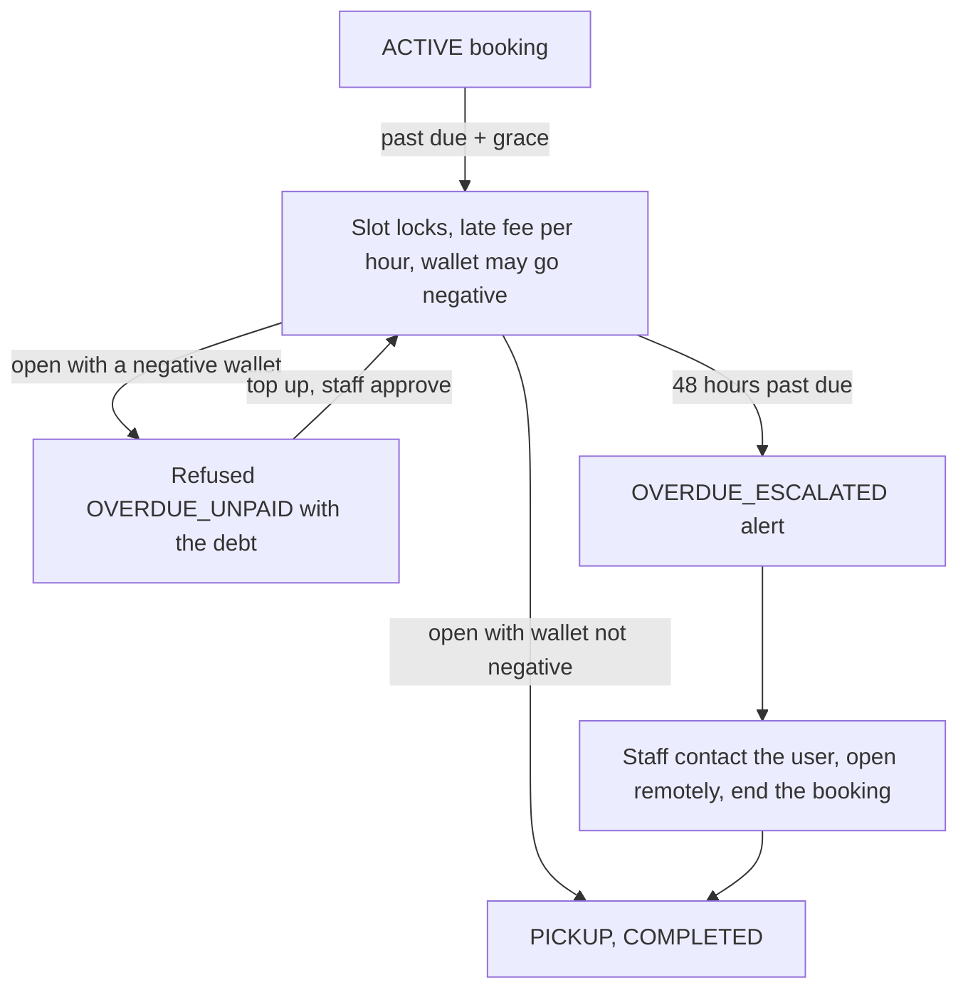

### Alerts

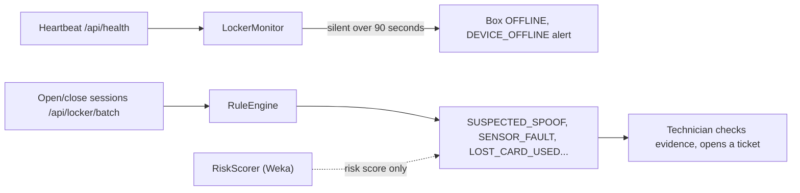

The firmware does not send `/api/locker/batch` today because the box has no door sensor or scale. Data for this flow comes from the seed, `scripts/send-demo.ps1` or the `ScenarioSender` tool:

```powershell
powershell -ExecutionPolicy Bypass -File scripts\send-demo.ps1 -Count 5 -Fault -Bad
```

Every case and error code (Vietnamese): [docs/SYSTEM_FLOWS.md](./docs/SYSTEM_FLOWS.md).

---

## Testing

Results on a database built clean from the scripts, on 2026-11-11:

| Suite | Result |
|---|---|
| TestNG, 14 classes | 83/83 pass, none skipped |
| Postman + newman, 19 scenarios | 241 requests, 514 assertions, 0 failures |
| Browser: visitor, book and cancel, open, overdue, phone page, 17 staff pages | 36/36 checks pass, no JavaScript error or HTTP 500 |

The tests write to the database, so run them only on a database named `SL_*`, never on `PRJ301_LOCKER`. Before using the scripts in `scripts/proof`:

- On another machine, or after rebuilding `PRJ301_LOCKER`, set `$script:RealDbCreated` in `scripts/proof/lib.ps1` to that database's real `create_date`. The scripts raise an alarm when the real database was rebuilt.
- `test.sh` reads the JDK folder from `JDK` and Tomcat from `TOMCAT`. `test-stack.ps1` uses JDK 1.8.0_202 and takes the Tomcat folder as `-TomcatHome`.

Build a test database and run TestNG:

```powershell
powershell -ExecutionPolicy Bypass -File scripts\proof\build-db.ps1 -Repo "$PWD" -Database SL_TEST -TestSetup
```

```bash
DB_URL='jdbc:sqlserver://localhost:1433;databaseName=SL_TEST;encrypt=false' sh scripts/test.sh
```

Run Postman on a separate test Tomcat on port 8081, on a freshly built database without `demo_box.sql`. `test-stack.ps1 start` stops if it finds `config/mail.local.properties` so the tests send no real mail, so run it in a clone without that file:

```powershell
powershell -ExecutionPolicy Bypass -File scripts\proof\test-stack.ps1 start -Database SL_TEST -Build
```

```powershell
powershell -ExecutionPolicy Bypass -File scripts\proof\newman.ps1 -Database SL_TEST
```

```powershell
powershell -ExecutionPolicy Bypass -File scripts\proof\test-stack.ps1 clean
```

More (Vietnamese): [docs/postman/README.md](./docs/postman/README.md) and [scripts/proof/README.md](./scripts/proof/README.md).

**Overdue demo without waiting:** open the slot once so the booking is ACTIVE, set `@username` in `sql/test_overdue.sql` and run it. Within 15 seconds the system locks the slot and charges the fee. Clean up with `sql/test_cleanup.sql`.

**Manual tools** in `test/tool`, not packaged in the WAR: `ScenarioSender` (fake ESP32 box), `DataReplayer`, `ModelTrainer`, `TransferCheck`, `DeviceKey`.

---

## Deploying to the Internet

| Option | Document (Vietnamese) |
|---|---|
| Render (Docker) + Azure SQL Database. **Each push to `main` makes Render build and deploy again** | [docs/deploy-render.md](./docs/deploy-render.md) |
| Run on your own PC through a Cloudflare tunnel, for demos | [docs/deploy.md](./docs/deploy.md) |

**Updating a running database** while keeping its rows: run only these files, in this order, skipping what is already done. Do not run `03_v2_v3.sql` again; it resets the box key.

| The database is at | Run |
|---|---|
| Built from `main` at commit `da95f43` | `upgrade_main_2026-11.sql`, `04_phone.sql`, `05_auto_checkin.sql` |
| Has `upgrade_main_2026-11.sql` | `04_phone.sql`, `05_auto_checkin.sql` |
| Has `04_phone.sql` | `05_auto_checkin.sql` |

```bash
sqlcmd -I -b -f 65001 -S <server> -d PRJ301_LOCKER -U <user> -P <password> -i sql/05_auto_checkin.sql
```

---

## Architecture and source

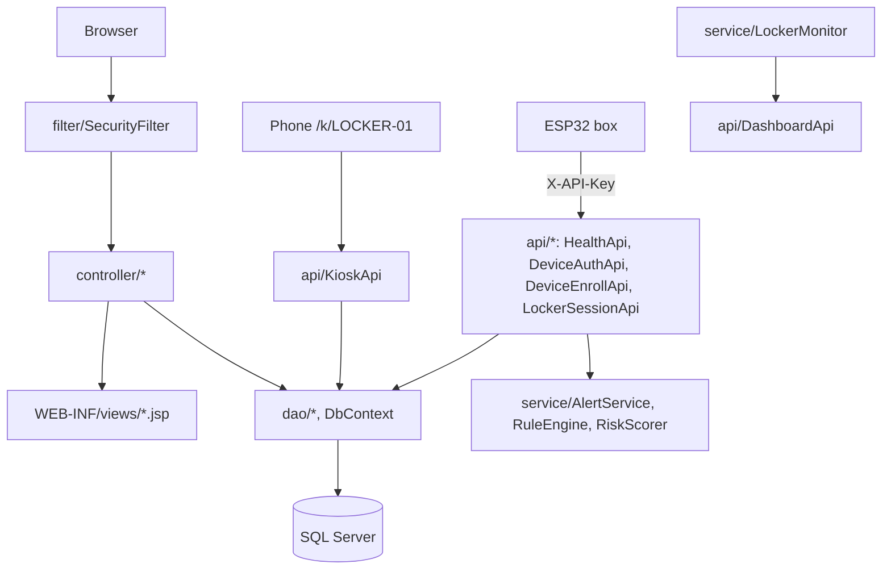

- `DbContext` is the only place that opens JDBC connections and keeps a small pool; DAOs close them with try-with-resources.
- Money and time rules live in SQL procedures; Java calls them and translates errors to Vietnamese (`Web.sqlMessage`).
- Views live in `WEB-INF/views` and are reachable only through controllers.
- `/api/dashboard` reads the in-memory snapshot of `LockerMonitor`, not the database; chart numbers are at `/api/dashboard/stats`.

```
SmartLocker/
├── config/        # Mail templates, sample config (*.local.properties are not committed)
├── docs/          # SYSTEM_FLOWS, specs, deploy, Postman, images, the paper
├── firmware/      # SmartLocker_Online (web-connected ESP32), SmartLocker_Local (hardware test)
├── lib/           # JDBC, Gson, jBCrypt, Weka; TestNG, JCommander, SLF4J for tests only
├── scripts/       # build-dev, test, set-device-key, send-demo, proof/ (test DB and Tomcat)
├── sql/           # 01-05, demo_box, upgrade, test_*
├── src/java/
│   ├── api/       # JSON API: devices, phone, dashboard, map, My locker
│   ├── controller/# MVC2 servlets
│   ├── dao/       # JDBC
│   ├── filter/    # SecurityFilter: sign-in, permissions, device API keys
│   ├── ml/        # Trained Weka model
│   ├── model/     # Data classes
│   ├── service/   # LockerMonitor, DueReminder, MailService, RuleEngine, RiskScorer, AuditVerifier
│   └── util/      # Web, Pricing, Csv, SecurityUtils, SlotImages
├── test/          # test/ (TestNG), tool/ (manual), support/
└── web/           # JSP, CSS, JS, Leaflet
```

### Main API

| Method | Endpoint | Description |
|---|---|---|
| `POST` | `/BookingController` | `action=reserve`, `cancel`, `extend` |
| `GET` | `/api/locker-map` | Areas, banks, slots, prices; open to visitors |
| `GET` | `/api/my-locker` | Open bookings, cards, fingerprints, history |
| `POST` | `/TopupController` | Top-up request; staff approve or reject |
| `POST` | `/api/health` | Heartbeat; returns pending commands and `tap_path` for the NFC tag |
| `POST` | `/api/device/auth` | PIN, card, fingerprint → `UNLOCK` / `CHOOSE` / `CONFIRM_EMAIL` / `DENY` |
| `POST` | `/api/device/enroll/start`, `/finish` | Enroll a card or fingerprint |
| `POST` | `/api/locker/batch` | Open/close sessions of a box |
| `POST` | `/api/kiosk/unlock` | Open from the phone page with a PIN or NFC tap |
| `GET` | `/api/dashboard`, `/api/dashboard/stats` | Dashboard and chart numbers |

Device API contract (Vietnamese): [docs/spec/smart-locker-v2.md](./docs/spec/smart-locker-v2.md) section 4.

---

## Security and known limits

**In place:**

- `SecurityFilter`: undeclared paths are refused; GET needs READ, other methods need WRITE. Visitors can only view the map and `/api/locker-map` (GET); also public are the box page `/k/*`, `/api/kiosk/unlock`, card confirmation `/c/*`, sign-in and sign-up.
- Passwords are hashed with BCrypt. The user is reloaded on every request, so a locked account is signed out at once.
- Booking races are stopped by locks in the procedure (`UPDLOCK, HOLDLOCK`).
- The audit log is append-only with a SHA-256 hash chain.
- Box API keys are stored as SHA-256. The session cookie is SameSite=Lax. User data is printed with `<c:out>` and `esc()`.

**Not in place, because this is a demo project.** Fix these before real use:

- No limit on failed sign-ins and no change-password page. Accounts created or reset by staff get the password `123456`.
- E-mail addresses are saved as typed, with no verification code.
- No CSRF token; it relies on SameSite=Lax.
- No dedicated error page for HTTP 500.
- `DbContext` defaults to `sa` / `12345` for local use; set `DB_URL`, `DB_USER`, `DB_PASSWORD` when deploying.
- The firmware uses `setInsecure()` and does not pin the TLS certificate.

---

## Research paper

The paper *Smart Locker with Anomalous Access Detection Based on IoT Device Telemetry* is
[docs/paper/smartlocker-10p.tex](./docs/paper/smartlocker-10p.tex): IEEE template (`IEEEtran`, one column, about 10
pages), six authors from FPT University, Ho Chi Minh Campus; the corresponding author is Kieu Trong Khanh.

| Part | Content |
|---|---|
| System | Three-tier architecture, workflow figure, hardware block diagram, sequence diagram of the box protocol, slot state diagram |
| Anomaly detection | Table of 8 priority-ordered rules, risk score (Eq. 1), alert rule (Eq. 2), two-tier flowchart |
| Evaluation | 4 Weka classifiers on 480 synthetic sessions (IBk, F1 = 0.977), 66 TestNG tests, 472 newman assertions, 6 detection scenarios, 6–31 ms response time |
| Limitations | Synthetic sessions (no door sensor or load cell yet), one physically locked slot, no CSRF token or certificate check |

**Compiling on Overleaf:** upload the `.tex` file (as `main.tex`) and the `docs/paper/images/` folder. The 22
references are embedded in the file (`filecontents*`), so no separate `references.bib` is needed. If the reference
count does not change, use *Recompile from scratch*.

**The workflow figure** (`images/workflow.pdf`, `workflow.png`) is drawn by a script; the parts are redrawn after the
real box, no copyrighted photo is used:

```bash
python -I docs/paper/tools/make_workflow.py
```

The measurements and the commands that produced them are in [docs/paper/evidence](./docs/paper/evidence/README.md).
The earlier long version is still [docs/paper/smartlocker.tex](./docs/paper/smartlocker.tex).

---

## Related documents

The documents below are in Vietnamese.

- [docs/SYSTEM_FLOWS.md](./docs/SYSTEM_FLOWS.md): business flows, cases, state diagrams.
- [docs/spec/smart-locker-v2.md](./docs/spec/smart-locker-v2.md), [docs/spec/smart-locker-v3.md](./docs/spec/smart-locker-v3.md): specifications.
- [docs/deploy.md](./docs/deploy.md), [docs/deploy-render.md](./docs/deploy-render.md): deployment.
- [docs/postman/README.md](./docs/postman/README.md): Postman and newman.
- [firmware/SmartLocker_Online/README.md](./firmware/SmartLocker_Online/README.md): flashing the firmware and using the real box.
- [docs/paper/smartlocker-10p.tex](./docs/paper/smartlocker-10p.tex): the paper (see [Research paper](#research-paper)), with measurements in [docs/paper/evidence](./docs/paper/evidence/README.md).

## License

PRJ301 course project. See [LICENSE](./LICENSE).
