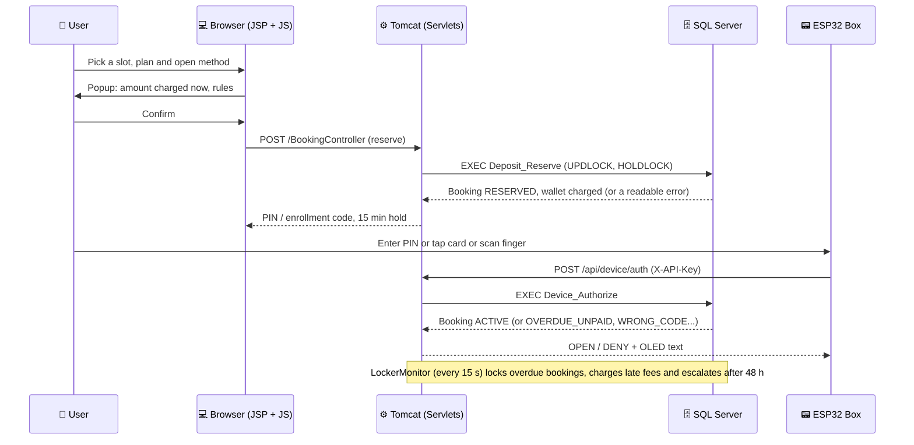

# 🔐 SmartLocker - Smart Locker Rental System

<div align="center">


-007396?style=for-the-badge&logo=java&logoColor=white)


**A complete Java web application for renting smart lockers online: book a slot, open it with a PIN, an RFID card or a fingerprint, and pay from a wallet, with ESP32 boxes that talk to the server through a per-device API key.**

*PRJ301 course project (FALL2026). The web interface is in Vietnamese; this file is the English overview. The full Vietnamese README is [README.md](./README.md).*

</div>

---

## ✨ Key Features

### For Users 👤

- **Secure Authentication:** Sign up and log in from a popup on the public map. Passwords are hashed with BCrypt (salted).
- **Locker Map:** Lockers grouped by area (Library, Dormitory A and B, Canteen, Student Cultural House) on a Leaflet map that works offline, refreshed every 10 seconds. Each bank is drawn as a cabinet whose door height follows the slot size.
- **Nearest Locker:** "Find lockers near me" sorts the areas by distance and opens walking directions in Google Maps. The position is computed in the browser and is never sent to the server.
- **Three Slot Sizes:** S 20x20x20 cm, M 40x40x40 cm, L 60x60x60 cm. Price = plan price x 1.00 / 1.30 / 1.69, and an RFID card gives 5% off. Example for a 2-hour plan: S 5,000 / M 6,500 / L 8,500 VND.
- **Booking You Can Trust:** Choose a plan and how to open the box (PIN, card, fingerprint). A confirmation popup shows the amount charged now. The slot is held for 15 minutes.
- **Cancel in 5 Minutes:** A full refund within the first 5 minutes. A no-show after the 15-minute hold loses the payment, and 3 no-shows in 7 days block booking for a while.
- **Paid Extensions:** Up to 3 extensions, each priced by the hour rate of the slot size.
- **Overdue Handling:** A slot is never released automatically. After the grace period the slot is locked and a late fee is charged per started hour (the wallet may go negative). The box refuses to open until the debt is paid, and after 48 hours the booking is escalated to staff.
- **Wallet:** Top up with a VietQR code; staff approve the request before the money is added.
- **My Locker:** PIN (show/hide), enrollment code for a card or fingerprint, countdowns for cancel and hold, overdue panel, e-mail reminder 15 minutes before the due time, registered cards, fingerprints and history.
- **Phone Page:** Scan the QR code on a box and enter the PIN at `/k/{device_code}` to open it (5 wrong tries lock the page for 2 minutes).

### For Staff 🛡️

- **Operator:** Locker map, remote unlock, top-up approval, and management of areas, banks, slots, plans, cards and users.
- **Technician:** Alerts, maintenance tickets, sensor calibration and slot status.
- **Auditor:** Read-only access, with verification of the tamper-evident audit log.
- **Admin:** Full access, including roles and permissions.
- **Dashboard:** Charts for slot status, area usage, devices, open alerts and revenue, served from a cached snapshot.

### For Devices 📟

- **Per-box API key:** The server stores only the SHA-256 of the key, and the device id always comes from the key, never from the request body.
- **Heartbeat and Offline Detection:** A box that stays silent for 90 seconds is marked OFFLINE and cannot be booked.
- **Lockout:** 5 wrong credentials on a box lock it for 2 minutes.
- **Alerts:** Fixed rules (`RuleEngine`) decide; a Weka model (`RiskScorer`) only adds a risk score.

---

## ⚙️ How It Works (Request Flow)

When a user books a locker, the system follows this flow so that a slot can never be sold twice and the money always matches the state:



---

## 📂 Project Structure

```
SmartLocker/
├── config/                 # Device keys and mail settings (*.local.properties, not committed)
├── docs/                   # Specs, SYSTEM_FLOWS, deploy notes, Postman, handoff
├── firmware/               # Arduino sketch for the ESP32 box
├── lib/                    # JDBC, Gson, jBCrypt, Weka (packaged); TestNG (tests only)
├── scripts/                # build-dev.sh, test.sh, set-device-key.ps1, update-tunnel-link.ps1
├── sql/                    # 01_schema, 02_data_v1, 03_v2_v3 and the test_* scripts
├── src/java/
│   ├── api/                # JSON APIs: devices, phone, dashboard, locker map, My Locker
│   ├── controller/         # MVC2 servlets, one per page
│   ├── dao/                # JDBC; DbContext is the only place that opens connections
│   ├── filter/             # SecurityFilter: login, role permissions, device keys
│   ├── ml/                 # Trained Weka model
│   ├── model/              # Data classes
│   ├── service/            # LockerMonitor, DueReminder, MailService, RuleEngine, RiskScorer, AuditVerifier
│   └── util/               # Web helpers, Pricing, Csv, SecurityUtils
├── test/
│   ├── test/               # TestNG unit and database integration tests
│   └── tool/               # Hand-run tools (ESP32 simulator, model trainer), not in the WAR
└── web/                    # JSP views, one stylesheet (app.css, light + dark), vanilla JS, vendored Leaflet
```

---

## 📡 Main API Endpoints

### Booking & Wallet

| Method | Endpoint | Description |
|--------|----------|-------------|
| `POST` | `/BookingController` | `action=reserve`, `cancel` or `extend` for the logged-in user. |
| `GET`  | `/api/my-locker` | The user's open booking, cards, fingerprints, plans and history. |
| `GET`  | `/api/locker-map` | Areas, banks, slots, sizes, plans and rules (open to visitors, read-only). |
| `POST` | `/TopupController` | Create a VietQR top-up request; staff approve or reject it. |

### Device & Phone

| Method | Endpoint | Description |
|--------|----------|-------------|
| `POST` | `/api/health` | Box heartbeat; returns pending commands and the server time. |
| `POST` | `/api/device/auth` | Checks a PIN, a card or a fingerprint at the box. |
| `POST` | `/api/device/enroll/start`, `/finish` | Registers a card or a fingerprint for an open booking. |
| `POST` | `/api/locker/batch` | Uploads the open/close history of a box. |
| `POST` | `/api/kiosk/unlock` | Opens a slot from the public phone page `/k/{device_code}`. |

### Staff

| Method | Endpoint | Description |
|--------|----------|-------------|
| `GET`  | `/api/dashboard` | Live numbers from the `LockerMonitor` snapshot (no database query). |
| `GET`  | `/api/dashboard/stats` | Chart data (per hour, per day, revenue), cached 60 seconds. |
| `GET`  | `/AuditController?action=verify` | Recomputes the SHA-256 chain of the audit log. |

---

## 🛠️ Technology Stack

| Layer | Technologies |
|-------|-------------|
| **Frontend** | JSP + JSTL, vanilla JavaScript, one CSS file with light and dark tokens, Leaflet (vendored, no CDN) |
| **Backend** | Java 8, Servlet 4 (MVC2), a security filter with role permissions |
| **Database** | SQL Server, stored procedures for every money and time rule |
| **Device** | ESP32 (Arduino), per-box API key, OLED, RFID and fingerprint sensor |
| **Security** | BCrypt, SHA-256 device keys, hash-chained audit log, SameSite=Lax session cookie |
| **Mail** | Plain-Java SMTP client (SSL 465 or STARTTLS 587) for due reminders |
| **AI** | Weka model that adds a risk score to alerts |
| **Testing** | TestNG, Postman + newman (17 scenarios, 201 requests) |
| **Hosting** | Tomcat 9; Cloudflare tunnel + GitHub Pages redirect for demos |

---

## 🚀 How to Run Locally

### 1. Clone the repository

```bash
git clone <your-repository-url>
cd SmartLocker
```

### 2. Set up the database

Requirements: JDK 8, Apache Tomcat 9, SQL Server 2019/2022 with `sqlcmd`, NetBeans (Ant web project).

The quick way runs the three scripts in order (`01_schema.sql` drops and recreates the database):

```powershell
.\run_demo_db.bat
```

Or one file at a time (always with `-I`):

```powershell
sqlcmd -S localhost -U sa -P 12345 -I -b -f 65001 -i sql\01_schema.sql
sqlcmd -S localhost -U sa -P 12345 -I -b -f 65001 -i sql\02_data_v1.sql
sqlcmd -S localhost -U sa -P 12345 -I -b -f 65001 -i sql\03_v2_v3.sql
```

Then give the real box its own secret key (kept in `config/device-keys.local.properties`, which is not committed):

```powershell
powershell -ExecutionPolicy Bypass -File scripts\set-device-key.ps1
```

The connection settings are in `src/java/dao/DbContext.java` (default `localhost:1433`, user `sa`).

### 3. Build and deploy

- **NetBeans:** Clean and Build, then Run on Tomcat 9.
- **Git Bash:** build the classes, copy `web/` and the runtime jars into `build/web`, and reload Tomcat:

```bash
sh scripts/build-dev.sh
```

Wait about 15 seconds, then open `http://localhost:8080/SmartLocker/`.

### 4. Test it

Unit and database tests (the integration tests need SQL Server running):

```bash
sh scripts/test.sh
```

End-to-end API tests with Postman and newman. Reset the test accounts first, because every wrong guess at a box counts toward its lockout:

```bash
sqlcmd -S localhost -U sa -P 12345 -d PRJ301_LOCKER -I -b -f 65001 -i sql/test_setup.sql
newman run docs/postman/SmartLocker-v2.postman_collection.json -e docs/postman/SmartLocker-local.postman_environment.json --env-var api_key=<LOCKER-01 key>
```

### 5. Demo accounts

All demo accounts use the password `123456`.

| Role | Accounts |
|------|----------|
| ADMIN | `admin` |
| OPERATOR | `operator1` (Library), `operator2` (Dormitory A), `operator3` (Canteen), `operator4` (Gym) |
| TECHNICIAN | `tech1` ... |
| AUDITOR | `auditor1` ... |
| END_USER | `student1` ... `student28`, plus the Postman users `v2pin`, `v2card`, `v2fp`, `v3overdue` |

Only `LOCKER-01` (bank CANT-A) is a real box. The other boxes are demo boxes, and `LockerMonitor` fakes their heartbeat. A real box that stops sending heartbeats goes OFFLINE after 90 seconds.

---

## 🔒 Security Notes

- Every path must be declared in `SecurityFilter`; an unknown path is refused. GET needs the READ permission and other methods need WRITE.
- A locked or deleted account is signed out on its next request, and role changes apply without a new login.
- Booking uses `UPDLOCK, HOLDLOCK` inside the stored procedures plus conditional updates, so two users can never get the same slot.
- User and device data is printed with `<c:out>`; JavaScript builds HTML only through the shared `esc()` helper.
- Known limits: no CSRF token (the session cookie is SameSite=Lax), the `sa` account is used in `DbContext`, and there is no connection pool.

## 📚 More Documentation

- [docs/spec/smart-locker-v3.md](./docs/spec/smart-locker-v3.md): the v3 rules (sizes, pricing, cancel, overdue, reminders).
- [docs/SYSTEM_FLOWS.md](./docs/SYSTEM_FLOWS.md): business flows and state diagrams.
- [docs/deploy.md](./docs/deploy.md): demo through a tunnel and the phone page.
- [docs/postman/README.md](./docs/postman/README.md): how to run the Postman collection.

## 📄 License

Course project for PRJ301. See [LICENSE](./LICENSE).
