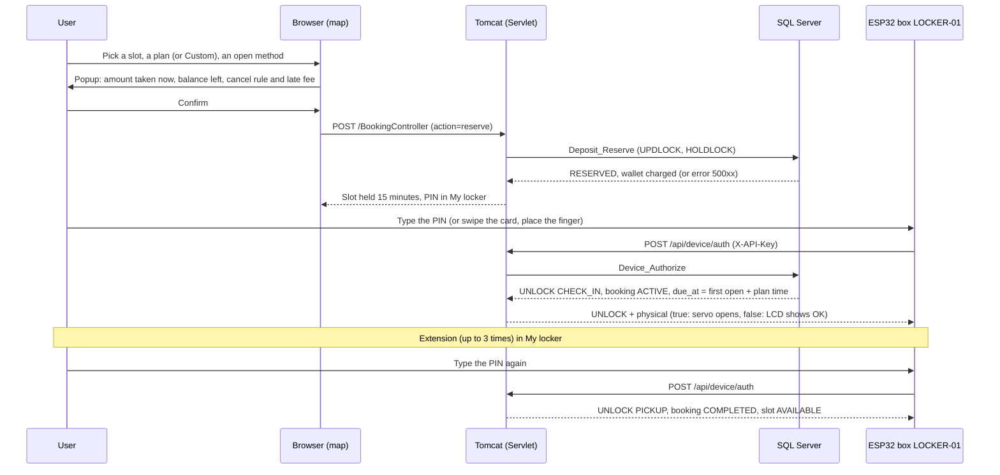
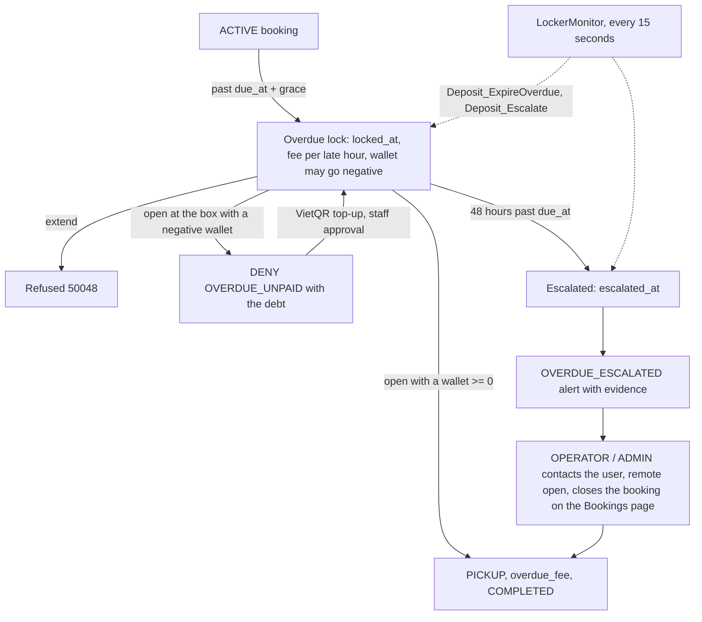
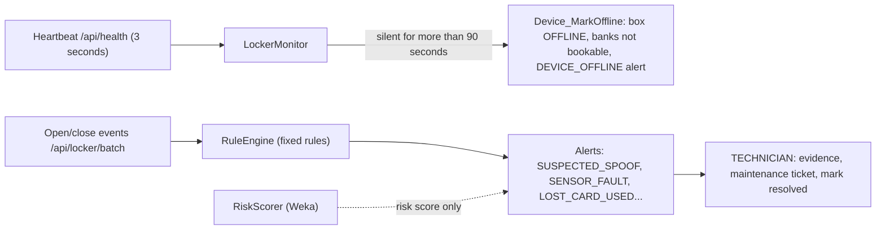
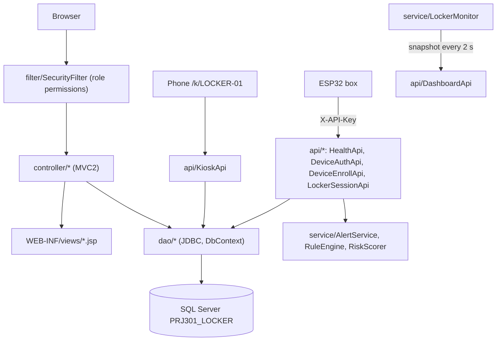

# SmartLocker - Smart Locker Rental System

<div align="center">


-007396?style=for-the-badge&logo=java&logoColor=white)


**A Java web application for renting lockers: book a slot on a map, open it with a PIN, an RFID card or a fingerprint,
pay from a wallet, with a real ESP32 box that talks to the server through a per-device API key.**

*PRJ301 course project (FALL2026). The web interface is in Vietnamese; the submitted Vietnamese README is [README.md](./README.md).*

</div>

---

## Contents

1. [Features](#features)
2. [Screenshots](#screenshots)
3. [Quick start](#quick-start)
4. [Demo hardware: one main box, many slots](#demo-hardware-one-main-box-many-slots)
5. [Pricing](#pricing)
6. [Flows](#flows)
7. [Testing](#testing)
8. [Architecture and project layout](#architecture-and-project-layout)
9. [Security](#security)
10. [Related documents](#related-documents)

---

## Features

### Users

- **The locker map is the home page:** the site opens straight on the map, which visitors can view without signing in.
  Sign-in and sign-up are a popup on the map (there is no separate login page). Passwords are hashed with BCrypt.
- **Areas, banks, slots:** 5 areas of VNU-HCM on a Leaflet map (vendored, no CDN), refreshed every 10 seconds. Each bank is drawn
  as a locker block with doors sized by slot size; overdue slots show a padlock. Without Internet the pins still show over a plain grid.
- **Find a locker near me:** sorts areas by distance and opens walking directions; the location stays in the browser.
- **Three slot sizes:** S 20x20x20, M 40x40x40, L 60x60x60 cm; the price depends on the size, the same for every open method ([Pricing](#pricing)).
- **Plans:** 2 hours, 4 hours, Day pass, or **Custom ("Tự chọn")** 1-23 hours / 1-7 days (hours capped at the day pass, discount for several days).
- **Clear booking:** a confirm popup shows the amount taken now, the balance left, the cancel rule and the late fee. The slot is held
  15 minutes; after booking the wallet must keep at least 10,000 VND for late fees.
- **Cancel within 5 minutes** for a full refund. No-show after the 15-minute hold: no refund; 3 no-shows in 7 days block booking for a while.
- **Extension:** up to 3 times, each started hour at the size's hourly rate.
- **Overdue:** a slot is never freed on its own (the user's things are inside). After the grace period the slot locks, each late hour
  is charged, and the wallet may go negative; the box refuses to open (`OVERDUE_UNPAID`) until the debt is paid. After 48 hours the
  booking is escalated to staff with an alert.
- **Wallet:** top-up by VietQR, credited after staff approval.
- **My locker ("Tủ của tôi"):** PIN (show/hide), card or fingerprint enrollment code, hold and cancel countdowns, extension, overdue
  panel with the debt, a due reminder e-mail 15 minutes before the due time (address confirmed by a code), registered cards and fingers, history.
- **Phone page** `/k/{device_code}`: scan the QR on the box and type the PIN (5 wrong tries lock the page for 2 minutes).

### Staff

- **OPERATOR:** staff map, remote open, top-up approval, areas, banks, slots, plans, cards, bookings, users.
- **TECHNICIAN:** alerts, maintenance tickets, sensor calibration, slot and device status.
- **AUDITOR:** read-only; verifies the hash chain of the audit log.
- **ADMIN:** everything, including roles and permissions.
- **Dashboard:** slot status, usage per area, devices, alerts, bookings per hour, busiest hours, 7-day revenue (revenue for ADMIN and OPERATOR only).

### Devices

- **One API key per box:** the server stores only its SHA-256; `device_id` comes from the key, never from the body.
- **One box manages several banks:** the real box authorizes every slot of its banks; the servo moves only for the physical slot
  ([details](#demo-hardware-one-main-box-many-slots)).
- **Heartbeat:** a box silent for more than 90 seconds goes OFFLINE and its banks cannot be booked.
- **Lockout:** 5 wrong guesses on a box lock it for 2 minutes.
- **Alerts:** fixed rules (`RuleEngine`) decide; a Weka model (`RiskScorer`) only adds a risk score.

---

## Screenshots

Taken from the running app at `http://localhost:8080/SmartLocker` (light theme). The data is the demo accounts and the test
accounts of `sql/test_setup.sql`; no real personal data.

| Locker map (visitor, not signed in) | Map on a phone |
|---|---|
|  |  |

| One area: banks, overdue-locked slots (A04, A12) | Slot card: fixed plan, size M price |
|---|---|
|  |  |

| Custom by hours (5 hours) | Custom by days (3 days, 10% off) |
|---|---|
|  |  |

| Booking confirm popup | My locker: PIN, cancel within 5 minutes |
|---|---|
|  |  |

| My locker: in use, extension | My locker: overdue, locked, in debt |
|---|---|
|  |  |

| Staff dashboard | Escalation alert after 48 hours |
|---|---|
|  |  |

| Alert list | Banks page: real box and physical slot |
|---|---|
|  |  |

<p align="center"><br>
<em>Phone unlock page <code>/k/LOCKER-01</code> (target of the QR code on the box)</em></p>

---

## Quick start

Requirements: JDK 8, Apache Tomcat 9, SQL Server 2019/2022 (with `sqlcmd`), Git Bash (for the `.sh` scripts). NetBeans is optional.

### 1. Database

Fast way, runs the 3 files (`01` drops and recreates the `PRJ301_LOCKER` database):

```powershell
powershell -ExecutionPolicy Bypass -File .\run_demo_db.ps1
```

Or by hand, **in this order** (always `-I`; SQL files with Vietnamese text must keep their UTF-8 BOM):

```powershell
sqlcmd -S localhost -U sa -P 12345 -I -b -f 65001 -i sql\01_schema.sql
sqlcmd -S localhost -U sa -P 12345 -I -b -f 65001 -i sql\02_data_v1.sql
sqlcmd -S localhost -U sa -P 12345 -I -b -f 65001 -i sql\03_v2_v3.sql
sqlcmd -S localhost -U sa -P 12345 -d PRJ301_LOCKER -I -b -f 65001 -i sql\demo_box.sql
```

| File | Content |
|---|---|
| `sql/01_schema.sql` | Database, tables, views, triggers, `Audit_Append`, base permissions |
| `sql/02_data_v1.sql` | Sample data (accounts, areas, banks, slots, history), scenario procedures, wallet and top-up |
| `sql/03_v2_v3.sql` | Open methods (PIN, card, finger), lockout, `Device_Authorize`, `Enroll_*`, `AppConfig`, S/M/L sizes, size prices, Custom, 5-minute cancel, overdue, reminders, the VNU-HCM areas (approximate coordinates, editable on the Areas page) |
| `sql/demo_box.sql` | The real box, the banks it manages and its physical slot ([below](#demo-hardware-one-main-box-many-slots)); safe to run again |
| `sql/test_setup.sql` | Test accounts and prepared bookings for Postman (not demo data) |
| `sql/test_overdue.sql` | Moves the due time of one `ACTIVE` booking into the past to demo the overdue lock, fee and escalation |
| `sql/test_cleanup.sql` | Closes the bookings and alerts left by the test accounts |

Notes:

- Running `02_data_v1.sql` again restores the old booking procedures, so run `03_v2_v3.sql` after it.
- `03_v2_v3.sql` resets the `LOCKER-01` key to the public sample key. Create your own secret key (kept in
  `config/device-keys.local.properties`, never committed) and store its SHA-256 in the DB:

  ```powershell
  powershell -ExecutionPolicy Bypass -File scripts\set-device-key.ps1
  ```

- To change one object on a live DB, run only that `CREATE OR ALTER` block, not all of `03_v2_v3.sql` (it resets the box key).
- The DB connection is in `src/java/dao/DbContext.java` (default `localhost:1433`, `sa` / `12345`).

### 2. Build and run on Tomcat

- **Git Bash:** compiles `src/java` into `build/web`, copies `web/` and the runtime jars, then tells Tomcat to reload the context
  (`TOMCAT` defaults to `E:/apache-tomcat-9.0.113`, `JAVAC` to JDK 1.8.0_202; override with environment variables):

  ```bash
  sh scripts/build-dev.sh
  ```

  The `SmartLocker` context points at `build/web` (Tomcat's `conf/Catalina/localhost/SmartLocker.xml`). Wait about 15 seconds,
  then open `http://localhost:8080/SmartLocker/`. Run Tomcat in its own window with `bin\startup.bat`.
- **NetBeans:** Clean and Build, then Run (Tomcat 9).

Due reminder e-mails need `config/mail.local.properties` (copy `mail.local.properties.example`); without it, e-mail is off.

### 3. Demo accounts

Shared password: `123456`. These are the accounts created by `sql/02_data_v1.sql`.

| Role | Accounts | Notes |
|---|---|---|
| ADMIN | `admin`, `admin_ops`, `admin_lib`, `admin_doma`, `admin_cant`, `admin_gym`, `sysadmin1`, `manager1`, `manager2` | `sysadmin2` is disabled |
| OPERATOR | `operator1` ... `operator22` | `operator20` locked, `operator22` disabled |
| TECHNICIAN | `tech1` ... `tech22` | `tech20` locked, `tech22` disabled |
| AUDITOR | `auditor1` ... `auditor16` | `auditor15` locked, `auditor16` disabled |
| END_USER | `student1` ... `student28`, `user1` | `locked1`, `student28` locked; `student27` disabled |
| END_USER (Postman) | `v2pin`, `v2card`, `v2fp`, `v2noshow`, `v3overdue`, `v3poor`, `v3late`, `v3esc` | Created by `sql/test_setup.sql` |

---

## Demo hardware: one main box, many slots

There is **one real ESP32 box** (`LOCKER-01` by default) with **one slot that has a servo lock**. The box manages every slot of
the banks attached to it: users may book any slot of those banks, and typing the PIN / swiping the card / placing the finger at the
box moves the booking through CHECK_IN and PICKUP as usual. The `UNLOCK` reply (of `/api/device/auth` and of the `UNLOCK` command in
the `/api/health` heartbeat) carries a `"physical"` flag:

- `true`: the physical slot (or no slot configured), the servo opens the door;
- `false`: another slot, the servo does not move and the LCD only shows `Ngan A03 OK` / `Da gui do` (or `Da lay do`).

Firmware 3.2 (`firmware/SmartLocker_Online`) reads the flag; older firmware ignores it and always moves the servo. Staff remote opens
and phone-page commands follow the same flag. The other banks belong to demo boxes (`"demo":true`) whose heartbeats `LockerMonitor`
fakes, so they stay online on the map. The staff **Banks** page ("Dãy tủ") marks "Hộp thật" (real box) and the physical slot (screenshot above).

### Setting the box, its banks and the physical slot

Edit the 4 variables at the top of `sql/demo_box.sql` and run it again:

```sql
DECLARE @device_code   NVARCHAR(30)  = N'LOCKER-01';  -- the real ESP32 box
DECLARE @banks         NVARCHAR(400) = N'CANT-A';     -- banks it manages, comma separated, e.g. N'CANT-A,CANT-B'
DECLARE @physical_bank NVARCHAR(20)  = N'CANT-A';     -- bank + slot of the compartment with the servo;
DECLARE @physical_slot NVARCHAR(20)  = N'A01';        --   both NULL: every slot of the box moves the servo
```

```powershell
sqlcmd -S localhost -U sa -P 12345 -d PRJ301_LOCKER -I -b -f 65001 -i sql\demo_box.sql
```

The script attaches the banks to the box, gives every bank the box drops a `"demo":true` device (so it does not go OFFLINE), stores
`physical_slot_id` in the box's `OperatingProfile`, never touches the API key, writes a `DEMO_BOX` audit entry and prints
bank → box → physical slot. Banks of one box need distinct slot codes (e.g. `CANT-A` A01-A15 and `CANT-B` B01-B12) because the box
finds a booking by slot code; the script refuses duplicates, and refuses to drop a bank that still has open bookings.

When the real box is off, its banks go OFFLINE after 90 seconds and cannot be booked: for browser-only tests, book on a demo bank
(e.g. `CANT-B`), or fake the box with `test/tool/ScenarioSender`.

### Firmware and wiring

Sketch `firmware/SmartLocker_Online/SmartLocker_Online.ino` (ESP32 Dev Module). Flashing, network setup (LAN or Cloudflare tunnel)
and use at the box: [firmware/SmartLocker_Online/README.md](./firmware/SmartLocker_Online/README.md) (Vietnamese).
`secrets.h` (Wi-Fi, server address, API key) is git-ignored.

| Part | ESP32 pins |
|---|---|
| RC522 (RFID) | SS 4, SCK 16, MOSI 17, MISO 34, RST to 3V3 |
| AS608 (fingerprint) | TX → 35, RX → 15 |
| LCD 1602 I2C | SDA 21, SCL 22, address 0x27 |
| Bolt servo | 32 |
| Door servo | 2 |
| SRF05 | TRIG 5, ECHO 18 (through a voltage divider) |
| 4x4 keypad | Rows 13, 14, 25, 26; columns 33, 19, 23, 27 |

At the box: `0-9` + `#` sends the 6-digit PIN; `B` + enrollment code enrolls a card; `C` + enrollment code enrolls a finger;
`D` shows the IP and server status. The box never decides on its own: every PIN, card and finger goes to the server.

---

## Pricing

Every number lives in the `AppConfig`, `SlotSize` and `StoragePlan` tables (`sql/03_v2_v3.sql`); `util.Pricing` mirrors the SQL
(`dbo.fn_SizePrice`, `fn_HourRate`, `fn_OverdueRate`, `fn_CustomPrice`). Price = plan price × size factor (S 100%, M 130%, L 169%),
rounded up to 100 VND. PIN, RFID card and fingerprint cost the same; a card only adds a 10,000 VND deposit (`CARD_DEPOSIT`), taken once
when the card is enrolled at the box. Amounts in VND:

| Plan (grace) | S | M | L |
|---|---:|---:|---:|
| 2 hours (10 min) | 5,000 | 6,500 | 8,500 |
| 4 hours (10 min) | 9,000 | 11,700 | 15,300 |
| Day pass (30 min) | 25,000 | 32,500 | 42,300 |
| Hourly rate (extension, Custom by hours) | 2,500 | 3,300 | 4,300 |
| Late fee per hour (150% of the hourly rate) | 3,800 | 4,900 | 6,400 |

**Custom** (whole hours 1-23 or whole days 1-7; the server prices it again, the page only displays):

- By hours: `min(hourly rate × N, day pass)` of the size.
- By days: `day pass × N × factor`, 100% for 1 day, 90% for 2-6 days (`CUSTOM_MULTI_DAY_PCT`), 80% for 7 days (`CUSTOM_WEEK_PCT`),
  rounded up to 100 VND.
- The grace period is the one of the longest plan not longer than the choice; extension and late fees follow the common rules.

| Custom | S | M | L |
|---|---:|---:|---:|
| 1 hour | 2,500 | 3,300 | 4,300 |
| 3 hours | 7,500 | 9,900 | 12,900 |
| 9 hours | 22,500 | 29,700 | 38,700 |
| 10-23 hours (capped at the day pass) | 25,000 | 32,500 | 42,300 |
| 1 day | 25,000 | 32,500 | 42,300 |
| 2 days (90%) | 45,000 | 58,500 | 76,100 |
| 3 days (90%) | 67,500 | 87,800 | 114,100 |
| 6 days (90%) | 135,000 | 175,500 | 228,200 |
| 7 days (80%) | 140,000 | 182,000 | 236,600 |

Other rules (`AppConfig`): 15-minute hold (`HOLD_MIN`), full refund within 5 minutes (`CANCEL_FREE_MIN`), 0% refund on no-show
(`NO_SHOW_REFUND_PCT`), 10,000 VND minimum left after booking (`BOOKING_BUFFER`), reminder 15 minutes before due (`DUE_REMINDER_MIN`),
escalation after 48 hours (`ESCALATE_HOURS`). To change a number, change both the SQL and `util.Pricing`, then run `PricingDatabaseIntegrationTest`.

---

## Flows

### Book, store and pick up



### Overdue, lock, escalation and alerts



### Device alerts



Every case, error code and the slot state diagram: [docs/SYSTEM_FLOWS.md](./docs/SYSTEM_FLOWS.md) (Vietnamese).

---

## Testing

**Unit and integration tests** (TestNG; the `*DatabaseIntegrationTest` classes need SQL Server running):

```bash
sh scripts/test.sh
```

One class: `sh scripts/test.sh test.PricingTest`. Classes: `PricingTest`, `PricingDatabaseIntegrationTest` (compares `util.Pricing`
with the SQL, Custom included), `AuditChainDatabaseIntegrationTest`, `RuleEngineTest`, `RiskScorerTest`, `SecurityUtilsTest`, `MailTemplatesTest`.

**Postman + newman** (17 scenarios: PIN, phone, card, fingerprint, wrong code and 5-try lockout, no-show, overdue, top-up, cancel,
buffer, escalation, extension). Run the setup script first, because every wrong guess at the box counts toward the 5-try lockout:

```bash
sqlcmd -S localhost -U sa -P 12345 -d PRJ301_LOCKER -I -b -f 65001 -i sql/test_setup.sql
newman run docs/postman/SmartLocker-v2.postman_collection.json -e docs/postman/SmartLocker-local.postman_environment.json --env-var api_key=<LOCKER-01 key>
sqlcmd -S localhost -U sa -P 12345 -d PRJ301_LOCKER -I -b -f 65001 -i sql/test_cleanup.sql
```

Details: [docs/postman/README.md](./docs/postman/README.md).

**Overdue demo without waiting:** book and open the box once (CHECK_IN), set `@username` in `sql/test_overdue.sql` and run it;
`LockerMonitor` locks, charges and (with `@minutes_late` over 48 hours) escalates within 15 seconds. Clean up with `sql/test_cleanup.sql`.

**Manual tools** (`test/tool`, not packed into the WAR): `ScenarioSender` (fake ESP32 box), `DataReplayer`, `ModelTrainer`
(trains the Weka model into `src/java/ml`), `TransferCheck`, `DeviceKey`. Run with Run File in NetBeans, or:

```powershell
javac -encoding UTF-8 -cp "build/web/WEB-INF/classes;lib/*" -d build/tools test/tool/*.java
java -cp "build/tools;build/web/WEB-INF/classes;lib/*" tool.ScenarioSender remote
```

---

## Architecture and project layout



- `DbContext` is the only place that opens JDBC connections and keeps a small pool; DAOs close connections with try-with-resources (`close()` returns them to the pool).
- Every money and time rule is a SQL procedure; Java calls it and translates errors into Vietnamese (`Web.sqlMessage`).
- Views live in `WEB-INF/views` and are reached only through controllers. User data is printed with `<c:out>`; JavaScript builds HTML through `esc()`.
- One stylesheet `web/css/app.css` (light/dark); `js/theme.js` sets the theme before paint; no CDN.
- `/api/dashboard` reads the in-memory `LockerMonitor` snapshot (no DB query); chart data is `/api/dashboard/stats`, cached 60 seconds.

```
SmartLocker/
├── config/        # Real box keys, e-mail settings (*.local.properties, not committed)
├── docs/          # SYSTEM_FLOWS, v2/v3 specs, deploy, Postman, images (README screenshots)
├── firmware/      # SmartLocker_Online (ESP32 talking to the web), SmartLocker_Local
├── lib/           # JDBC, Gson, jBCrypt, Weka (in the WAR); TestNG, JCommander, SLF4J (tests only)
├── scripts/       # build-dev.sh, test.sh, set-device-key.ps1, update-tunnel-link.ps1, mail-preview.sh
├── sql/           # 01_schema, 02_data_v1, 03_v2_v3, demo_box and the test_* scripts
├── src/java/
│   ├── api/       # JSON APIs: devices, phone, dashboard, locker map, My locker
│   ├── controller/# MVC2 servlets, one per page
│   ├── dao/       # JDBC; DbContext
│   ├── filter/    # SecurityFilter: sign-in, permissions, device API keys
│   ├── ml/        # Trained Weka model
│   ├── model/     # Data classes
│   ├── service/   # LockerMonitor, DueReminder, MailService, RuleEngine, RiskScorer, AuditVerifier
│   └── util/      # Web, Pricing, Csv, SecurityUtils, SlotImages
├── test/
│   ├── test/      # Unit and integration tests (TestNG)
│   └── tool/      # Manual tools, not packed into the WAR
└── web/           # JSP, css, js, vendored Leaflet
```

### Main APIs

| Method | Endpoint | Description |
|---|---|---|
| `POST` | `/BookingController` | `action=reserve` (plan `planId` or Custom `customMin`), `cancel`, `extend` |
| `GET` | `/api/locker-map` | Areas, banks, slots, size prices, Custom (visitors may read) |
| `GET` | `/api/my-locker` | Open booking, cards, fingers, history of the user |
| `POST` | `/TopupController` | VietQR top-up request; staff approve or reject |
| `POST` | `/api/health` | Box heartbeat; returns pending commands (`UNLOCK` with `physical`) |
| `POST` | `/api/device/auth` | PIN, card or finger at the box → `UNLOCK` / `DENY` |
| `POST` | `/api/device/enroll/start`, `/finish` | Card or finger enrollment for the open booking |
| `POST` | `/api/locker/batch` | Open/close history of the box |
| `POST` | `/api/kiosk/unlock` | Open from the phone page `/k/{device_code}` |
| `GET` | `/api/dashboard`, `/api/dashboard/stats` | Dashboard and chart data |

Device API contract: [docs/spec/smart-locker-v2.md](./docs/spec/smart-locker-v2.md) section 4.

---

## Security

- `SecurityFilter`: undeclared paths are refused; GET needs the resource's READ permission, other methods need WRITE.
  Only the map and `/api/locker-map` (GET) are open to visitors.
- The user is reloaded on every request: a locked account is signed out at once, a role change applies at once.
- Booking races are prevented by locks inside the procedure (`UPDLOCK, HOLDLOCK`).
- The audit log is append-only and hash-chained with SHA-256; AUDITOR is read-only.
- Box API keys are stored as SHA-256; an e-mail address is saved only after the code sent to it comes back; session cookie SameSite=Lax.
- Known limits: no CSRF token yet (relies on SameSite=Lax), the `sa` account is in `DbContext`.

## Related documents

- [docs/SYSTEM_FLOWS.md](./docs/SYSTEM_FLOWS.md): business flows, case table, state diagrams.
- [docs/spec/smart-locker-v2.md](./docs/spec/smart-locker-v2.md): v2 specification and device API contract.
- [docs/spec/smart-locker-v3.md](./docs/spec/smart-locker-v3.md): v3 (sizes, prices, cancel, overdue, reminders).
- [docs/deploy.md](./docs/deploy.md): demo over a Cloudflare tunnel, fixed GitHub Pages link, QR for the box.
- [docs/postman/README.md](./docs/postman/README.md): Postman collection and newman.
- [firmware/SmartLocker_Online/README.md](./firmware/SmartLocker_Online/README.md): flashing and using the real box.

## License

PRJ301 coursework. See [LICENSE](./LICENSE).
