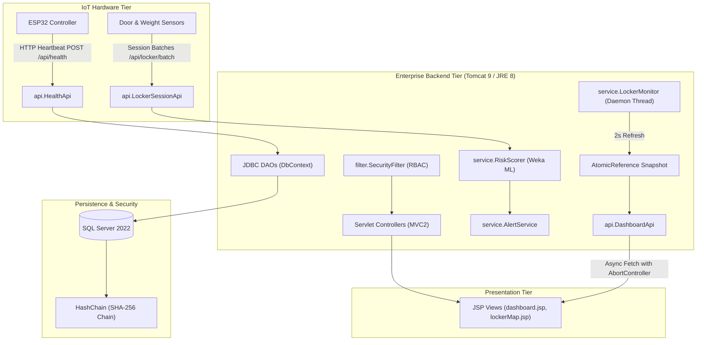
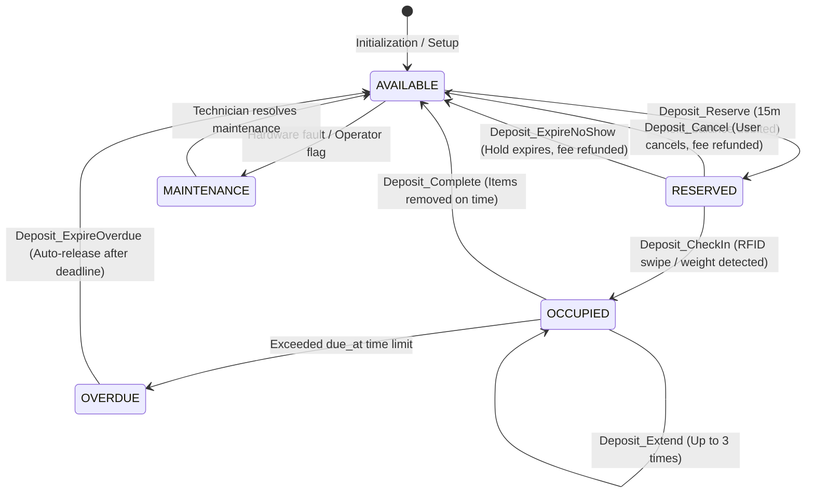

# 🔐 SmartLocker - Enterprise IoT Locker Management System

<div align="center">


**A high-performance Java Web (MVC2) IoT application for smart campus & facility locker management, featuring real-time telemetry streaming, Weka AI anomaly detection, and cryptographic audit hash chaining.**

[Explore Architecture Flows](docs/SYSTEM_FLOWS.md) · [View Schema Scripts](sql/) · [Report Bug](https://github.com/HoangDuc1003/SmartLocker/issues)

</div>

---

## 📌 Executive Summary

**SmartLocker** is an end-to-end IoT locker control and telemetry platform built on pure Java Servlet/JSP (MVC2 architecture) and SQL Server. It coordinates physical ESP32 locker controllers with an enterprise web application, providing automated booking, wallet payments, real-time slot visualization, hardware fault reporting, AI-driven anti-tamper detection, and an immutable cryptographic audit trail.

---

## ✨ Key Features

### 👤 For End Users
- **Self Registration & Authentication:** Secure BCrypt credential hashing with automatic role provisioning (`END_USER`).
- **Interactive Locker Map:** Visual, real-time matrix of available, occupied, and reserved slots across campus areas (Canteen, Library, Dormitory, Sports Hall).
- **In-App Digital Wallet:** Account top-ups via dynamic VietQR codes with non-round flexible amounts.
- **Instant Online Booking:** Atomic slot reservation with a 15-minute hold window and automated refunds on cancellation or no-show.
- **Self-Service Extensions:** Extend active reservations online (up to 3 times per booking).
- **RFID Card Self-Management:** Register, inspect, and report lost RFID badges.

### 🛡️ For Locker Operators & Administrators
- **Industrial IoT Real-Time Dashboard:**
  - Zero-database-load In-Memory Snapshot Cache updated every 2 seconds via `AtomicReference`.
  - Live pulse connection indicators (`LIVE`, `RECONNECTING`, `DISCONNECTED`).
  - Bento KPI cards with differential DOM hydration and occupancy rate tracking.
  - Live sensor sparkline telemetry (door-open duration vs. weight delta).
- **Remote Hardware Commands:** Send remote `UNLOCK` and `LOCK` commands queued for controller dispatch.
- **Locker Matrix Overrides:** Direct slot status control (`AVAILABLE`, `MAINTENANCE`, `DISABLED`).
- **Top-Up Verification:** Manual approval workflow with ledger auditing.

### 🔧 For Technicians & Auditors
- **Fault Detection & Ticketing:** Automated work order dispatch when sensors fail calibration or connectivity.
- **AI Tamper & Security Feed:** Weka Machine Learning model (`RiskScorer`) combined with deterministic rule engines to flag forced openings and sensor spoofing.
- **Cryptographic Audit Hash Chain:** Tamper-evident ledger linking every database mutation into an unbroken SHA-256 chain (`AuditVerifier`).

---

## 🏗️ System Architecture



---

## 🔄 Business Lifecycles & State Transitions

The complete end-to-end lifecycle from registration to locker return follows a strict finite-state machine:



> 📖 **Full Architectural Documentation:** For comprehensive flowcharts, concurrency controls, and sequence diagrams, refer to [docs/SYSTEM_FLOWS.md](docs/SYSTEM_FLOWS.md).

---

## 👥 Demo Accounts

Every sample account in the database seed uses password: `123456`

The database includes **100 sample user accounts** distributed realistically across all 5 roles:

| Role | Count | Sample Usernames | Permissions | Primary Responsibility |
| :--- | :--- | :--- | :--- | :--- |
| **Administrator** (`ADMIN`) | 10 | `admin`, `admin_ops`, `admin_lib`, `sysadmin1`, `manager1` | `*` (Full Access) | Global configuration, slot status, security review |
| **Locker Operator** (`OPERATOR`) | 22 | `operator1` to `operator22` | `MAP`, `ALERT`, `USER`, `COMMAND` | Real-time monitoring, remote unlocks, top-up reviews |
| **Technician** (`TECHNICIAN`) | 22 | `tech1` to `tech22` | `MAP`, `ALERT`, `MAINTENANCE`, `CALIBRATION` | Slot repairs, sensor calibrations, ticket resolutions |
| **Auditor** (`AUDITOR`) | 16 | `auditor1` to `auditor16` | `AUDIT:R`, `ALERT:R` (Strict Read-Only) | Cryptographic hash chain verification, log inspection |
| **End User** (`END_USER`) | 30 | `student1` to `student28`, `locked1`, `user1` | `MAP:R`, `BOOKING`, `TOPUP`, `MYCARD` | Booking slots, topping up wallet, badge management |

> 💡 **Demo Account Statuses:** 90 accounts are `ACTIVE`, 5 accounts are `LOCKED` (e.g., `locked1`, `student28`), and 5 accounts are `DISABLED` (e.g., `sysadmin2`, `operator22`), allowing complete testing of authorization error handling.

---

## 🚀 Quick Start Guide

### Prerequisites
- **Java:** JDK 8 (Target bytecode Major Version 52.0).
- **Web Container:** Apache Tomcat 9.0.x.
- **Database:** Microsoft SQL Server 2019/2022 + SSMS.
- **IDE:** NetBeans 13+ or VS Code with Java Extension Pack.

### 1. Database Setup
Execute the SQL migration scripts in order within SQL Server Management Studio (SSMS):
```sql
-- 1. Schema, tables, triggers, and baseline RBAC permissions
sql/01_schema.sql

-- 2. Expanded demo seed (100 accounts, 7 controllers, 90 slots, historical telemetry)
sql/02_sample_data.sql

-- 3. Stored procedures for all 5 business scenarios
sql/03_scenarios.sql

-- 4. Dynamic wallet transactions and booking constraints
sql/04_wallet_booking.sql

-- 5. Enhanced overdue auto-release and reviewer corrections
sql/05_fix_reviewer_feedback.sql
```

### 2. Configure Database Connection
Edit [`src/java/dao/DbContext.java`](src/java/dao/DbContext.java) with your local SQL Server credentials:
```java
private static final String URL = "jdbc:sqlserver://localhost:1433;databaseName=PRJ301_LOCKER;encrypt=false";
private static final String USER = "sa";
private static final String PASSWORD = "YOUR_PASSWORD_HERE";
```

### 3. Build & Deploy
Deploy to Tomcat via Ant or NetBeans:
```powershell
# Compile targeting Java 8 bytecode
ant compile

# Package distribution WAR
ant dist
```
Navigate to: `http://localhost:8080/SmartLocker/`

---

## 📂 Project Directory Structure

```
SmartLocker/
├── docs/                   # Technical specs, scenarios, and flow diagrams
│   └── SYSTEM_FLOWS.md     # Detailed sequence diagrams & state matrices
├── nbproject/              # NetBeans & Ant build definitions
├── sql/                    # SQL Server schemas, seed data & scenario procedures
├── src/java/
│   ├── api/                # REST endpoints (DashboardApi, HealthApi, etc.)
│   ├── controller/         # MVC Servlets (Login, Booking, Topup, Map, etc.)
│   ├── dao/                # JDBC DAOs with connection pooling & try-with-resources
│   ├── filter/             # SecurityFilter (RBAC permission enforcement)
│   ├── ml/                 # Trained Weka models (locker_model.bin, header.arff)
│   ├── model/              # Domain entities (User, Device, Slot, Deposit, Alert)
│   ├── service/            # LockerMonitor, RiskScorer, AuditVerifier, RuleEngine
│   └── util/               # SecurityUtils (SHA-256, BCrypt), Web helpers
└── web/
    ├── css/                # Industrial IoT CSS stylesheets (app.css, locker-map.css)
    ├── js/                 # Vanilla JS real-time engines (locker-map.js, app.js)
    └── WEB-INF/views/      # JSP templates (dashboard.jsp, lockerMap.jsp, etc.)
```

---

## 🔒 Security & Defense-in-Depth

- **Zero Full-Table Scan Polling:** Polling clients read from a non-blocking in-memory cache; single-query `SUM(CASE WHEN...)` aggregation reduces database load by over 80%.
- **Separation of Duties (SoD):** Auditor accounts maintain strictly immutable, read-only permissions with no overlap into administrative operations.
- **Race Condition Prevention:** Slot reservations utilize conditional database writes (`WHERE status = 'AVAILABLE'`) combined with table-level row locks.
- **Service Worker Isolation:** Dashboard runtime features automatic unregistration of stray localhost service workers to prevent cache pollution.
- **Immutable Ledger:** Every sensitive mutation appends a block to the `HashChain` table verified by SHA-256 hashes matching UTF-16LE SQL Server collation.

---

## 📄 License
This project is part of academic coursework for PRJ301. All rights reserved.
