# SmartLocker - Hệ thống tủ gửi đồ thông minh

<div align="center">


-007396?style=for-the-badge&logo=java&logoColor=white)


**Ứng dụng web Java để thuê tủ gửi đồ: đặt ngăn trên bản đồ, mở bằng mật mã, thẻ từ hoặc vân tay, trả tiền bằng ví,
với hộp tủ ESP32 thật giao tiếp qua API có khóa riêng cho từng hộp.**

*Đồ án môn PRJ301 (FALL2026). Bản tiếng Anh: [README.en.md](./README.en.md).*

</div>

---

## Mục lục

1. [Chức năng](#chức-năng)
2. [Ảnh chụp màn hình](#ảnh-chụp-màn-hình)
3. [Cài đặt nhanh](#cài-đặt-nhanh)
4. [Phần cứng demo: một hộp chính, nhiều ngăn](#phần-cứng-demo-một-hộp-chính-nhiều-ngăn)
5. [Bảng giá](#bảng-giá)
6. [Luồng hoạt động](#luồng-hoạt-động)
7. [Kiểm thử](#kiểm-thử)
8. [Kiến trúc và cấu trúc thư mục](#kiến-trúc-và-cấu-trúc-thư-mục)
9. [Bảo mật](#bảo-mật)
10. [Tài liệu liên quan](#tài-liệu-liên-quan)

---

## Chức năng

### Người dùng

- **Bản đồ tủ là trang chính:** vào địa chỉ của web là tới thẳng bản đồ, khách xem được không cần đăng nhập. Đăng nhập và
  đăng ký nằm trong popup trên bản đồ (không có trang đăng nhập riêng). Mật khẩu băm BCrypt.
- **Khu, dãy, ngăn:** 5 khu trong ĐHQG-HCM trên bản đồ Leaflet (đặt sẵn trong repo, không CDN), tự làm mới 10 giây một lần.
  Mỗi dãy vẽ thành một khối tủ, cửa cao theo cỡ ngăn; ngăn quá hạn hiện ổ khóa. Mất Internet thì bản đồ vẫn hiện các ghim trên nền lưới.
- **Tìm tủ gần tôi:** sắp khu theo khoảng cách và mở chỉ đường đi bộ; vị trí chỉ tính trên trình duyệt.
- **Ba cỡ ngăn:** S 20x20x20, M 40x40x40, L 60x60x60 cm; giá theo cỡ, như nhau cho mọi cách mở ([Bảng giá](#bảng-giá)).
- **Gói gửi:** 2 giờ, 4 giờ, Trọn ngày, hoặc **Tự chọn** 1-23 giờ / 1-7 ngày (giờ không vượt giá trọn ngày, nhiều ngày được giảm).
- **Đặt rõ ràng:** popup xác nhận ghi số tiền trừ ngay, số dư còn lại, luật hủy và phụ phí. Giữ chỗ 15 phút; sau khi đặt ví phải
  còn ít nhất 10.000 đ dự phòng phụ phí.
- **Hủy:** trong 5 phút đầu hoàn đủ; sau đó, tới hết 15 phút giữ chỗ, vẫn hủy được và hoàn 50% (để ngăn trống sớm cho người khác).
  Không đến trong 15 phút giữ chỗ thì không hoàn; 3 lần không đến trong 7 ngày bị tạm cấm đặt.
- **Gia hạn** tối đa 3 lần, mỗi giờ bắt đầu tính theo giá một giờ của cỡ ngăn.
- **Quá hạn:** ngăn không bao giờ tự giải phóng (đồ vẫn ở trong). Quá ân hạn thì tủ khóa, mỗi giờ trễ trừ phụ phí, ví có thể âm;
  hộp từ chối mở (`OVERDUE_UNPAID`) tới khi nạp đủ tiền. Quá 48 giờ, lượt gửi được chuyển cho nhân viên kèm cảnh báo.
- **Ví:** nạp tiền bằng mã VietQR, nhân viên duyệt rồi mới cộng tiền.
- **Tủ của tôi:** mật mã (ẩn/hiện), mã đăng ký thẻ hoặc vân tay, đếm ngược hủy và giữ chỗ, gia hạn, khung quá hạn và số nợ,
  email nhắc hạn 15 phút trước giờ trả (email được xác nhận bằng mã), thẻ và vân tay đã đăng ký, số lần đã mở tủ trong lượt, lịch sử.
- **Mở nhiều lần trong một lượt thuê:** lần xác thực đầu cất đồ (CHECK_IN). Sau đó mỗi lần nhập mật mã / quẹt thẻ / đặt vân tay,
  màn hộp hỏi `A: Mo tu` / `B: Tra tu`: phím A mở để lấy hoặc cất thêm đồ (lượt vẫn chạy, phase `ACCESS`), phím B lấy hết đồ và
  kết thúc lượt (PICKUP); `*` hoặc 15 giây không bấm thì hủy. Lượt đã bị khóa quá hạn chỉ trả tủ được.
- **Trang điện thoại** `/k/{device_code}`: quét QR dán trên hộp, nhập mật mã để mở (sai 5 lần thì trang tạm khóa 2 phút);
  lượt đang thuê có hai nút "Mở tủ" / "Trả tủ" như trên hộp.

### Nhân viên

- **OPERATOR:** bản đồ tủ cho nhân viên, lệnh mở từ xa, duyệt nạp tiền, quản lý khu, dãy, ngăn, gói gửi, thẻ, lượt gửi, người dùng.
- **TECHNICIAN:** cảnh báo, phiếu bảo trì, hiệu chuẩn cảm biến, trạng thái ngăn và thiết bị.
- **AUDITOR:** chỉ đọc; kiểm tra chuỗi băm của nhật ký audit.
- **ADMIN:** toàn quyền, gồm vai trò và phân quyền.
- **Dashboard:** trạng thái ngăn, mức dùng theo khu, thiết bị, cảnh báo, lượt đặt theo giờ, khung giờ đông, doanh thu 7 ngày
  (doanh thu chỉ cho ADMIN và OPERATOR).

### Thiết bị

- **Khóa API riêng cho mỗi hộp:** máy chủ chỉ lưu SHA-256 của khóa; `device_id` lấy từ khóa, không tin nội dung gửi lên.
- **Một hộp quản lý nhiều dãy:** hộp thật xác thực mọi ngăn của các dãy được gắn với nó, servo chỉ mở ở ngăn vật lý
  ([chi tiết](#phần-cứng-demo-một-hộp-chính-nhiều-ngăn)).
- **Heartbeat:** hộp im lặng quá 90 giây thì chuyển OFFLINE và các dãy của nó không đặt được.
- **Khóa nhập sai:** 5 lần đoán sai trên một hộp thì hộp tạm khóa 2 phút.
- **Cảnh báo:** luật cố định (`RuleEngine`) quyết định; mô hình Weka (`RiskScorer`) chỉ cho thêm điểm rủi ro.

---

## Ảnh chụp màn hình

Chụp từ bản chạy thật tại `http://localhost:8080/SmartLocker` (giao diện sáng). Dữ liệu là tài khoản demo và tài khoản test của
`sql/test_setup.sql`, không có dữ liệu cá nhân thật.

| Bản đồ tủ (khách, chưa đăng nhập) | Bản đồ trên điện thoại |
|---|---|
| 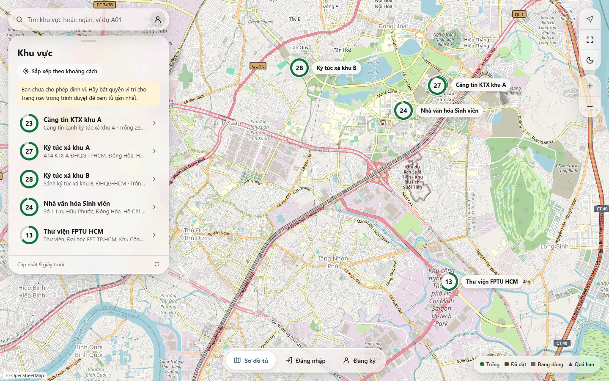 | 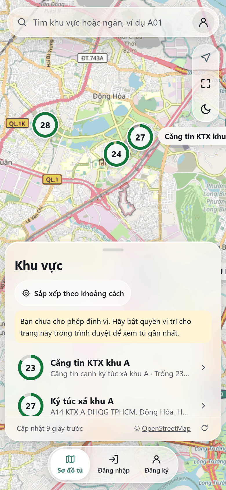 |

| Một khu: các dãy, ngăn khóa quá hạn (A04, A12) | Thẻ ngăn: gói cố định, giá theo cỡ M |
|---|---|
| 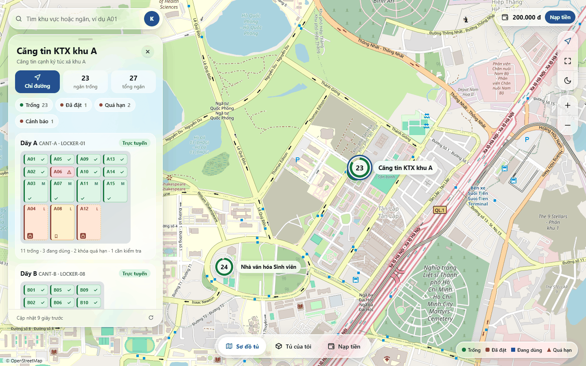 | 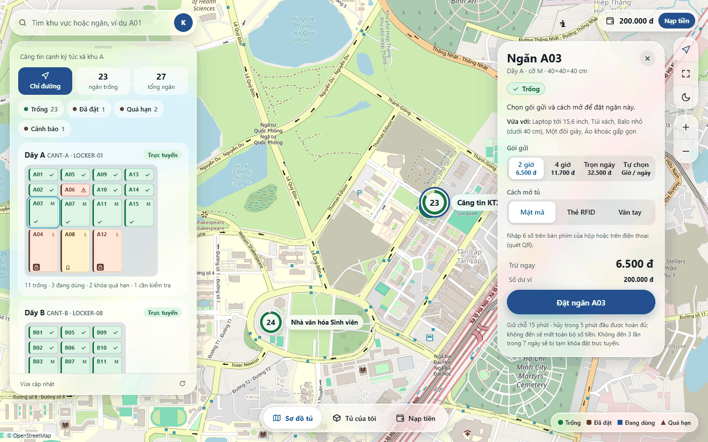 |

| Tự chọn theo giờ (5 giờ) | Tự chọn theo ngày (3 ngày, giảm 10%) |
|---|---|
| 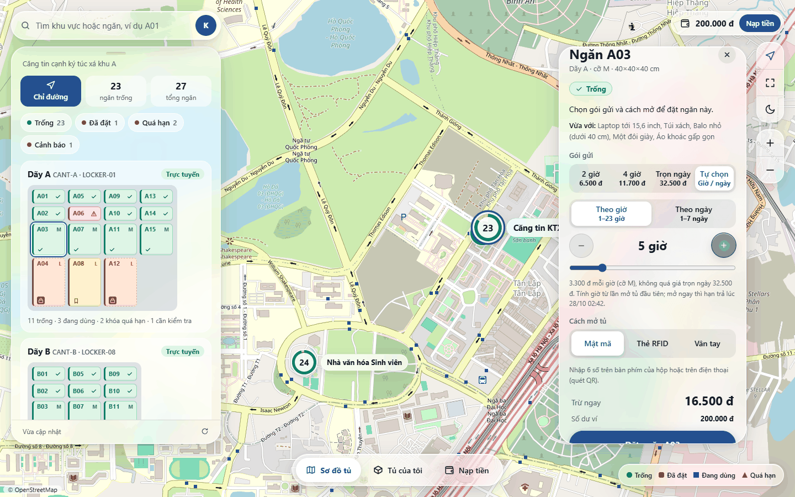 | 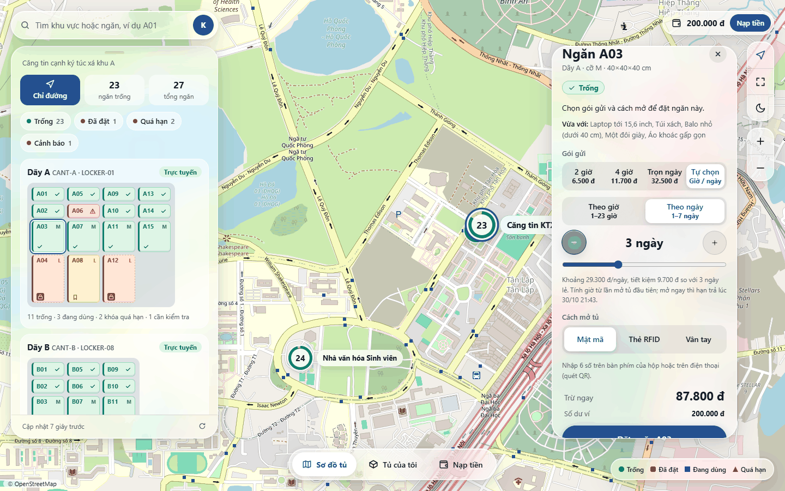 |

| Popup xác nhận đặt | Tủ của tôi: mật mã, nút hủy kèm đếm ngược |
|---|---|
| 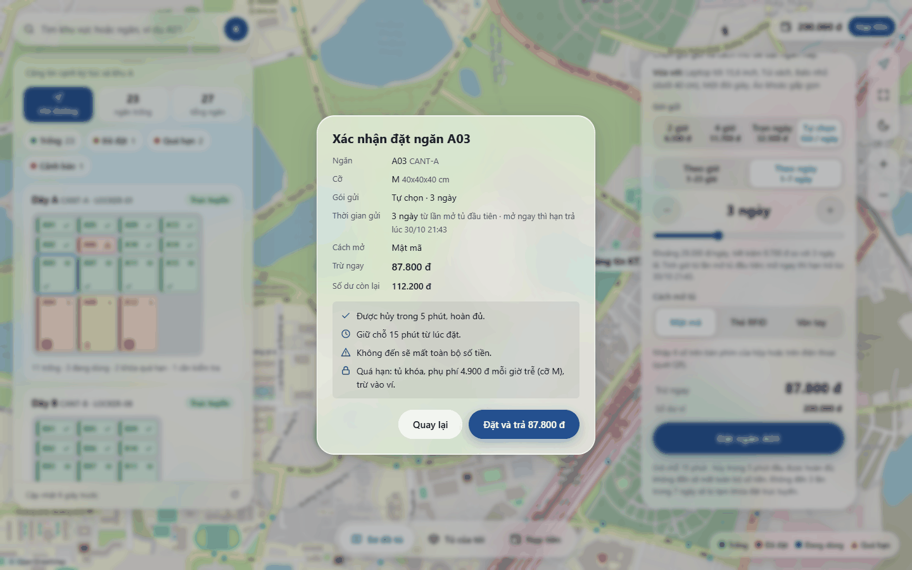 | 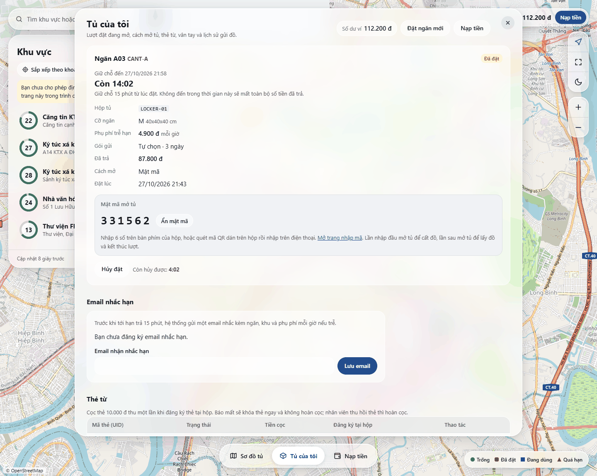 |

| Tủ của tôi: đang gửi, gia hạn | Tủ của tôi: quá hạn, tủ khóa, đang nợ |
|---|---|
| 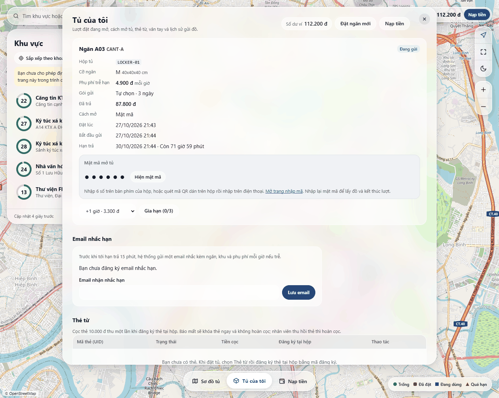 | 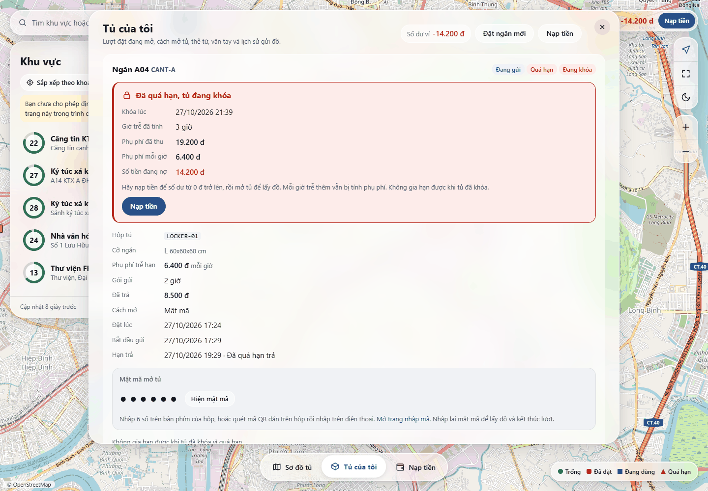 |

| Dashboard nhân viên | Cảnh báo chuyển xử lý sau 48 giờ |
|---|---|
| 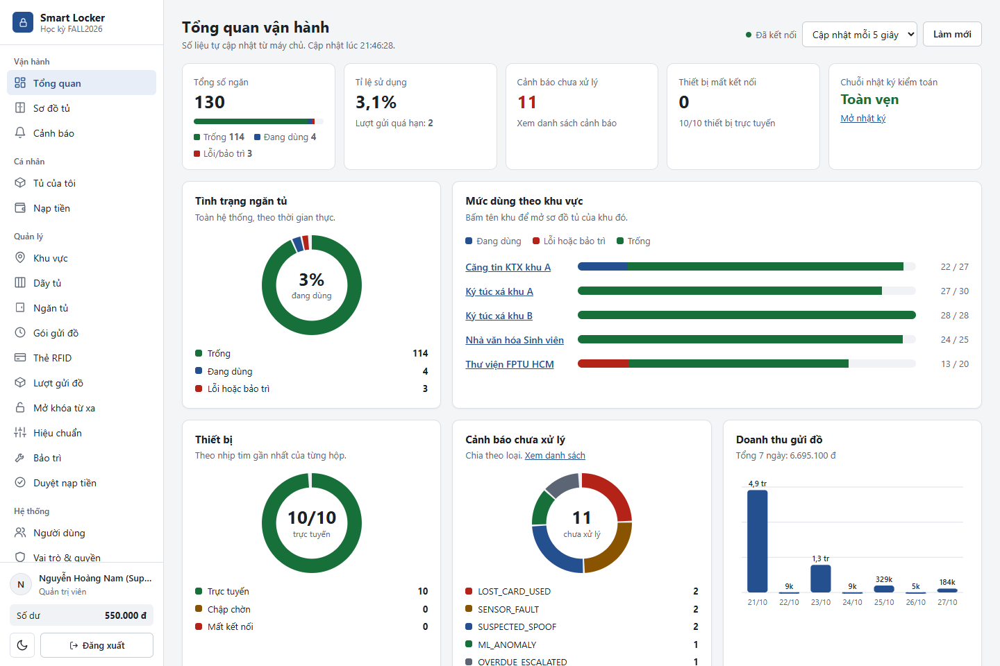 | 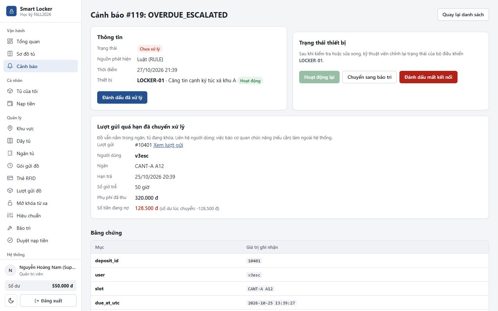 |

| Danh sách cảnh báo | Dãy tủ: hộp thật và ngăn có khóa thật |
|---|---|
| 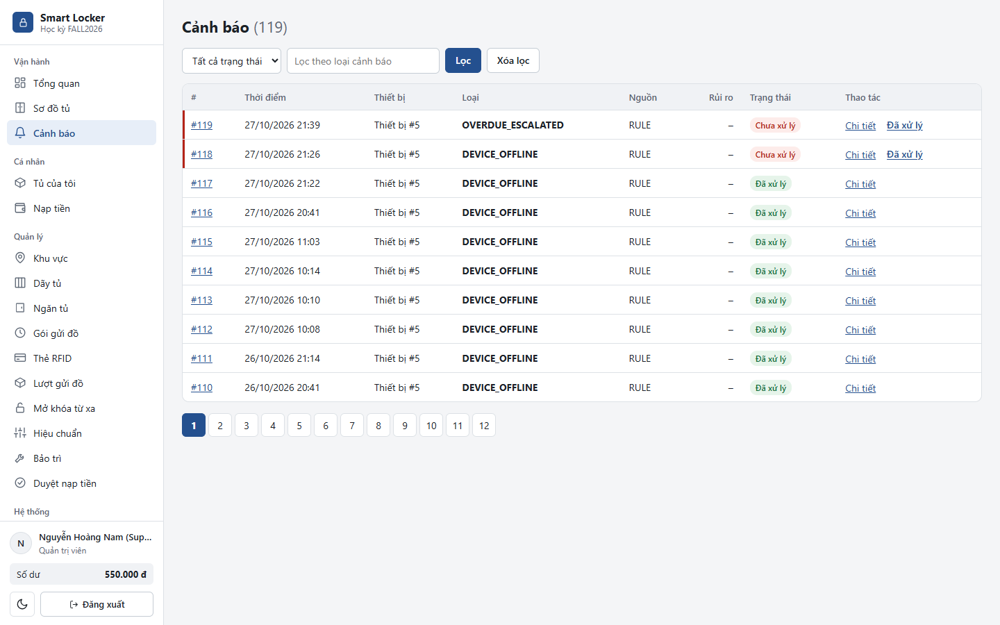 | 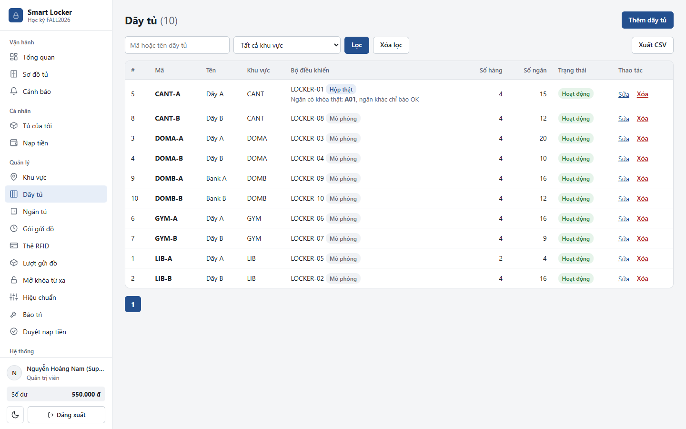 |

<p align="center">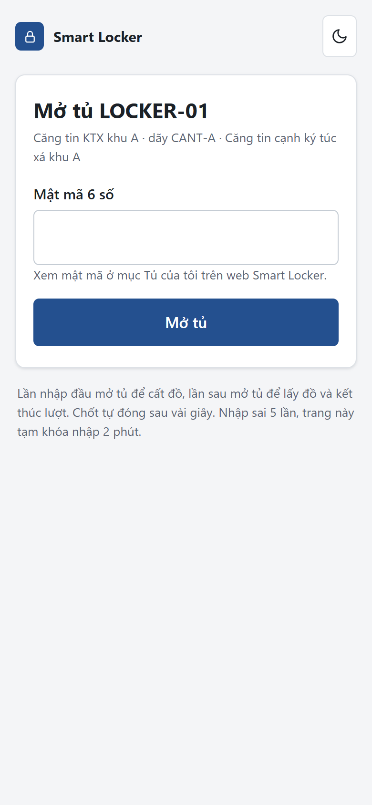<br>
<em>Trang mở tủ bằng điện thoại <code>/k/LOCKER-01</code> (đích của mã QR dán trên hộp)</em></p>

---

## Cài đặt nhanh

Yêu cầu: JDK 8, Apache Tomcat 9, SQL Server 2019/2022 (có `sqlcmd`), Git Bash (cho các script `.sh`). NetBeans là tùy chọn.

### 1. Cơ sở dữ liệu

Cách nhanh, chạy cả 3 file (file `01` xóa và tạo lại database `PRJ301_LOCKER`):

```powershell
powershell -ExecutionPolicy Bypass -File .\run_demo_db.ps1
```

Hoặc chạy tay theo **đúng thứ tự** (luôn có `-I`, file SQL có chữ Việt phải giữ UTF-8 BOM):

```powershell
sqlcmd -S localhost -U sa -P 12345 -I -b -f 65001 -i sql\01_schema.sql
sqlcmd -S localhost -U sa -P 12345 -I -b -f 65001 -i sql\02_data_v1.sql
sqlcmd -S localhost -U sa -P 12345 -I -b -f 65001 -i sql\03_v2_v3.sql
sqlcmd -S localhost -U sa -P 12345 -d PRJ301_LOCKER -I -b -f 65001 -i sql\demo_box.sql
```

| File | Nội dung |
|---|---|
| `sql/01_schema.sql` | Database, bảng, view, trigger, `Audit_Append`, quyền cơ bản |
| `sql/02_data_v1.sql` | Dữ liệu mẫu (tài khoản, khu, dãy, ngăn, lịch sử), procedure của các tình huống, ví và nạp tiền |
| `sql/03_v2_v3.sql` | Cách mở (mật mã, thẻ, vân tay), khóa nhập sai, `Device_Authorize`, `Enroll_*`, `AppConfig`, cỡ S/M/L, giá theo cỡ, Tự chọn, hủy 5 phút, quá hạn, nhắc hạn, các khu trong ĐHQG-HCM (tọa độ gần đúng, sửa ở trang Khu vực) |
| `sql/demo_box.sql` | Hộp thật, các dãy nó quản lý và ngăn có khóa thật ([xem dưới](#phần-cứng-demo-một-hộp-chính-nhiều-ngăn)); chạy lại được nhiều lần |
| `sql/test_setup.sql` | Tài khoản và lượt gửi dựng sẵn cho Postman (không phải dữ liệu demo) |
| `sql/test_overdue.sql` | Dời hạn trả của một lượt `ACTIVE` về quá khứ để demo khóa quá hạn, phụ phí, chuyển xử lý |
| `sql/test_cleanup.sql` | Đóng các lượt gửi và cảnh báo mà tài khoản test để lại |

Lưu ý:

- Chạy lại `02_data_v1.sql` đưa các procedure đặt tủ về bản cũ, nên khi đó phải chạy lại `03_v2_v3.sql`.
- `03_v2_v3.sql` đặt khóa của `LOCKER-01` về khóa mẫu công khai. Tạo khóa bí mật riêng (lưu trong
  `config/device-keys.local.properties`, không commit) và ghi SHA-256 của nó vào DB:

  ```powershell
  powershell -ExecutionPolicy Bypass -File scripts\set-device-key.ps1
  ```

- Muốn đổi một object trên DB đang chạy, chỉ chạy khối `CREATE OR ALTER` đó, đừng chạy lại cả `03_v2_v3.sql` (nó đặt lại khóa hộp).
- Kết nối DB nằm ở `src/java/dao/DbContext.java` (mặc định `localhost:1433`, `sa` / `12345`).

### 2. Build và chạy trên Tomcat

- **Git Bash:** biên dịch `src/java` vào `build/web`, chép `web/` và các jar cần khi chạy, rồi báo Tomcat tải lại context
  (`TOMCAT` mặc định `E:/apache-tomcat-9.0.113`, `JAVAC` mặc định JDK 1.8.0_202; đổi bằng biến môi trường):

  ```bash
  sh scripts/build-dev.sh
  ```

  Context `SmartLocker` trỏ tới `build/web` (file `conf/Catalina/localhost/SmartLocker.xml` của Tomcat). Chờ khoảng 15 giây
  rồi mở `http://localhost:8080/SmartLocker/`. Nên chạy Tomcat trong cửa sổ riêng bằng `bin\startup.bat`.
- **NetBeans:** Clean and Build, rồi Run (Tomcat 9).

Email nhắc hạn cần `config/mail.local.properties` (chép từ `mail.local.properties.example`); không có file này thì việc gửi email tắt.

### 3. Tài khoản demo

Mật khẩu chung: `123456`. Bảng dưới là tài khoản do `sql/02_data_v1.sql` tạo.

| Vai trò | Tài khoản | Ghi chú |
|---|---|---|
| ADMIN | `admin`, `admin_ops`, `admin_lib`, `admin_doma`, `admin_cant`, `admin_gym`, `sysadmin1`, `manager1`, `manager2` | `sysadmin2` bị vô hiệu hóa |
| OPERATOR | `operator1` ... `operator22` | `operator20` bị khóa, `operator22` bị vô hiệu hóa |
| TECHNICIAN | `tech1` ... `tech22` | `tech20` bị khóa, `tech22` bị vô hiệu hóa |
| AUDITOR | `auditor1` ... `auditor16` | `auditor15` bị khóa, `auditor16` bị vô hiệu hóa |
| END_USER | `student1` ... `student28`, `user1` | `locked1`, `student28` bị khóa; `student27` bị vô hiệu hóa |
| END_USER (Postman) | `v2pin`, `v2card`, `v2fp`, `v2noshow`, `v3overdue`, `v3poor`, `v3late`, `v3esc` | Tạo bởi `sql/test_setup.sql` |

---

## Phần cứng demo: một hộp chính, nhiều ngăn

Chỉ có **một hộp ESP32 thật** (mặc định `LOCKER-01`) với **một ngăn có servo khóa**. Hộp này quản lý mọi ngăn của các dãy được
gắn với nó: người dùng đặt ngăn nào của các dãy đó cũng được, nhập mật mã / quẹt thẻ / đặt vân tay tại hộp thì lượt gửi vẫn
chuyển CHECK_IN rồi PICKUP như thường. Câu trả lời `UNLOCK` (của `/api/device/auth` và lệnh `UNLOCK` trong heartbeat `/api/health`)
có thêm cờ `"physical"`:

- `true`: đúng ngăn vật lý (hoặc chưa cấu hình ngăn nào), servo mở cửa;
- `false`: ngăn khác, hộp không động servo, màn LCD chỉ báo `Ngan A03 OK` / `Da gui do` (hoặc `Da lay do`).

Firmware 3.2 (`firmware/SmartLocker_Online`) đọc cờ này; firmware cũ không đọc cờ thì mở servo như trước. Lệnh mở từ xa của nhân viên
và lệnh từ trang điện thoại cũng theo cờ này. Các dãy còn lại gắn với hộp minh họa (`"demo":true`), được `LockerMonitor` giả
heartbeat nên luôn trực tuyến trên bản đồ. Trang **Dãy tủ** của nhân viên ghi "Hộp thật" và "Ngăn có khóa thật: A01" (ảnh ở trên).

### Đặt hộp, các dãy và ngăn vật lý

Sửa 4 biến ở đầu `sql/demo_box.sql` rồi chạy lại script:

```sql
DECLARE @device_code   NVARCHAR(30)  = N'LOCKER-01';  -- hộp ESP32 thật
DECLARE @banks         NVARCHAR(400) = N'CANT-A';     -- các dãy nó quản lý, cách nhau bằng dấu phẩy, ví dụ N'CANT-A,CANT-B'
DECLARE @physical_bank NVARCHAR(20)  = N'CANT-A';     -- dãy + ngăn có servo;
DECLARE @physical_slot NVARCHAR(20)  = N'A01';        --   cả hai NULL: mọi ngăn của hộp đều mở servo
```

```powershell
sqlcmd -S localhost -U sa -P 12345 -d PRJ301_LOCKER -I -b -f 65001 -i sql\demo_box.sql
```

Script gắn các dãy vào hộp, giao dãy bị hộp bỏ ra cho một thiết bị `"demo":true` (để không thành OFFLINE), lưu `physical_slot_id`
trong `OperatingProfile` của hộp, không đổi khóa API, ghi nhật ký `DEMO_BOX` và in bảng dãy → hộp → ngăn vật lý. Các dãy cùng một hộp
phải có mã ngăn khác nhau (ví dụ `CANT-A` A01-A15 và `CANT-B` B01-B12) vì hộp nhận lượt gửi theo mã ngăn; script từ chối nếu trùng,
và từ chối bỏ một dãy còn lượt gửi đang mở.

Hộp thật không gửi heartbeat (tắt máy) thì sau 90 giây các dãy của nó chuyển OFFLINE và không đặt được: khi chỉ thử trên trình duyệt,
hãy đặt ở một dãy minh họa (ví dụ `CANT-B`), hoặc giả hộp bằng `test/tool/ScenarioSender`.

### Firmware và sơ đồ chân

Sketch `firmware/SmartLocker_Online/SmartLocker_Online.ino` (ESP32 Dev Module). Hướng dẫn nạp, nối mạng (LAN hoặc Cloudflare tunnel)
và thao tác tại hộp: [firmware/SmartLocker_Online/README.md](./firmware/SmartLocker_Online/README.md).
`secrets.h` (Wi-Fi, địa chỉ máy chủ, khóa API) nằm trong `.gitignore`.

| Thiết bị | Chân ESP32 |
|---|---|
| RC522 (thẻ từ) | SS 4, SCK 16, MOSI 17, MISO 34, RST nối 3V3 |
| AS608 (vân tay) | TX → 35, RX → 15 |
| LCD 1602 I2C | SDA 21, SCL 22, địa chỉ 0x27 |
| Servo chốt | 32 |
| Servo cửa | 2 |
| SRF05 | TRIG 5, ECHO 18 (qua mạch chia áp) |
| Keypad 4x4 | Hàng 13, 14, 25, 26; cột 33, 19, 23, 27 |

Tại hộp: `0-9` + `#` gửi mật mã 6 số; `B` + mã đăng ký đăng ký thẻ; `C` + mã đăng ký đăng ký vân tay; `D` xem IP và tình trạng máy chủ.
Hộp không tự quyết định mở: mọi mật mã, thẻ, vân tay đều gửi lên máy chủ.

---

## Bảng giá

Mọi con số nằm trong bảng `AppConfig`, `SlotSize`, `StoragePlan` (`sql/03_v2_v3.sql`); `util.Pricing` tính giống hệt SQL
(`dbo.fn_SizePrice`, `fn_HourRate`, `fn_OverdueRate`, `fn_CustomPrice`). Giá = giá gói × hệ số cỡ (S 100%, M 130%, L 169%),
làm tròn lên 100 đ. Mật mã, thẻ RFID và vân tay cùng một giá; thẻ chỉ thêm cọc 10.000 đ (`CARD_DEPOSIT`), trừ một lần khi đăng ký thẻ tại hộp.

| Gói (ân hạn) | S | M | L |
|---|---:|---:|---:|
| 2 giờ (10 phút) | 5.000 | 6.500 | 8.500 |
| 4 giờ (10 phút) | 9.000 | 11.700 | 15.300 |
| Trọn ngày (30 phút) | 25.000 | 32.500 | 42.300 |
| Giá một giờ (gia hạn, Tự chọn theo giờ) | 2.500 | 3.300 | 4.300 |
| Phụ phí mỗi giờ trễ (150% giá một giờ) | 3.800 | 4.900 | 6.400 |

**Tự chọn** (số nguyên giờ 1-23 hoặc số nguyên ngày 1-7; giá do server tính lại, trang chỉ hiển thị):

- Theo giờ: `min(giá một giờ × N, giá trọn ngày)` của cỡ ngăn.
- Theo ngày: `giá trọn ngày × N × hệ số`, hệ số 100% cho 1 ngày, 90% cho 2-6 ngày (`CUSTOM_MULTI_DAY_PCT`),
  80% cho 7 ngày (`CUSTOM_WEEK_PCT`), làm tròn lên 100 đ.
- Ân hạn lấy theo gói dài nhất không vượt thời gian chọn; gia hạn và phụ phí trễ giữ luật chung.

| Tự chọn | S | M | L |
|---|---:|---:|---:|
| 1 giờ | 2.500 | 3.300 | 4.300 |
| 3 giờ | 7.500 | 9.900 | 12.900 |
| 9 giờ | 22.500 | 29.700 | 38.700 |
| 10-23 giờ (bằng giá trọn ngày) | 25.000 | 32.500 | 42.300 |
| 1 ngày | 25.000 | 32.500 | 42.300 |
| 2 ngày (90%) | 45.000 | 58.500 | 76.100 |
| 3 ngày (90%) | 67.500 | 87.800 | 114.100 |
| 6 ngày (90%) | 135.000 | 175.500 | 228.200 |
| 7 ngày (80%) | 140.000 | 182.000 | 236.600 |

Các luật khác (`AppConfig`): giữ chỗ 15 phút (`HOLD_MIN`), hủy và hoàn 100% trong 5 phút (`CANCEL_FREE_MIN`), hủy sau đó tới hết giữ chỗ hoàn 50% làm tròn xuống 100 đ
(`CANCEL_LATE_REFUND_PCT`), không đến hoàn 0%
(`NO_SHOW_REFUND_PCT`), dư tối thiểu sau khi đặt 10.000 đ (`BOOKING_BUFFER`), email nhắc trước 15 phút (`DUE_REMINDER_MIN`),
chuyển xử lý sau 48 giờ (`ESCALATE_HOURS`). Đổi một con số thì sửa cả SQL và `util.Pricing`, rồi chạy `PricingDatabaseIntegrationTest`.

---

## Luồng hoạt động

### Đặt tủ, gửi và lấy đồ

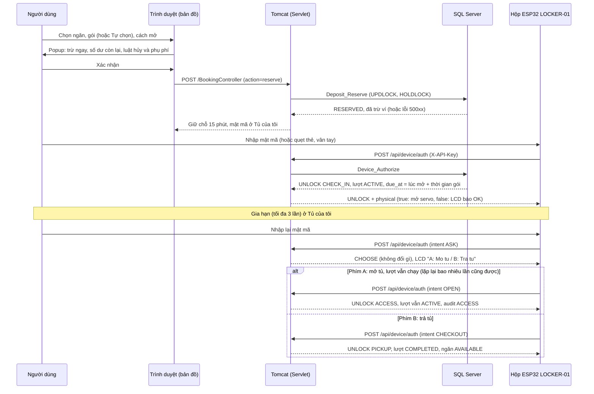

### Quá hạn, khóa, chuyển xử lý và cảnh báo

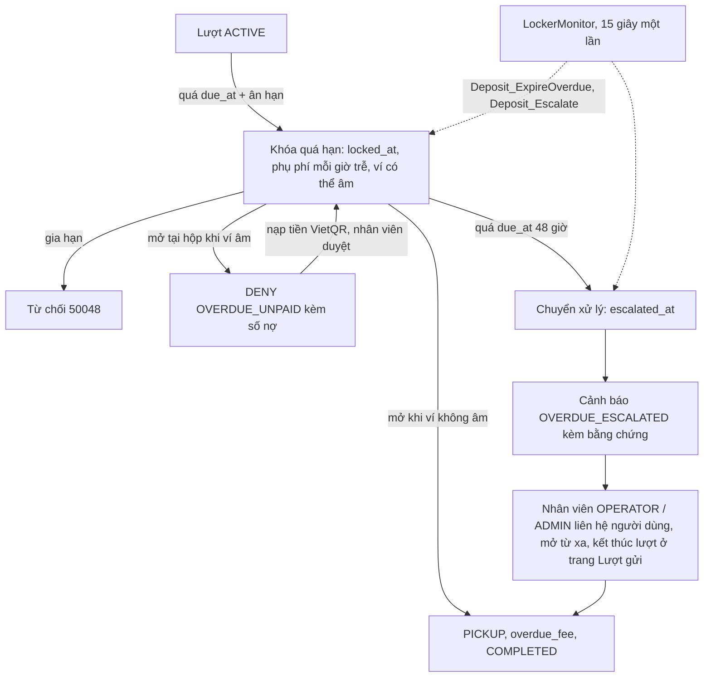

### Cảnh báo từ thiết bị

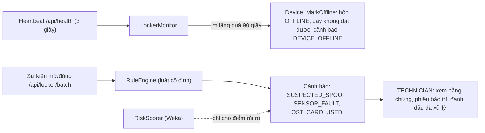

Chi tiết từng tình huống, mã lỗi và sơ đồ trạng thái ngăn: [docs/SYSTEM_FLOWS.md](./docs/SYSTEM_FLOWS.md).

---

## Kiểm thử

**Unit test và integration test** (TestNG; các lớp `*DatabaseIntegrationTest` cần SQL Server đang chạy):

```bash
sh scripts/test.sh
```

Chạy một lớp: `sh scripts/test.sh test.PricingTest`. Các lớp: `PricingTest`, `PricingDatabaseIntegrationTest` (so `util.Pricing` với
SQL, gồm Tự chọn), `AuditChainDatabaseIntegrationTest`, `RuleEngineTest`, `RiskScorerTest`, `SecurityUtilsTest`, `MailTemplatesTest`.

**Postman + newman** (17 kịch bản: mật mã, điện thoại, thẻ, vân tay, sai mã và khóa 5 lần, không đến, quá hạn, nạp tiền,
hủy, mức đệm, chuyển xử lý, gia hạn). Chạy script dựng dữ liệu trước, vì mỗi lần đoán sai ở hộp đều tính vào khóa 5 lần:

```bash
sqlcmd -S localhost -U sa -P 12345 -d PRJ301_LOCKER -I -b -f 65001 -i sql/test_setup.sql
newman run docs/postman/SmartLocker-v2.postman_collection.json -e docs/postman/SmartLocker-local.postman_environment.json --env-var api_key=<khóa LOCKER-01>
sqlcmd -S localhost -U sa -P 12345 -d PRJ301_LOCKER -I -b -f 65001 -i sql/test_cleanup.sql
```

Hướng dẫn chi tiết: [docs/postman/README.md](./docs/postman/README.md).

**Demo quá hạn không cần chờ:** đặt và mở tủ một lần (CHECK_IN), sửa `@username` trong `sql/test_overdue.sql` rồi chạy;
`LockerMonitor` khóa, tính phụ phí và (với `@minutes_late` trên 48 giờ) chuyển xử lý trong 15 giây. Dọn bằng `sql/test_cleanup.sql`.

**Công cụ chạy tay** (`test/tool`, không đóng gói vào WAR): `ScenarioSender` (giả hộp ESP32), `DataReplayer`, `ModelTrainer`
(train mô hình Weka vào `src/java/ml`), `TransferCheck`, `DeviceKey`. Chạy bằng Run File trong NetBeans, hoặc:

```powershell
javac -encoding UTF-8 -cp "build/web/WEB-INF/classes;lib/*" -d build/tools test/tool/*.java
java -cp "build/tools;build/web/WEB-INF/classes;lib/*" tool.ScenarioSender remote
```

---

## Kiến trúc và cấu trúc thư mục

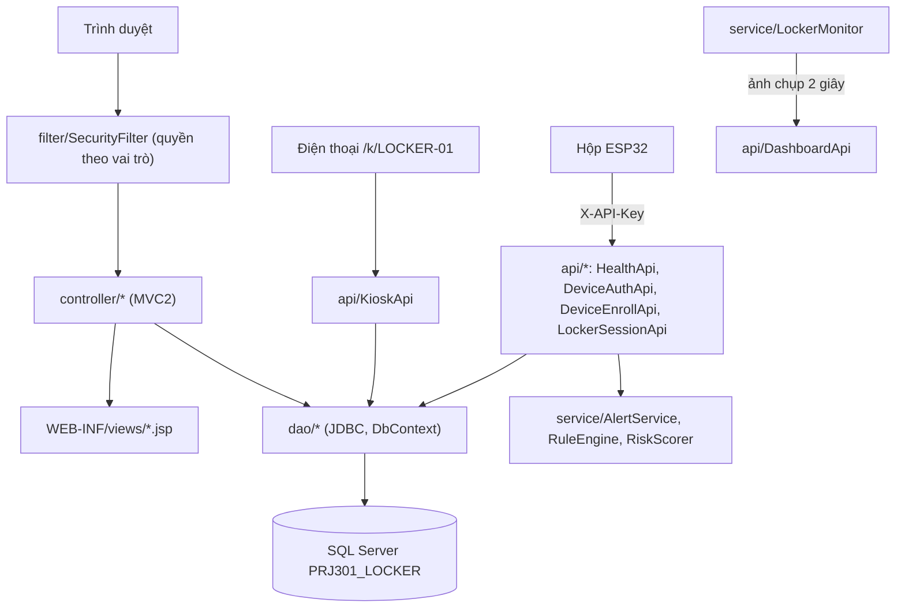

- `DbContext` là nơi duy nhất mở kết nối JDBC và giữ một pool nhỏ; DAO đóng kết nối bằng try-with-resources (`close()` trả về pool).
- Mọi quy tắc về tiền và thời gian nằm trong procedure SQL; Java chỉ gọi và dịch lỗi sang tiếng Việt (`Web.sqlMessage`).
- View nằm trong `WEB-INF/views`, chỉ vào được qua controller. Dữ liệu người dùng in bằng `<c:out>`; JavaScript dựng HTML qua `esc()`.
- Một stylesheet `web/css/app.css` (sáng/tối); `js/theme.js` đặt theme trước khi vẽ; không dùng CDN.
- `/api/dashboard` đọc ảnh chụp trong bộ nhớ của `LockerMonitor` (không truy vấn DB); số liệu biểu đồ ở `/api/dashboard/stats`, nhớ 60 giây.

```
SmartLocker/
├── config/        # Khóa hộp thật, cấu hình email (*.local.properties, không commit)
├── docs/          # SYSTEM_FLOWS, spec v2/v3, deploy, Postman, images (ảnh README)
├── firmware/      # SmartLocker_Online (ESP32 nối web), SmartLocker_Local
├── lib/           # JDBC, Gson, jBCrypt, Weka (vào WAR); TestNG, JCommander, SLF4J (chỉ để test)
├── scripts/       # build-dev.sh, test.sh, set-device-key.ps1, update-tunnel-link.ps1, mail-preview.sh
├── sql/           # 01_schema, 02_data_v1, 03_v2_v3, demo_box và các script test_*
├── src/java/
│   ├── api/       # API JSON: thiết bị, điện thoại, dashboard, bản đồ tủ, Tủ của tôi
│   ├── controller/# Servlet MVC2, mỗi trang một controller
│   ├── dao/       # JDBC; DbContext
│   ├── filter/    # SecurityFilter: đăng nhập, phân quyền, khóa API thiết bị
│   ├── ml/        # Mô hình Weka đã train
│   ├── model/     # Lớp dữ liệu
│   ├── service/   # LockerMonitor, DueReminder, MailService, RuleEngine, RiskScorer, AuditVerifier
│   └── util/      # Web, Pricing, Csv, SecurityUtils, SlotImages
├── test/
│   ├── test/      # Unit test và integration test (TestNG)
│   └── tool/      # Công cụ chạy tay, không đóng gói vào WAR
└── web/           # JSP, css, js, Leaflet đặt sẵn
```

### API chính

| Method | Endpoint | Mô tả |
|---|---|---|
| `POST` | `/BookingController` | `action=reserve` (gói `planId` hoặc Tự chọn `customMin`), `cancel` (`expectedRefund`: số popup đã hiện), `extend` |
| `GET` | `/api/locker-map` | Khu, dãy, ngăn, giá theo cỡ, Tự chọn (khách xem được, chỉ đọc) |
| `GET` | `/api/my-locker` | Lượt đang mở, thẻ, vân tay, lịch sử của người dùng |
| `POST` | `/TopupController` | Yêu cầu nạp tiền VietQR; nhân viên duyệt hoặc từ chối |
| `POST` | `/api/health` | Heartbeat của hộp; trả lệnh đang chờ (`UNLOCK` có `physical`) |
| `POST` | `/api/device/auth` | Mật mã, thẻ hoặc vân tay tại hộp → `UNLOCK` / `DENY` |
| `POST` | `/api/device/enroll/start`, `/finish` | Đăng ký thẻ hoặc vân tay cho lượt đang mở |
| `POST` | `/api/locker/batch` | Lịch sử mở/đóng của hộp |
| `POST` | `/api/kiosk/unlock` | Mở từ trang điện thoại `/k/{device_code}` |
| `GET` | `/api/dashboard`, `/api/dashboard/stats` | Số liệu dashboard và biểu đồ |

Hợp đồng API thiết bị: [docs/spec/smart-locker-v2.md](./docs/spec/smart-locker-v2.md) mục 4.

---

## Bảo mật

- `SecurityFilter`: đường dẫn chưa khai báo bị từ chối; GET cần quyền READ, các phương thức khác cần WRITE của tài nguyên.
  Chỉ bản đồ và `/api/locker-map` (GET) mở cho khách.
- Người dùng được nạp lại ở mỗi request: tài khoản bị khóa bị đăng xuất ngay, đổi vai trò có hiệu lực ngay.
- Đặt tủ chống tranh chấp bằng khóa trong procedure (`UPDLOCK, HOLDLOCK`).
- Nhật ký audit chỉ thêm, nối chuỗi băm SHA-256; AUDITOR chỉ đọc.
- Khóa API hộp lưu SHA-256; email chỉ lưu sau khi mã gửi tới email đó được nhập lại; cookie phiên SameSite=Lax.
- Hạn chế đã biết: chưa có CSRF token (dựa vào SameSite=Lax), tài khoản `sa` nằm trong `DbContext`.

## Tài liệu liên quan

- [docs/SYSTEM_FLOWS.md](./docs/SYSTEM_FLOWS.md): luồng nghiệp vụ, bảng tình huống, sơ đồ trạng thái.
- [docs/spec/smart-locker-v2.md](./docs/spec/smart-locker-v2.md): đặc tả v2 và hợp đồng API thiết bị.
- [docs/spec/smart-locker-v3.md](./docs/spec/smart-locker-v3.md): v3 (cỡ ngăn, giá, hủy, quá hạn, nhắc hạn).
- [docs/deploy.md](./docs/deploy.md): demo qua Cloudflare tunnel, link cố định GitHub Pages, QR cho hộp.
- [docs/postman/README.md](./docs/postman/README.md): Postman collection và cách chạy bằng newman.
- [firmware/SmartLocker_Online/README.md](./firmware/SmartLocker_Online/README.md): nạp firmware và dùng hộp thật.

## Giấy phép

Đồ án học tập môn PRJ301. Xem [LICENSE](./LICENSE).
