# SmartLocker - Hệ thống tủ gửi đồ thông minh

<div align="center">


-007396?style=for-the-badge&logo=java&logoColor=white)


**Thuê tủ gửi đồ trên web: chọn ngăn trên bản đồ, trả tiền bằng ví, mở tủ bằng mật mã, thẻ RFID, điện thoại (chạm NFC) hoặc vân tay.
Hộp tủ ESP32 thật nói chuyện với máy chủ qua API có khóa riêng cho từng hộp.**

*Đồ án môn PRJ301 (FALL2026). English version: [README.en.md](./README.en.md).*

</div>

---

## Mục lục

1. [Hệ thống gồm những gì](#hệ-thống-gồm-những-gì)
2. [Chức năng](#chức-năng)
3. [Ảnh chụp màn hình](#ảnh-chụp-màn-hình)
4. [Cài đặt và chạy](#cài-đặt-và-chạy)
5. [Hộp tủ ESP32](#hộp-tủ-esp32)
6. [Bảng giá và luật](#bảng-giá-và-luật)
7. [Luồng hoạt động](#luồng-hoạt-động)
8. [Kiểm thử](#kiểm-thử)
9. [Triển khai lên Internet](#triển-khai-lên-internet)
10. [Kiến trúc và mã nguồn](#kiến-trúc-và-mã-nguồn)
11. [Bảo mật và hạn chế đã biết](#bảo-mật-và-hạn-chế-đã-biết)
12. [Tài liệu liên quan](#tài-liệu-liên-quan)

---

## Hệ thống gồm những gì

| Thành phần | Công nghệ | Vai trò |
|---|---|---|
| Web | Java 8, Servlet/JSP (MVC2), Tomcat 9 | Bản đồ tủ, đặt ngăn, ví, trang nhân viên, API cho hộp tủ |
| Cơ sở dữ liệu | SQL Server | Toàn bộ luật về tiền và thời gian nằm trong stored procedure |
| Hộp tủ | ESP32, PN532, AS608, keypad, LCD, servo | Nhận mật mã, thẻ, vân tay, chạm điện thoại; máy chủ quyết định có mở hay không |
| Bản đồ | Leaflet đặt sẵn trong repo, Mapbox nếu có token | Mất Internet vẫn thấy các ghim trên nền lưới |
| Cảnh báo | Luật cố định (`RuleEngine`) và mô hình Weka (`RiskScorer`) | Luật quyết định, mô hình chỉ cho thêm điểm rủi ro |

Trang web không dùng CDN, chữ hiển thị là tiếng Việt, có giao diện sáng và tối.

## Chức năng

### Người dùng

- **Bản đồ là trang chính.** Khách xem được không cần đăng nhập. Đăng nhập và đăng ký nằm trong popup trên bản đồ, không có trang riêng.
- **Khu, dãy, ngăn.** 5 khu trong ĐHQG-HCM, tự làm mới 10 giây một lần. "Tìm tủ gần tôi" sắp khu theo khoảng cách, vị trí chỉ tính trên trình duyệt.
- **Ba cỡ ngăn:** S 20x20x20, M 40x40x40, L 60x60x60 cm.
- **Gói gửi:** 2 giờ, 4 giờ, Trọn ngày, hoặc Tự chọn 1-23 giờ / 1-7 ngày.
- **Bốn cách mở, cùng một giá, không tiền cọc:** mật mã 6 số, thẻ RFID, chạm điện thoại, vân tay.
- **Đặt rõ ràng.** Popup ghi số tiền trừ ngay, số dư còn lại, luật hủy và phụ phí. Sau khi đặt, ví phải còn ít nhất 10.000 đ dự phòng phụ phí.
- **Hủy.** Trong 5 phút đầu hoàn đủ, sau đó tới hết 15 phút giữ chỗ hoàn 50%.
- **Tự check-in.** Hết 15 phút giữ chỗ, lượt tự bắt đầu tính giờ và không hủy được nữa. Ngăn vẫn khóa cho người đặt. Nếu tới hạn trả mà chưa từng mở, lượt kết thúc `NO_SHOW`, ngăn trống lại, không tính phụ phí, không hoàn tiền; 3 lần như vậy trong 7 ngày thì bị tạm cấm đặt.
- **Mở nhiều lần trong một lượt.** Lần đầu cất đồ (CHECK_IN). Các lần sau hộp hỏi `A: Mo tu` / `B: Tra tu`: phím A mở tủ, lượt vẫn chạy; phím B lấy đồ và kết thúc lượt.
- **Gia hạn** tối đa 3 lần, tính theo giá một giờ của cỡ ngăn.
- **Quá hạn.** Ngăn không tự giải phóng vì đồ còn trong đó. Quá ân hạn thì tủ khóa, mỗi giờ trễ trừ phụ phí, ví có thể âm, hộp từ chối mở (`OVERDUE_UNPAID`) tới khi nạp đủ tiền. Quá 48 giờ, lượt được chuyển cho nhân viên kèm cảnh báo.
- **Ví.** Nạp tiền bằng mã VietQR, nhân viên duyệt rồi mới cộng tiền.
- **Tủ của tôi.** Mật mã (ẩn/hiện), mã đăng ký thẻ hoặc vân tay, đếm ngược, gia hạn, số nợ, số lần đã mở, lịch sử, email nhắc hạn 15 phút trước giờ trả.
- **Thẻ từ.** Đăng ký tại hộp bằng mã 6 số, báo mất, đổi thẻ. Quẹt thẻ của người có email thật cần bấm xác nhận qua email hoặc trên bản đồ.
- **Trang điện thoại** `/k/{device_code}`: quét QR dán trên hộp rồi nhập mật mã, hoặc chạm điện thoại vào đầu đọc rồi bấm "Mở tủ của tôi".

### Nhân viên

| Vai trò | Quyền chính |
|---|---|
| OPERATOR | Bản đồ nhân viên, mở từ xa, duyệt nạp tiền, quản lý khu, dãy, ngăn, gói gửi, thẻ, lượt gửi, người dùng |
| TECHNICIAN | Cảnh báo, phiếu bảo trì, hiệu chuẩn cảm biến, trạng thái ngăn và thiết bị |
| AUDITOR | Chỉ đọc, kiểm tra chuỗi băm của nhật ký audit |
| ADMIN | Toàn quyền, gồm vai trò và phân quyền |

Trang **Tổng quan** có trạng thái ngăn, mức dùng theo khu, thiết bị, cảnh báo, lượt đặt theo giờ và doanh thu 7 ngày (doanh thu chỉ cho ADMIN và OPERATOR).
Trang **Dữ liệu cảm biến** liệt kê các phiên mở/đóng do hộp gửi lên, có tìm kiếm, lọc theo hộp và ngày, sắp xếp, phân trang.

### Thiết bị

- **Khóa API riêng cho mỗi hộp.** Máy chủ chỉ lưu SHA-256 của khóa; `device_id` lấy từ khóa, không tin nội dung gửi lên.
- **Một hộp quản lý nhiều dãy.** Servo chỉ mở ở ngăn vật lý, các ngăn khác chỉ báo trên LCD.
- **Heartbeat.** Hộp im lặng quá 90 giây thì chuyển OFFLINE và các dãy của nó không đặt được.
- **Khóa nhập sai.** 5 lần đoán sai trên một hộp thì hộp tạm khóa 2 phút.

---

## Ảnh chụp màn hình

Chụp từ bản chạy thật trên dữ liệu demo, không có dữ liệu cá nhân thật.

| Bản đồ tủ (khách, chưa đăng nhập) | Bản đồ trên điện thoại |
|---|---|
| 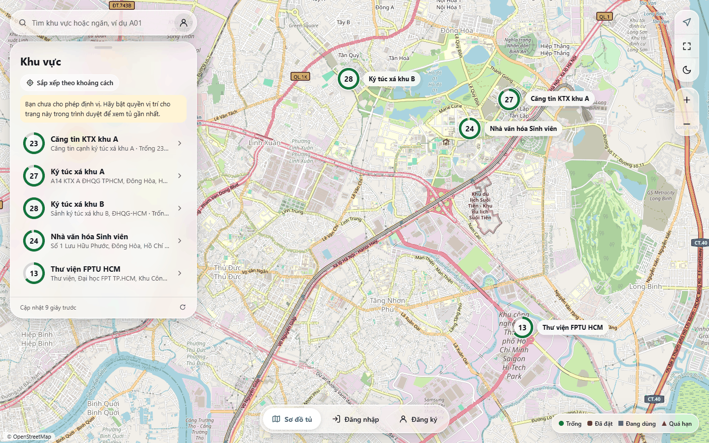 | 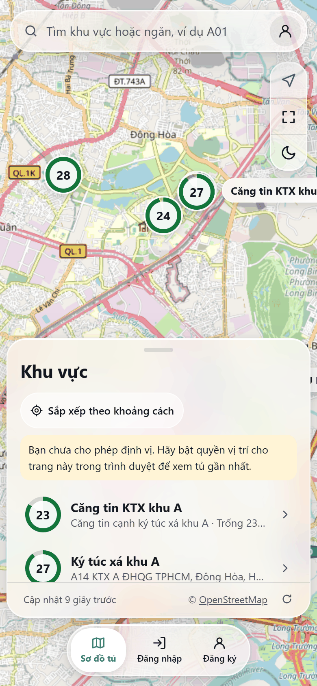 |

| Một khu: các dãy và ngăn khóa quá hạn | Thẻ ngăn: gói gửi và bốn cách mở |
|---|---|
| 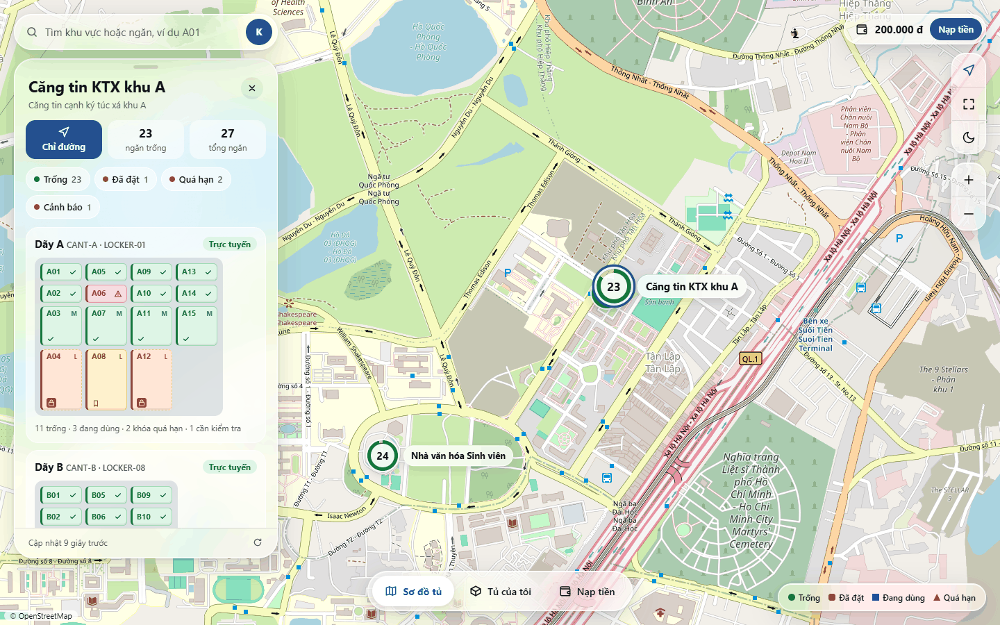 | 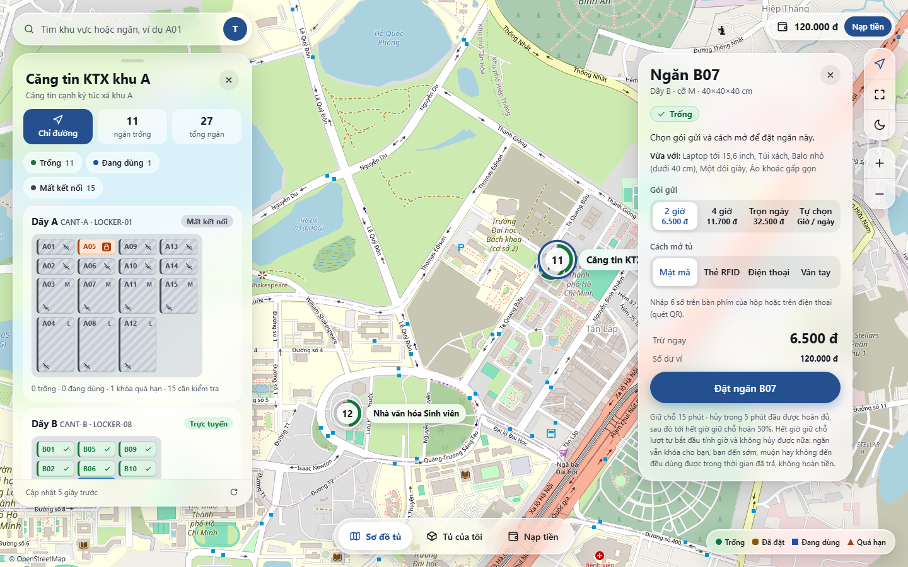 |

| Tự chọn theo giờ | Tự chọn theo ngày |
|---|---|
| 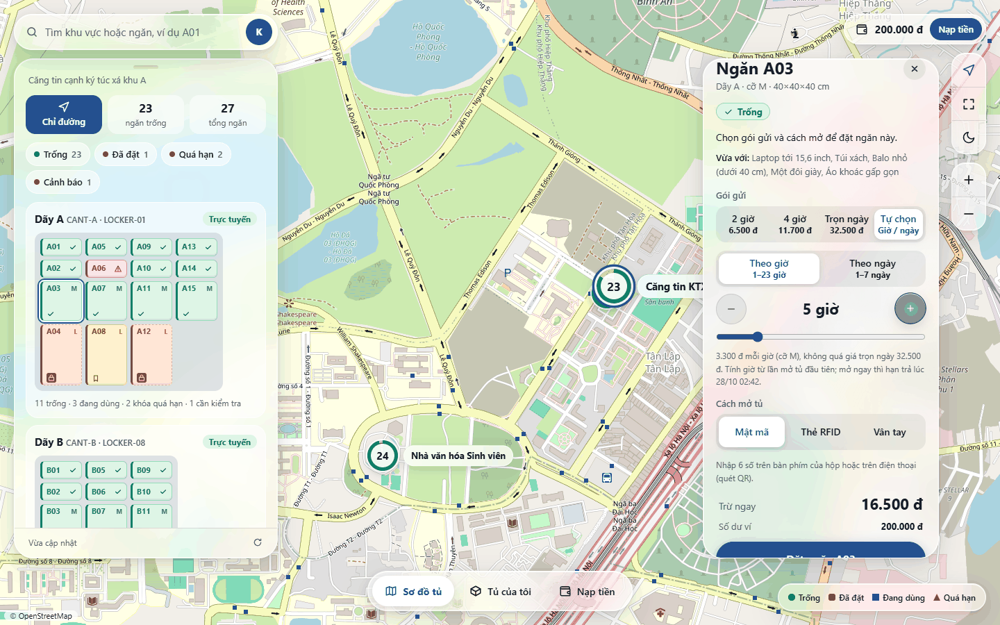 | 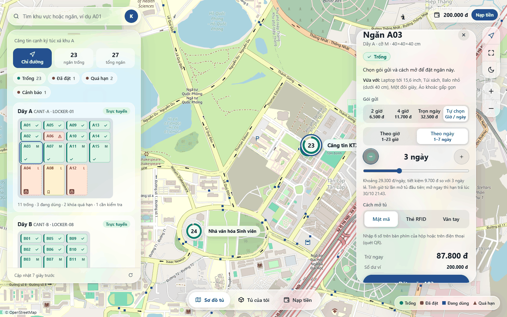 |

| Popup xác nhận đặt | Tủ của tôi: mật mã, nút hủy kèm đếm ngược |
|---|---|
| 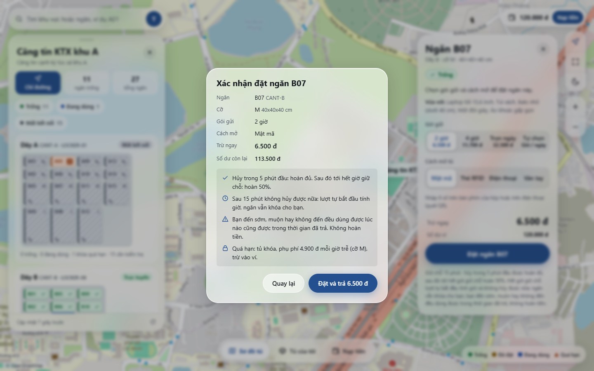 | 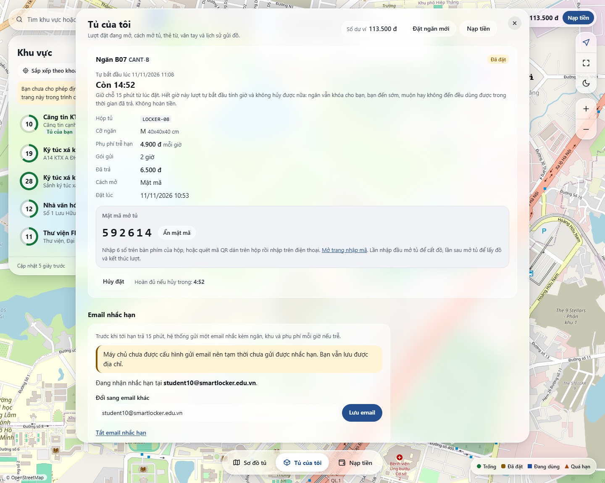 |

| Tủ của tôi: đang gửi, gia hạn | Tủ của tôi: quá hạn, tủ khóa, đang nợ |
|---|---|
| 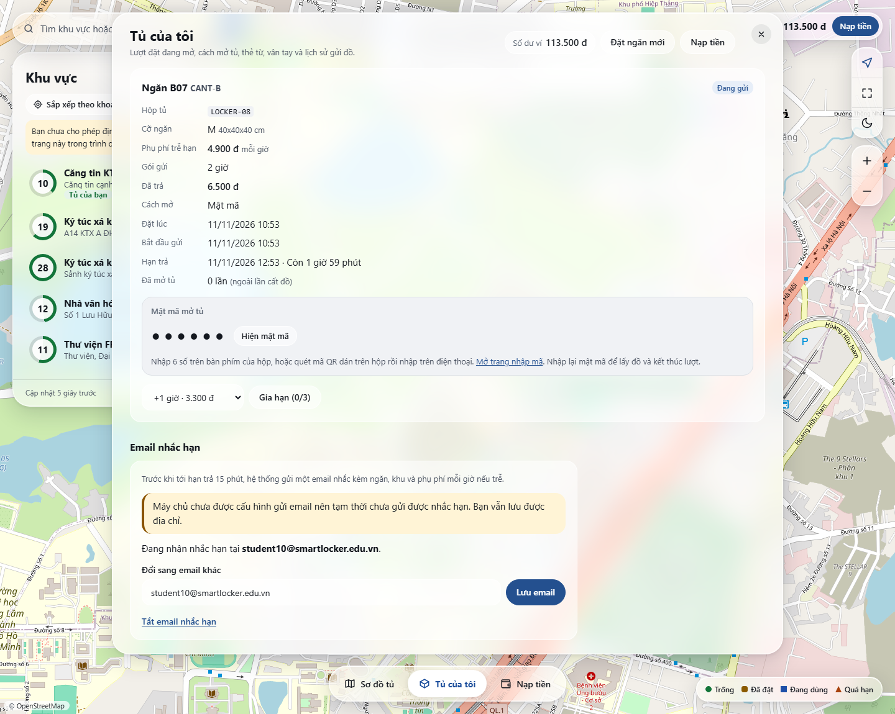 | 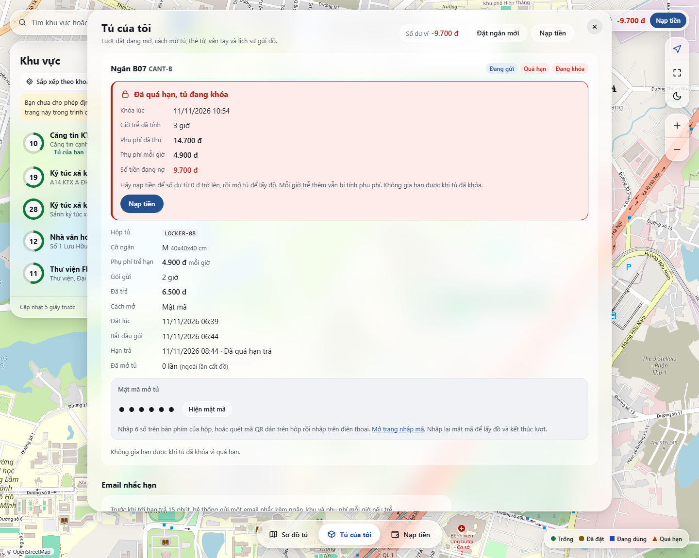 |

| Tổng quan cho nhân viên | Dữ liệu cảm biến |
|---|---|
| 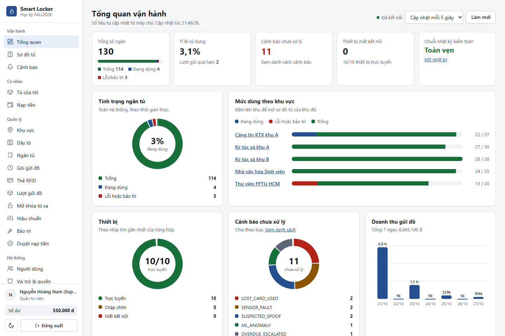 | 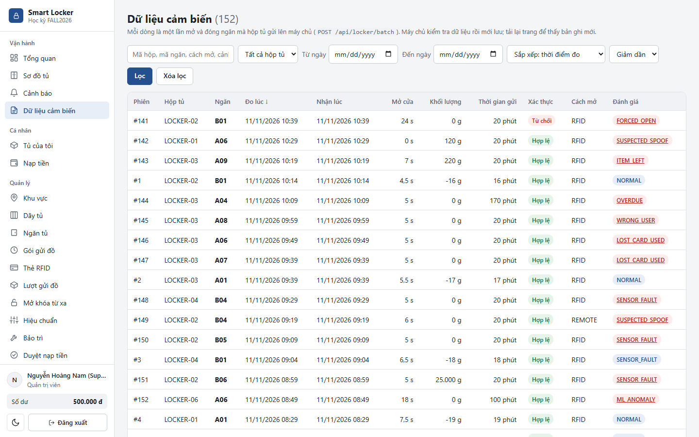 |

| Cảnh báo chuyển xử lý sau 48 giờ | Danh sách cảnh báo |
|---|---|
| 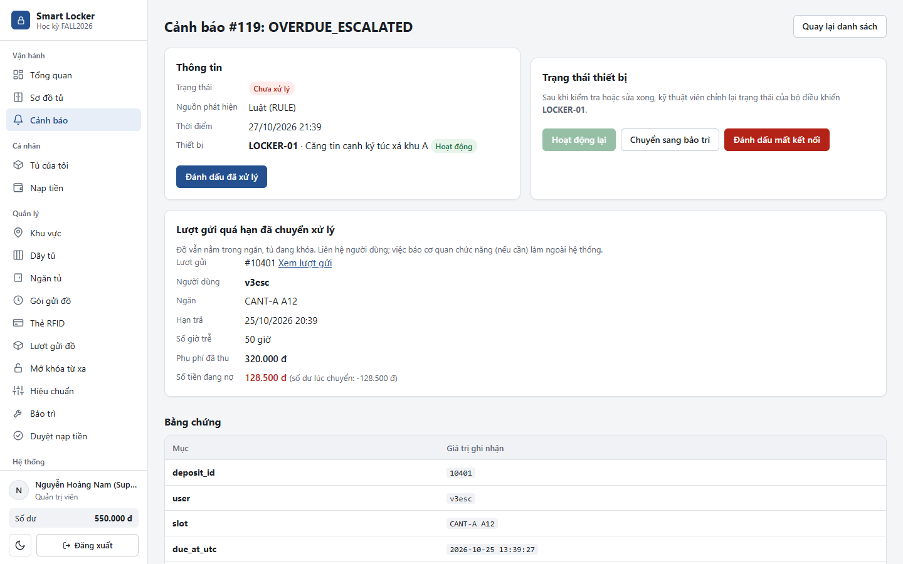 | 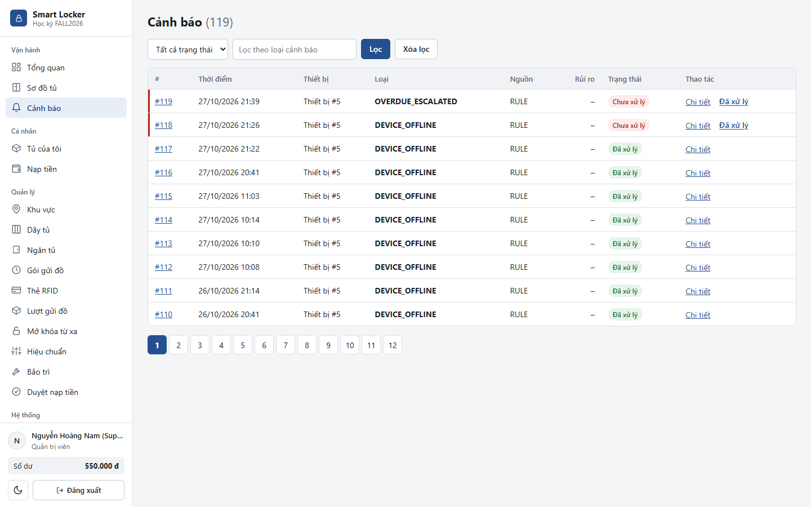 |

| Dãy tủ: hộp thật và ngăn có khóa thật | Trang mở tủ trên điện thoại |
|---|---|
| 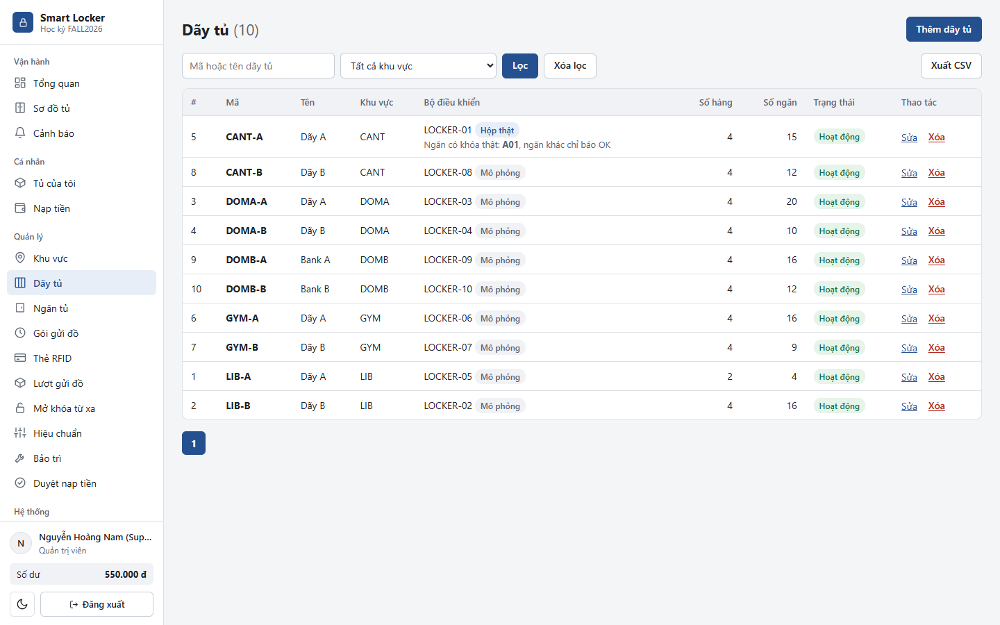 | 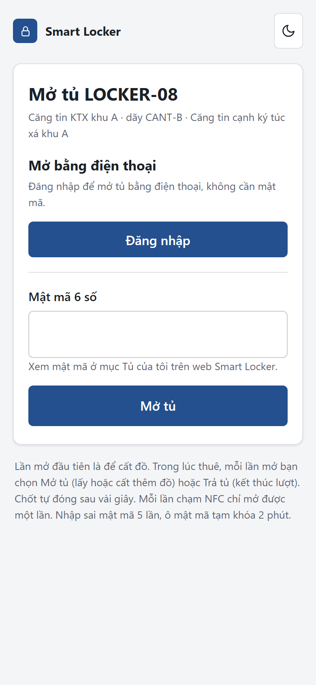 |

---

## Cài đặt và chạy

Cần có JDK 8, Apache Tomcat 9, SQL Server 2019/2022 kèm `sqlcmd`, Git Bash cho các script `.sh`. NetBeans là tùy chọn.

### 1. Tạo cơ sở dữ liệu

Chạy một lệnh (lệnh này **xóa và tạo lại** database `PRJ301_LOCKER`):

```powershell
powershell -ExecutionPolicy Bypass -File .\run_demo_db.ps1
```

Script chạy lần lượt các file `01` tới `05` dưới đây. Tham số mặc định là `localhost`, `sa`, `12345`.

| File | Nội dung |
|---|---|
| `sql/01_schema.sql` | Database, bảng, view, trigger, `Audit_Append`, quyền cơ bản |
| `sql/02_data_v1.sql` | Dữ liệu mẫu, procedure của các tình huống, ví và nạp tiền |
| `sql/03_v2_v3.sql` | Cách mở, khóa nhập sai, `Device_Authorize`, `AppConfig`, cỡ S/M/L, giá, Tự chọn, hủy, quá hạn, nhắc hạn, các khu trong ĐHQG-HCM |
| `sql/04_phone.sql` | Cách mở `PHONE`, mã chạm NFC, bỏ cọc thẻ |
| `sql/05_auto_checkin.sql` | Hết giờ giữ chỗ thì tự check-in |
| `sql/demo_box.sql` | Chọn hộp thật, các dãy nó quản lý và ngăn có servo (chạy riêng, xem [Hộp tủ ESP32](#hộp-tủ-esp32)) |
| `sql/upgrade_main_2026-11.sql` | Nâng cấp DB đang chạy, dùng khi [triển khai](#triển-khai-lên-internet) |
| `sql/test_setup.sql`, `test_overdue.sql`, `test_cleanup.sql` | Dữ liệu cho Postman, demo quá hạn, dọn dữ liệu test |

Lưu ý khi chạy lại từng file:

- Luôn dùng `sqlcmd -I -b -f 65001`. File có chữ Việt phải giữ UTF-8 BOM.
- Chạy lại `02` phải chạy lại `03`, `04`, `05`. Chạy lại `03` phải chạy lại `04`, `05`. Chạy lại `04` phải chạy lại `05`.
- `03_v2_v3.sql` đặt khóa của `LOCKER-01` về khóa mẫu công khai. Trước khi cắm hộp thật, tạo khóa riêng bằng lệnh sau (khóa lưu trong `config/device-keys.local.properties`, không commit):

  ```powershell
  powershell -ExecutionPolicy Bypass -File scripts\set-device-key.ps1
  ```

### 2. Build và chạy

**NetBeans:** Clean and Build, rồi Run trên Tomcat 9.

**Git Bash:** biên dịch vào `build/web`, rồi báo Tomcat tải lại. Đổi đường dẫn bằng biến `TOMCAT` và `JAVAC` nếu máy bạn khác mặc định.

```bash
sh scripts/build-dev.sh
```

Context `SmartLocker` của Tomcat trỏ tới `build/web` (file `conf/Catalina/localhost/SmartLocker.xml`). Chờ khoảng 15 giây rồi mở <http://localhost:8080/SmartLocker/>.

Kết nối DB mặc định là `localhost:1433`, `sa` / `12345`. Đổi bằng biến môi trường `DB_URL`, `DB_USER`, `DB_PASSWORD`.

Hai tính năng tùy chọn, chép file `.example` trong `config/` thành file `.local.properties` rồi điền:

| File | Tác dụng khi có file |
|---|---|
| `config/mail.local.properties` | Gửi email nhắc hạn và xác nhận thẻ; không có thì tắt gửi mail |
| `config/mapbox.local.properties` | Dùng bản đồ Mapbox (`pk.*`); không có thì dùng Leaflet |

### 3. Tài khoản demo

Mật khẩu chung: `123456`.

| Vai trò | Tài khoản | Không đăng nhập được |
|---|---|---|
| ADMIN | `admin`, `admin_ops`, `admin_lib`, `admin_doma`, `admin_cant`, `admin_gym`, `sysadmin1`, `manager1`, `manager2` | `sysadmin2` |
| OPERATOR | `operator1` ... `operator22` | `operator20`, `operator22` |
| TECHNICIAN | `tech1` ... `tech22` | `tech20`, `tech22` |
| AUDITOR | `auditor1` ... `auditor16` | `auditor15`, `auditor16` |
| END_USER | `student1` ... `student28`, `user1` | `locked1`, `student27`, `student28` |

Một số tài khoản mẫu đã có sẵn lượt gửi. Muốn thử đặt ngăn mới, dùng tài khoản chưa có lượt đang mở, ví dụ `student10`.

---

## Hộp tủ ESP32

Bản demo có **một hộp ESP32 thật** (`LOCKER-01`) với **một ngăn có servo**. Hộp này quản lý mọi ngăn của các dãy gắn với nó. Mở ngăn nào lượt gửi cũng chạy đúng, nhưng phản hồi `UNLOCK` có cờ `physical`:

- `true`: đúng ngăn vật lý, servo mở cửa.
- `false`: ngăn khác, servo không chạy, LCD chỉ báo kết quả.

Các dãy còn lại gắn với hộp minh họa (`"demo":true`), được máy chủ giả heartbeat nên luôn trực tuyến.

**Chọn dãy cho hộp thật:** sửa 4 biến ở đầu `sql/demo_box.sql` rồi chạy trong database của app. Mặc định hộp quản lý dãy `LIB-A`, ngăn servo `A01`.

```sql
DECLARE @device_code   NVARCHAR(30)  = N'LOCKER-01';
DECLARE @banks         NVARCHAR(400) = N'LIB-A';     -- nhiều dãy thì cách nhau bằng dấu phẩy
DECLARE @physical_bank NVARCHAR(20)  = N'LIB-A';
DECLARE @physical_slot NVARCHAR(20)  = N'A01';       -- cả hai NULL: mọi ngăn đều mở servo
```

Các dãy cùng một hộp phải có mã ngăn khác nhau. Khi hộp thật tắt, sau 90 giây các dãy của nó thành OFFLINE; muốn thử chỉ trên trình duyệt thì đặt ở dãy minh họa như `CANT-B`.

**Firmware** là `firmware/SmartLocker_Online` (bản 4.1, board ESP32 Dev Module). Chép `secrets.example.h` thành `secrets.h` rồi điền Wi-Fi, địa chỉ máy chủ và khóa hộp. Hướng dẫn nạp đầy đủ: [firmware/SmartLocker_Online/README.md](./firmware/SmartLocker_Online/README.md).

| Thiết bị | Chân ESP32 |
|---|---|
| PN532 (thẻ và chạm NFC, I2C, địa chỉ 0x24) | SDA 21, SCL 22 |
| LCD 1602 I2C (địa chỉ 0x27) | SDA 21, SCL 22 |
| AS608 (vân tay) | TX → 35, RX → 15 |
| Servo chốt | 32 |
| Servo kéo ngăn | 2 (cắm dây tín hiệu sau khi nạp xong) |
| SRF05 | TRIG 5, ECHO 18 (qua mạch chia áp) |
| Keypad 4x4 | Hàng 13, 14, 25, 26; cột 33, 19, 23, 27 |

Thao tác tại hộp: `0-9` + `#` gửi mật mã; `B` + mã đăng ký để đăng ký thẻ; `C` + mã đăng ký để đăng ký vân tay; `D` xem IP và tình trạng máy chủ.

**Chạm điện thoại:** PN532 giả làm một thẻ NFC chứa link `/k/LOCKER-01?n=<mã>`. Mã do máy chủ cấp qua heartbeat, đổi mỗi phút và sau mỗi lần mở, dùng được 5 phút. Điện thoại chạm vào là mở trang của hộp; người đã đăng nhập bấm "Mở tủ của tôi". Mỗi vòng lặp PN532 luân phiên đọc thẻ và giả lập thẻ NFC. Một số iPhone không đọc được thẻ giả lập, khi đó dùng QR.

`firmware/SmartLocker_Local` là bản thử phần cứng không nối mạng và vẫn dùng đầu đọc RC522.

---

## Bảng giá và luật

Giá = giá gói × hệ số cỡ (S 100%, M 130%, L 169%), làm tròn lên 100 đ. Đơn vị là đồng.

| Gói (ân hạn) | S | M | L |
|---|---:|---:|---:|
| 2 giờ (10 phút) | 5.000 | 6.500 | 8.500 |
| 4 giờ (10 phút) | 9.000 | 11.700 | 15.300 |
| Trọn ngày (30 phút) | 25.000 | 32.500 | 42.300 |
| Giá một giờ (gia hạn, Tự chọn theo giờ) | 2.500 | 3.300 | 4.300 |
| Phụ phí mỗi giờ trễ (150% giá một giờ) | 3.800 | 4.900 | 6.400 |

**Tự chọn** do máy chủ tính lại, trang chỉ hiển thị:

- Theo giờ (1-23): `min(giá một giờ × N, giá trọn ngày)`.
- Theo ngày (1-7): `giá trọn ngày × N × hệ số`. Hệ số 100% cho 1 ngày, 90% cho 2-6 ngày, 80% cho 7 ngày, làm tròn lên 100 đ.

| Tự chọn | S | M | L |
|---|---:|---:|---:|
| 3 giờ | 7.500 | 9.900 | 12.900 |
| 9 giờ | 22.500 | 29.700 | 38.700 |
| 10-23 giờ | 25.000 | 32.500 | 42.300 |
| 2 ngày | 45.000 | 58.500 | 76.100 |
| 3 ngày | 67.500 | 87.800 | 114.100 |
| 6 ngày | 135.000 | 175.500 | 228.200 |
| 7 ngày | 140.000 | 182.000 | 236.600 |

| Luật | Giá trị | Khóa trong `AppConfig` |
|---|---|---|
| Giữ chỗ | 15 phút | `HOLD_MIN` |
| Hủy hoàn đủ | 5 phút đầu | `CANCEL_FREE_MIN` |
| Hủy muộn, tới hết giữ chỗ | hoàn 50%, làm tròn xuống 100 đ | `CANCEL_LATE_REFUND_PCT` |
| Số dư tối thiểu sau khi đặt | 10.000 đ | `BOOKING_BUFFER` |
| Email nhắc trước hạn | 15 phút | `DUE_REMINDER_MIN` |
| Chuyển nhân viên xử lý | 48 giờ | `ESCALATE_HOURS` |

Các con số nằm trong `AppConfig`, `SlotSize`, `StoragePlan`, và `util.Pricing` tính giống hệt SQL. Đổi một con số thì sửa cả hai nơi rồi chạy `PricingDatabaseIntegrationTest`.

---

## Luồng hoạt động

### Đặt tủ, gửi và lấy đồ

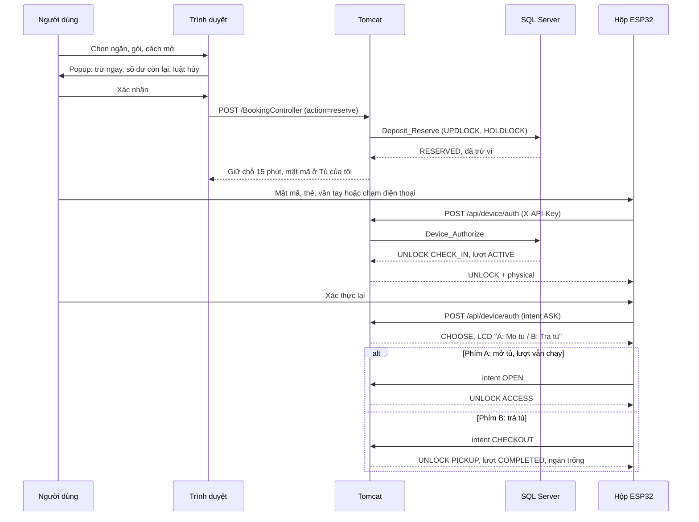

### Quá hạn

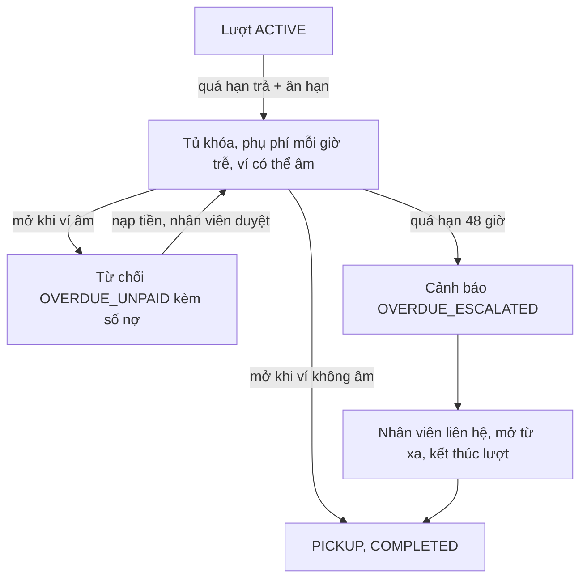

### Cảnh báo

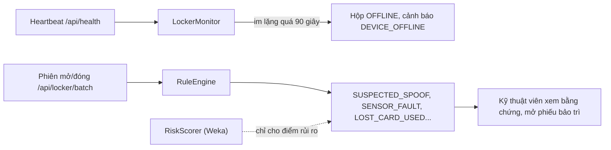

Firmware hiện không gửi `/api/locker/batch` vì hộp không có cảm biến cửa và cân. Dữ liệu cho luồng này đến từ dữ liệu mẫu, `scripts/send-demo.ps1` hoặc công cụ `ScenarioSender`:

```powershell
powershell -ExecutionPolicy Bypass -File scripts\send-demo.ps1 -Count 5 -Fault -Bad
```

Chi tiết từng tình huống và mã lỗi: [docs/SYSTEM_FLOWS.md](./docs/SYSTEM_FLOWS.md).

---

## Kiểm thử

Kết quả trên database dựng sạch từ script, ngày 11/11/2026:

| Bộ kiểm thử | Kết quả |
|---|---|
| TestNG, 14 lớp | 83/83 đạt, không bỏ qua |
| Postman + newman, 19 kịch bản | 241 request, 514 assertion, 0 lỗi |
| Trình duyệt: khách, đặt và hủy, mở tủ, quá hạn, trang điện thoại, 17 trang nhân viên | 36/36 mục đạt, không có lỗi JavaScript hay HTTP 500 |

Test ghi vào database nên chỉ chạy trên database có tiền tố `SL_`, không chạy trên `PRJ301_LOCKER`. Lệnh PowerShell dưới đây dùng đường dẫn tuyệt đối tới thư mục repo:

```powershell
powershell -ExecutionPolicy Bypass -File scripts\proof\build-db.ps1 -Repo "$PWD" -Database SL_TEST -TestSetup
```

```bash
DB_URL='jdbc:sqlserver://localhost:1433;databaseName=SL_TEST;encrypt=false' sh scripts/test.sh
```

Chạy Postman trên một Tomcat test riêng ở cổng 8081, trên một database mới dựng và chưa chạy `demo_box.sql`. Hai script dưới đây dừng lại nếu thấy `config/mail.local.properties`, để test không gửi mail thật:

```powershell
powershell -ExecutionPolicy Bypass -File scripts\proof\test-stack.ps1 start -Database SL_TEST -Build
```

```powershell
powershell -ExecutionPolicy Bypass -File scripts\proof\newman.ps1 -Database SL_TEST
```

```powershell
powershell -ExecutionPolicy Bypass -File scripts\proof\test-stack.ps1 clean
```

Thêm: [docs/postman/README.md](./docs/postman/README.md) và [scripts/proof/README.md](./scripts/proof/README.md).

**Demo quá hạn không cần chờ:** mở tủ một lần để lượt thành ACTIVE, sửa `@username` trong `sql/test_overdue.sql` rồi chạy. Trong 15 giây hệ thống khóa tủ và tính phụ phí. Dọn bằng `sql/test_cleanup.sql`.

**Công cụ chạy tay** trong `test/tool`, không đóng gói vào WAR: `ScenarioSender` (giả hộp ESP32), `DataReplayer`, `ModelTrainer`, `TransferCheck`, `DeviceKey`.

---

## Triển khai lên Internet

| Cách | Tài liệu |
|---|---|
| Render (Docker) + Azure SQL Database. **Mỗi lần push lên `main`, Render tự build và deploy lại** | [docs/deploy-render.md](./docs/deploy-render.md) |
| Chạy trên máy cá nhân qua Cloudflare tunnel, dùng khi demo | [docs/deploy.md](./docs/deploy.md) |

**Cập nhật database đang chạy** mà giữ nguyên dữ liệu: chỉ chạy các file sau, theo đúng thứ tự, bỏ qua bước đã làm. Đừng chạy lại `03_v2_v3.sql` vì nó đặt lại khóa của hộp.

| Database đang ở bản | Chạy |
|---|---|
| Dựng từ `main` tại commit `da95f43` | `upgrade_main_2026-11.sql`, `04_phone.sql`, `05_auto_checkin.sql` |
| Đã có `upgrade_main_2026-11.sql` | `04_phone.sql`, `05_auto_checkin.sql` |
| Đã có `04_phone.sql` | `05_auto_checkin.sql` |

```bash
sqlcmd -I -b -f 65001 -S <server> -d PRJ301_LOCKER -U <user> -P <password> -i sql/05_auto_checkin.sql
```

---

## Kiến trúc và mã nguồn

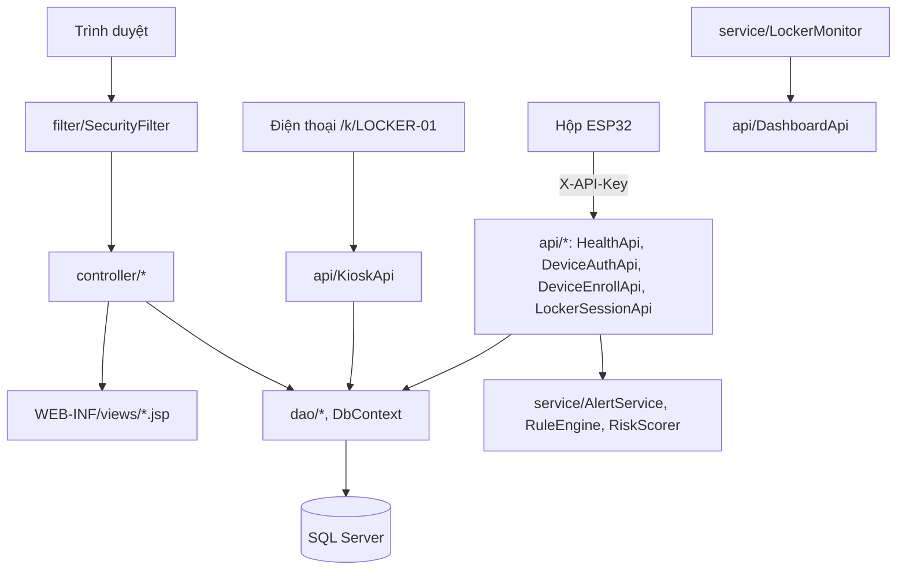

- `DbContext` là nơi duy nhất mở kết nối JDBC và giữ một pool nhỏ; DAO đóng kết nối bằng try-with-resources.
- Luật về tiền và thời gian nằm trong procedure SQL; Java gọi procedure và dịch lỗi sang tiếng Việt (`Web.sqlMessage`).
- View nằm trong `WEB-INF/views`, chỉ vào được qua controller.
- `/api/dashboard` đọc ảnh chụp trong bộ nhớ của `LockerMonitor`, không truy vấn DB; số liệu biểu đồ ở `/api/dashboard/stats`.

```
SmartLocker/
├── config/        # Mẫu email, file cấu hình mẫu (*.local.properties không commit)
├── docs/          # SYSTEM_FLOWS, spec, deploy, Postman, ảnh, bài báo (paper)
├── firmware/      # SmartLocker_Online (ESP32 nối web), SmartLocker_Local (thử phần cứng)
├── lib/           # JDBC, Gson, jBCrypt, Weka; TestNG, JCommander, SLF4J chỉ dùng để test
├── scripts/       # build-dev, test, set-device-key, send-demo, proof/ (DB và Tomcat test)
├── sql/           # 01-05, demo_box, upgrade, test_*
├── src/java/
│   ├── api/       # API JSON: thiết bị, điện thoại, dashboard, bản đồ, Tủ của tôi
│   ├── controller/# Servlet MVC2
│   ├── dao/       # JDBC
│   ├── filter/    # SecurityFilter: đăng nhập, phân quyền, khóa API thiết bị
│   ├── ml/        # Mô hình Weka đã train
│   ├── model/     # Lớp dữ liệu
│   ├── service/   # LockerMonitor, DueReminder, MailService, RuleEngine, RiskScorer, AuditVerifier
│   └── util/      # Web, Pricing, Csv, SecurityUtils, SlotImages
├── test/          # test/ (TestNG), tool/ (chạy tay), support/
└── web/           # JSP, CSS, JS, Leaflet
```

### API chính

| Method | Endpoint | Mô tả |
|---|---|---|
| `POST` | `/BookingController` | `action=reserve`, `cancel`, `extend` |
| `GET` | `/api/locker-map` | Khu, dãy, ngăn, giá; khách xem được |
| `GET` | `/api/my-locker` | Lượt đang mở, thẻ, vân tay, lịch sử |
| `POST` | `/TopupController` | Yêu cầu nạp tiền; nhân viên duyệt hoặc từ chối |
| `POST` | `/api/health` | Heartbeat; trả lệnh đang chờ và `tap_path` cho thẻ NFC |
| `POST` | `/api/device/auth` | Mật mã, thẻ, vân tay → `UNLOCK` / `CHOOSE` / `CONFIRM_EMAIL` / `DENY` |
| `POST` | `/api/device/enroll/start`, `/finish` | Đăng ký thẻ hoặc vân tay |
| `POST` | `/api/locker/batch` | Phiên mở/đóng của hộp |
| `POST` | `/api/kiosk/unlock` | Mở từ trang điện thoại bằng mật mã hoặc chạm NFC |
| `GET` | `/api/dashboard`, `/api/dashboard/stats` | Số liệu tổng quan và biểu đồ |

Hợp đồng API thiết bị: [docs/spec/smart-locker-v2.md](./docs/spec/smart-locker-v2.md) mục 4.

---

## Bảo mật và hạn chế đã biết

**Đã có:**

- `SecurityFilter`: đường dẫn chưa khai báo bị từ chối; GET cần quyền READ, phương thức khác cần WRITE. Chỉ bản đồ và `/api/locker-map` (GET) mở cho khách.
- Mật khẩu băm BCrypt. Người dùng được nạp lại ở mỗi request, tài khoản bị khóa bị đăng xuất ngay.
- Đặt tủ chống tranh chấp bằng khóa trong procedure (`UPDLOCK, HOLDLOCK`).
- Nhật ký audit chỉ thêm, nối chuỗi băm SHA-256.
- Khóa API của hộp lưu dạng SHA-256. Cookie phiên SameSite=Lax. Dữ liệu người dùng in bằng `<c:out>` và `esc()`.

**Chưa có, vì đây là đồ án demo.** Cần xử lý trước khi dùng thật:

- Chưa giới hạn số lần đăng nhập sai và chưa có trang đổi mật khẩu. Tài khoản mới do nhân viên tạo hoặc đặt lại đều dùng mật khẩu `123456`.
- Email lưu ngay khi nhập, chưa xác minh bằng mã.
- Chưa có CSRF token, hiện dựa vào SameSite=Lax.
- Chưa có trang lỗi 500 riêng.
- `DbContext` có sẵn mặc định `sa` / `12345` cho máy local; khi triển khai phải đặt `DB_URL`, `DB_USER`, `DB_PASSWORD`.
- Firmware dùng `setInsecure()`, không ghim chứng chỉ TLS.

---

## Tài liệu liên quan

- [docs/SYSTEM_FLOWS.md](./docs/SYSTEM_FLOWS.md): luồng nghiệp vụ, tình huống, sơ đồ trạng thái.
- [docs/spec/smart-locker-v2.md](./docs/spec/smart-locker-v2.md), [docs/spec/smart-locker-v3.md](./docs/spec/smart-locker-v3.md): đặc tả.
- [docs/deploy.md](./docs/deploy.md), [docs/deploy-render.md](./docs/deploy-render.md): triển khai.
- [docs/postman/README.md](./docs/postman/README.md): Postman và newman.
- [firmware/SmartLocker_Online/README.md](./firmware/SmartLocker_Online/README.md): nạp firmware và dùng hộp thật.
- [docs/paper/smartlocker.tex](./docs/paper/smartlocker.tex): bài báo, số đo ở [docs/paper/evidence](./docs/paper/evidence/README.md).

## Giấy phép

Đồ án học tập môn PRJ301. Xem [LICENSE](./LICENSE).
