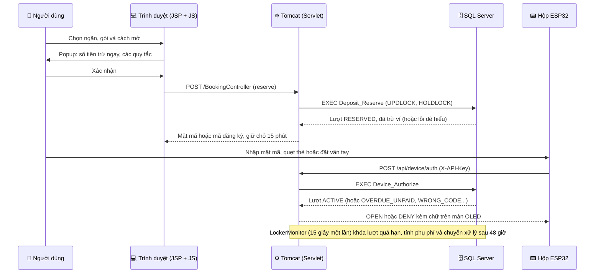

# 🔐 SmartLocker - Hệ thống tủ gửi đồ thông minh

<div align="center">


-007396?style=for-the-badge&logo=java&logoColor=white)


**Ứng dụng web Java hoàn chỉnh để thuê tủ gửi đồ: đặt ngăn trực tuyến, mở bằng mật mã, thẻ từ hoặc vân tay, trả tiền bằng ví, với các hộp tủ ESP32 giao tiếp qua API có khóa riêng cho từng hộp.**

*Đồ án môn PRJ301 (FALL2026). Bản tóm tắt tiếng Anh: [README.en.md](./README.en.md).*

</div>

---

## ✨ Chức năng chính

### Người dùng 👤

- **Đăng ký, đăng nhập:** ngay trong popup trên bản đồ tủ công khai. Mật khẩu băm BCrypt có salt.
- **Sơ đồ tủ:** các khu (Thư viện, Ký túc xá A và B, Căng tin, Nhà văn hóa Sinh viên) trên bản đồ Leaflet chạy được khi mất mạng, làm mới 10 giây một lần. Mỗi dãy vẽ thành một khối tủ, cửa cao theo cỡ ngăn.
- **Tìm tủ gần tôi:** sắp các khu theo khoảng cách và mở chỉ đường đi bộ trên Google Maps. Vị trí chỉ tính trên trình duyệt, không gửi lên máy chủ.
- **Ba cỡ ngăn:** S 20x20x20, M 40x40x40, L 60x60x60 cm. Giá = giá gói x 1,00 / 1,30 / 1,69 (tròn lên 100 đ), thẻ từ giảm thêm 5%. Ví dụ gói 2 giờ: S 5.000 đ, M 6.500 đ, L 8.500 đ.
- **Đặt ngăn rõ ràng:** chọn gói và cách mở (mật mã, thẻ từ, vân tay); popup xác nhận cho biết số tiền trừ ngay. Giữ chỗ 15 phút, sau khi đặt ví phải còn ít nhất 10.000 đ dự phòng phụ phí.
- **Hủy trong 5 phút:** hoàn đủ tiền nếu hủy trong 5 phút đầu. Không đến sau 15 phút giữ chỗ thì không hoàn tiền; 3 lần không đến trong 7 ngày bị tạm cấm đặt.
- **Gia hạn có phí:** tối đa 3 lần, mỗi giờ bắt đầu tính theo giá một giờ của cỡ ngăn (S 2.500 đ, M 3.300 đ, L 4.300 đ).
- **Quá hạn:** ngăn không tự giải phóng. Quá thời gian ân hạn thì tủ bị khóa, mỗi giờ trễ bị trừ phụ phí 1,5 lần giá một giờ (S 3.800 đ, M 4.900 đ, L 6.400 đ); ví có thể âm. Hộp từ chối mở (`OVERDUE_UNPAID`) tới khi nạp đủ tiền, và quá 48 giờ lượt được chuyển cho nhân viên xử lý.
- **Ví:** nạp tiền bằng mã VietQR, nhân viên duyệt rồi mới cộng tiền.
- **Tủ của tôi:** mật mã (ẩn/hiện), mã đăng ký thẻ hoặc vân tay, đếm ngược thời gian còn hủy được và giữ chỗ, khung quá hạn, email nhắc hạn 15 phút trước giờ trả, thẻ và vân tay đã đăng ký, lịch sử.
- **Trang điện thoại:** quét QR ở hộp, vào `/k/{device_code}` và nhập mật mã để mở tủ (sai 5 lần thì khóa trang 2 phút).

### Nhân viên 🛡️

- **Operator:** sơ đồ tủ, lệnh mở từ xa, duyệt nạp tiền, quản lý khu, dãy, ngăn, gói gửi, thẻ, người dùng.
- **Technician:** cảnh báo, phiếu bảo trì, hiệu chuẩn cảm biến, trạng thái ngăn.
- **Auditor:** chỉ đọc; xem và kiểm tra chuỗi băm của nhật ký audit.
- **Admin:** toàn quyền, gồm vai trò và phân quyền.
- **Dashboard:** biểu đồ trạng thái ngăn, mức dùng theo khu, thiết bị, cảnh báo và doanh thu, đọc từ ảnh chụp số liệu trong bộ nhớ.

### Thiết bị 📟

- **Khóa API riêng cho mỗi hộp:** máy chủ chỉ lưu SHA-256 của khóa; `device_id` lấy từ khóa, không tin nội dung gửi lên.
- **Heartbeat:** hộp im lặng quá 90 giây thì chuyển OFFLINE và không đặt được.
- **Khóa nhập sai:** 5 lần sai trên một hộp thì hộp tạm khóa 2 phút.
- **Cảnh báo:** luật cố định (`RuleEngine`) quyết định; mô hình Weka (`RiskScorer`) chỉ cho thêm điểm rủi ro.

---

## ⚙️ Luồng hoạt động (đặt tủ)

Khi người dùng đặt một ngăn, hệ thống đi theo luồng sau để không bao giờ bán một ngăn hai lần và tiền luôn khớp với trạng thái:



Chi tiết các luồng và sơ đồ trạng thái: [docs/SYSTEM_FLOWS.md](./docs/SYSTEM_FLOWS.md).

---

## 🏗️ Kiến trúc

```mermaid
flowchart TD
    ESP["Hộp ESP32"] -->|X-API-Key| API["api/* (HealthApi, DeviceAuthApi, DeviceEnrollApi, LockerSessionApi)"]
    Phone["Điện thoại /k/LOCKER-01"] --> Kiosk["api/KioskApi"]
    Browser["Trình duyệt"] --> Filter["filter/SecurityFilter (RBAC theo bảng Permissions)"]
    Filter --> Ctrl["controller/* (MVC2)"]
    Ctrl --> Views["WEB-INF/views/*.jsp"]
    API --> DAO["dao/* (JDBC, DbContext)"]
    Kiosk --> DAO
    Ctrl --> DAO
    API --> Svc["service/AlertService, RuleEngine, RiskScorer"]
    Monitor["service/LockerMonitor"] -->|ảnh chụp 2 giây| DashApi["api/DashboardApi"]
    DAO --> DB[(SQL Server PRJ301_LOCKER)]
```



- `DbContext` mở một kết nối JDBC cho mỗi lần gọi DAO và đóng ngay bằng try-with-resources (không có connection pool).
- Mọi view nằm trong `WEB-INF/views`, chỉ vào được qua controller. Dữ liệu người dùng in bằng `<c:out>`; JavaScript dựng HTML qua `esc()` của `js/app.js`.
- Một stylesheet chung `web/css/app.css` (sáng/tối); `js/theme.js` đặt theme trước khi vẽ trang; không dùng CDN.
- `LockerMonitor` dựng ảnh chụp số liệu mỗi 2 giây cho dashboard; mỗi 15 giây chạy các procedure hết hạn giữ chỗ, khóa và tính phụ phí quá hạn, chuyển xử lý, hết hạn lệnh và đánh dấu hộp mất kết nối. `DueReminder` (luồng riêng) gửi email nhắc hạn qua `MailService` (SMTP viết bằng Java thuần).

---

## 📂 Cấu trúc thư mục

```
SmartLocker/
├── config/                 # Khóa hộp thật, cấu hình email (*.local.properties, không commit)
├── docs/                   # Đặc tả, SYSTEM_FLOWS, deploy, Postman, handoff
├── firmware/               # Mã Arduino cho hộp ESP32
├── lib/                    # JDBC, Gson, jBCrypt, Weka (đóng gói vào WAR); TestNG, JCommander, SLF4J (chỉ để test)
├── scripts/                # build-dev.sh, test.sh, mail-preview.sh, set-device-key.ps1, update-tunnel-link.ps1
├── sql/                    # 01_schema, 02_data_v1, 03_v2_v3 và các script test_*
├── src/java/
│   ├── api/                # API JSON: thiết bị, điện thoại, dashboard, sơ đồ tủ, Tủ của tôi
│   ├── controller/         # Servlet MVC2, mỗi trang một controller
│   ├── dao/                # JDBC; DbContext là nơi duy nhất mở kết nối
│   ├── filter/             # SecurityFilter: đăng nhập, phân quyền, khóa API thiết bị
│   ├── ml/                 # Mô hình Weka đã train
│   ├── model/              # Lớp dữ liệu
│   ├── service/            # LockerMonitor, DueReminder, MailService, RuleEngine, RiskScorer, AuditVerifier
│   └── util/               # Web (đọc tham số, dịch lỗi SQL), Pricing, Csv, SecurityUtils, SlotImages
├── test/
│   ├── test/               # Unit test và integration test (TestNG)
│   └── tool/               # Công cụ chạy tay (giả hộp ESP32, train mô hình), không đóng gói vào WAR
└── web/                    # JSP, css, js, Leaflet đặt sẵn (không CDN)
```

---

## 📡 API chính

### Đặt tủ và ví

| Method | Endpoint | Mô tả |
|--------|----------|-------|
| `POST` | `/BookingController` | `action=reserve`, `cancel` hoặc `extend` cho người dùng đang đăng nhập. |
| `GET`  | `/api/my-locker` | Lượt đang mở, thẻ, vân tay, gói và lịch sử của người dùng. |
| `GET`  | `/api/locker-map` | Khu, dãy, ngăn, cỡ, gói và quy tắc (khách xem được, chỉ đọc). |
| `POST` | `/TopupController` | Tạo yêu cầu nạp tiền VietQR; nhân viên duyệt hoặc từ chối. |

### Thiết bị và điện thoại

| Method | Endpoint | Mô tả |
|--------|----------|-------|
| `POST` | `/api/health` | Heartbeat của hộp; trả lệnh đang chờ và giờ máy chủ. |
| `POST` | `/api/device/auth` | Kiểm tra mật mã, thẻ hoặc vân tay tại hộp. |
| `POST` | `/api/device/enroll/start`, `/finish` | Đăng ký thẻ hoặc vân tay cho lượt đang mở. |
| `POST` | `/api/locker/batch` | Gửi lịch sử mở/đóng của hộp. |
| `POST` | `/api/kiosk/unlock` | Mở ngăn từ trang điện thoại công khai `/k/{device_code}`. |

### Nhân viên

| Method | Endpoint | Mô tả |
|--------|----------|-------|
| `GET`  | `/api/dashboard` | Số liệu từ ảnh chụp của `LockerMonitor` (không truy vấn DB). |
| `GET`  | `/api/dashboard/stats` | Dữ liệu biểu đồ (theo giờ, theo ngày, doanh thu), lưu đệm 60 giây. |
| `GET`  | `/AuditController?action=verify` | Tính lại chuỗi băm SHA-256 của nhật ký audit. |

Hợp đồng chi tiết của API thiết bị: [docs/spec/smart-locker-v2.md](./docs/spec/smart-locker-v2.md) mục 4. Quy tắc v3 (cỡ ngăn, giá, hủy, quá hạn, nhắc hạn): [docs/spec/smart-locker-v3.md](./docs/spec/smart-locker-v3.md).

---

## 🛠️ Công nghệ

| Tầng | Công nghệ |
|------|-----------|
| **Giao diện** | JSP + JSTL, JavaScript thuần, một file CSS có token sáng/tối, Leaflet (đặt sẵn, không CDN) |
| **Backend** | Java 8, Servlet 4 (MVC2), bộ lọc bảo mật theo quyền của vai trò |
| **Cơ sở dữ liệu** | SQL Server, procedure cho mọi quy tắc về tiền và thời gian |
| **Thiết bị** | ESP32 (Arduino), khóa API riêng cho từng hộp, màn OLED, đầu đọc thẻ và cảm biến vân tay |
| **Bảo mật** | BCrypt, khóa thiết bị lưu SHA-256, nhật ký audit chuỗi băm, cookie phiên SameSite=Lax |
| **Email** | Máy khách SMTP viết bằng Java thuần (SSL 465 hoặc STARTTLS 587) |
| **AI** | Mô hình Weka cho thêm điểm rủi ro của cảnh báo |
| **Kiểm thử** | TestNG, Postman + newman (17 kịch bản, 201 request) |
| **Triển khai** | Tomcat 9; demo qua Cloudflare tunnel và trang chuyển hướng GitHub Pages |

---

## 🚀 Cài đặt và chạy

Yêu cầu: JDK 8, Apache Tomcat 9, SQL Server 2019/2022 (có `sqlcmd`), NetBeans (dự án web Ant).

### 1. Clone dự án

```bash
git clone <đường-dẫn-repository>
cd SmartLocker
```

### 2. Cơ sở dữ liệu

Cách nhanh: chạy `run_demo_db.bat` (gọi `run_demo_db.ps1`, chạy 01 → 07, 09 rồi 10; file `01` xóa và tạo lại database).

```powershell
.\run_demo_db.bat
```

Hoặc chạy 3 file theo **đúng thứ tự** (luôn có `-I`):

```powershell
sqlcmd -S localhost -U sa -P 12345 -I -b -f 65001 -i sql\01_schema.sql
sqlcmd -S localhost -U sa -P 12345 -I -b -f 65001 -i sql\02_data_v1.sql
sqlcmd -S localhost -U sa -P 12345 -I -b -f 65001 -i sql\03_v2_v3.sql
```

| File | Nội dung |
|---|---|
| `sql/01_schema.sql` | Database, bảng, view, trigger, `Audit_Append`, quyền cơ bản |
| `sql/02_data_v1.sql` | Dữ liệu mẫu (tài khoản, khu, dãy, ngăn, lịch sử), procedure của các tình huống (hộp mất kết nối, mở từ xa, mất thẻ, đặt tủ...), ví và nạp tiền, sửa quyền TECHNICIAN |
| `sql/03_v2_v3.sql` | v2 (cách mở, mật mã, vân tay, khóa nhập sai, `Device_Authorize`, `Enroll_*`), tên tiếng Việt cho dữ liệu mẫu, v3 (`AppConfig`, cỡ S/M/L, giá theo cỡ, hủy 5 phút, quá hạn, email nhắc hạn), các khu trong ĐHQG-HCM (toạ độ **gần đúng**, sửa trong trang Khu vực) và khu `DOMB` |
| `sql/test_setup.sql` | Tài khoản và lượt gửi dựng sẵn cho Postman (không phải dữ liệu demo) |
| `sql/test_cleanup.sql` | Dọn các lượt gửi và cảnh báo do Postman để lại trên hộp thật |
| `sql/test_overdue.sql` | Dời hạn trả của một lượt về quá khứ để demo khóa quá hạn và phụ phí |

Chạy lại `02_data_v1.sql` đưa các procedure đặt tủ về bản cũ, nên khi đó phải chạy lại `03_v2_v3.sql`.

Sau `03_v2_v3.sql`, khóa của `LOCKER-01` trở về khóa mẫu công khai. Tạo khóa bí mật riêng (lưu trong `config/device-keys.local.properties`, không commit) và ghi SHA-256 của nó vào DB:

```powershell
powershell -ExecutionPolicy Bypass -File scripts\set-device-key.ps1
```

Kết nối DB nằm ở `src/java/dao/DbContext.java` (mặc định `localhost:1433`, `sa` / `12345`).

### 3. Build và triển khai

- **NetBeans:** Clean and Build, rồi Run (Tomcat 9).
- **Git Bash:** biên dịch, chép `web/` và các jar cần khi chạy vào `build/web`, rồi báo Tomcat tải lại context:

```bash
sh scripts/build-dev.sh
```

Chờ khoảng 15 giây rồi mở `http://localhost:8080/SmartLocker/`.

### 4. Kiểm thử

Unit test và integration test (các lớp `*DatabaseIntegrationTest` cần SQL Server đang chạy):

```bash
sh scripts/test.sh
```

Postman + newman. Chạy script dựng dữ liệu trước, vì mỗi lần đoán sai ở hộp đều tính vào khóa 5 lần:

```bash
sqlcmd -S localhost -U sa -P 12345 -d PRJ301_LOCKER -I -b -f 65001 -i sql/test_setup.sql
newman run docs/postman/SmartLocker-v2.postman_collection.json -e docs/postman/SmartLocker-local.postman_environment.json --env-var api_key=<khóa LOCKER-01>
```

Chạy xong, `sql/test_cleanup.sql` dọn các lượt gửi và cảnh báo do test để lại. Hướng dẫn chi tiết: [docs/postman/README.md](./docs/postman/README.md). `sql/test_overdue.sql` dời hạn trả của một lượt về quá khứ để demo khóa quá hạn và phụ phí.

### 5. Tài khoản demo

Mật khẩu chung: `123456`.

| Vai trò | Tài khoản | Ghi chú |
|---|---|---|
| ADMIN | `admin`, `admin_lib`, `admin_doma`, `admin_cant`, `admin_gym`, `admin_ops`, `manager1`, `manager2`, `sysadmin1` | `sysadmin2` bị vô hiệu hóa |
| OPERATOR | `operator1` (LIB), `operator2` (DOMA), `operator3` (CANT), `operator4` (GYM) | Mỗi khu một người |
| TECHNICIAN | `tech1` ... `tech22` | `tech20` bị khóa, `tech22` bị vô hiệu hóa |
| AUDITOR | `auditor1` ... `auditor16` | `auditor15` bị khóa, `auditor16` bị vô hiệu hóa |
| END_USER | `student1` ... `student28`, `user1` | `locked1`, `student28` bị khóa; `student27` bị vô hiệu hóa |
| END_USER (Postman) | `v2pin`, `v2card`, `v2fp`, `v2noshow`, `v3overdue`, `v3poor`, `v3late`, `v3esc` | Tạo bởi `sql/test_setup.sql` |

Chỉ `LOCKER-01` (dãy CANT-A) là hộp thật; các hộp còn lại là hộp minh họa (`"demo":true`) và `LockerMonitor` giả heartbeat cho riêng chúng. Hộp thật không gửi heartbeat sẽ chuyển OFFLINE sau 90 giây, nên khi test trên trình duyệt hãy đặt ở dãy CANT-B.

### 6. Công cụ chạy tay (`test/tool`)

`ScenarioSender` (giả hộp ESP32), `DataReplayer` (phát lại dữ liệu `PublicSession`), `ModelTrainer` (train mô hình Weka vào `src/java/ml`), `TransferCheck` (so sánh F1), `DeviceKey` (đọc khóa LOCKER-01). Chạy bằng Run File trong NetBeans, hoặc từ thư mục dự án:

```powershell
javac -encoding UTF-8 -cp "build/web/WEB-INF/classes;lib/*" -d build/tools test/tool/*.java
java -cp "build/tools;build/web/WEB-INF/classes;lib/*" tool.ScenarioSender remote
```

---

## 🔒 Bảo mật

- `SecurityFilter`: đường dẫn chưa khai báo bị từ chối; GET cần quyền READ, các phương thức khác cần WRITE của tài nguyên.
- Tài khoản bị khóa hoặc xóa bị đăng xuất ở request kế tiếp; đổi vai trò có hiệu lực ngay, không cần đăng nhập lại.
- Đặt tủ chống tranh chấp bằng khóa trong procedure (`UPDLOCK, HOLDLOCK`) và cập nhật có điều kiện trạng thái ngăn.
- Nhật ký audit chỉ thêm, nối chuỗi băm SHA-256; AUDITOR chỉ có quyền đọc.
- Hạn chế đã biết: chưa có CSRF token (cookie phiên là SameSite=Lax), tài khoản `sa` nằm trong `DbContext`, không có connection pool.

## 📚 Tài liệu liên quan

- [docs/spec/smart-locker-v2.md](./docs/spec/smart-locker-v2.md): đặc tả v2 và hợp đồng API thiết bị.
- [docs/spec/smart-locker-v3.md](./docs/spec/smart-locker-v3.md): v3, chỉ phần thay đổi.
- [docs/SYSTEM_FLOWS.md](./docs/SYSTEM_FLOWS.md): luồng nghiệp vụ, sơ đồ trạng thái.
- [docs/deploy.md](./docs/deploy.md): chạy demo qua tunnel, trang điện thoại, khóa API của hộp thật.
- [docs/postman/](./docs/postman/README.md): Postman collection và cách chạy bằng newman.

## 📄 Giấy phép

Đồ án học tập môn PRJ301. Xem [LICENSE](./LICENSE).
