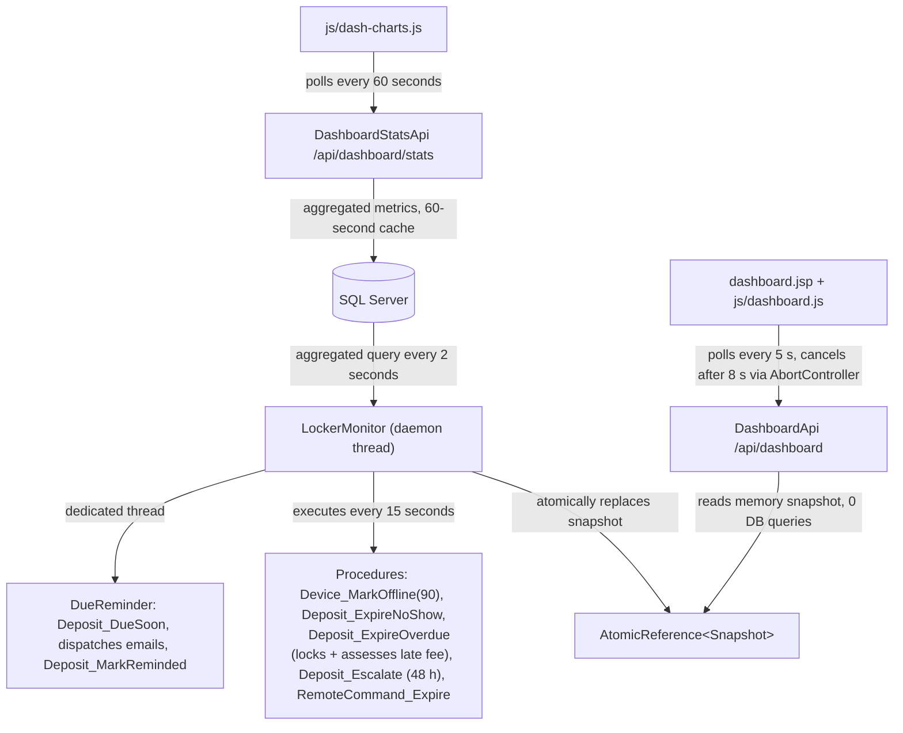
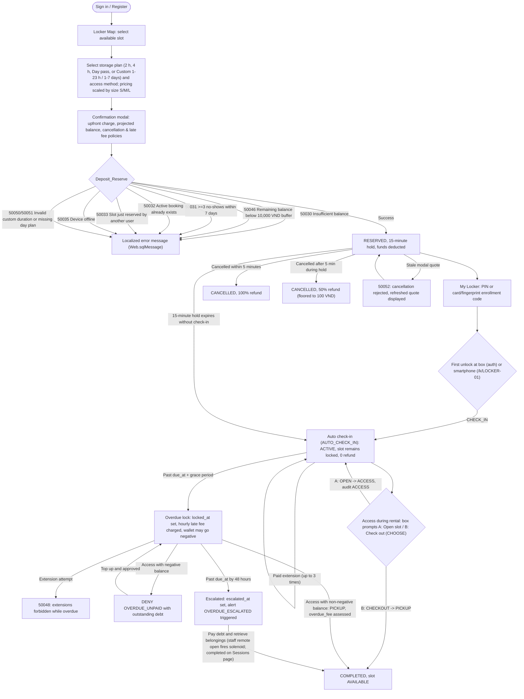
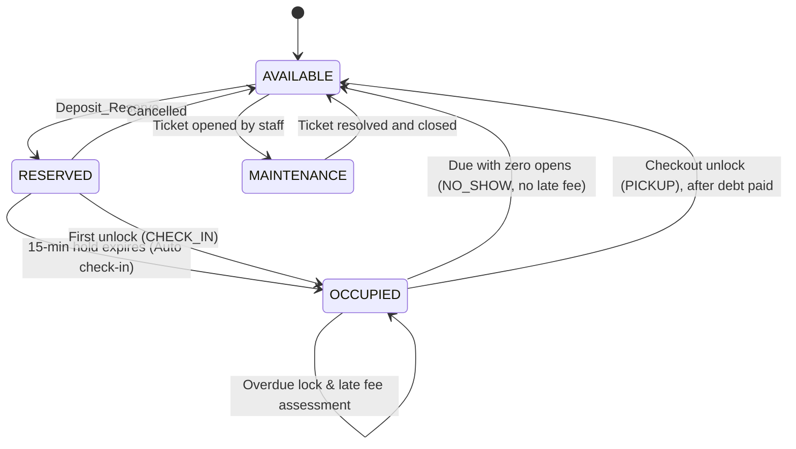

# SmartLocker: System Architecture & Business Flows

This document details the operational data paths, lifecycle state machines, and business rules implemented in SmartLocker (v3).
Detailed device API contracts are defined in `spec/smart-locker-v2.md` Section 4; v3 enhancements (size-based pricing, cancellation refunds, automatic check-in on hold expiry, overdue locking, debt handling, and staff escalation) are detailed in `spec/smart-locker-v3.md`.
All core numerical parameters (15-min hold, 5-min cancellation window, 50% late cancellation refund, 10,000 VND safety buffer, 150% late fee rate, 48-hour escalation threshold) are centralized in database table `AppConfig`.

---

## Part 1: Dashboard and Background Daemons

### 1.1 Data Flow



### 1.2 Core Components
1. **`LockerMonitor`** (`ServletContextListener`, background thread):
   - Every 2 seconds builds an in-memory `Snapshot` (KPIs, slot status breakdown, active alerts, device connectivity, recent access events) and runs `AuditVerifier` across the cryptographic hash chain.
   - Every 15 seconds invokes lifecycle expiry stored procedures. Devices silent for >90 seconds transition to `OFFLINE`.
   - Simulated units (`"demo":true` in `OperatingProfile`) receive synthetic heartbeats; real hardware (`LOCKER-01`) communicates strictly via live HTTP requests.
   - `DueReminder` dispatches warning emails 15 minutes prior to `due_at` for accounts with verified email addresses.
2. **`DashboardApi`**: Serves JSON from the cached in-memory snapshot; responds HTTP 503 during cold-boot warmup before the initial snapshot completes.
   `?device=ID` queries per-device analytics.
3. **`dashboard.jsp`**: Server renders the initial view; subsequent updates poll asynchronously via `dashboard.js`, skipping redundant polls while an in-flight request is pending and mutating only changed DOM elements.

---

## Part 2: Locker Rental Lifecycle

### 2.1 Reservation & Access Flow



**Custom Duration Plans** (`Deposit_Reserve` accepts `@custom_min`, price recomputed server-side by `dbo.fn_CustomPrice`):
1–23 hours (`CUSTOM_MAX_HOURS`) or 1–7 days (`CUSTOM_MAX_DAYS`).
Hourly: `min(hourly_rate * N, day_pass_rate)`. Daily: `day_pass_rate * N * multiplier * size_factor`. Multiplier is 100% for 1 day, 90% for 2–6 days (`CUSTOM_MULTI_DAY_PCT`), 80% for >=7 days (`CUSTOM_WEEK_PCT`).
Overdue lockers never release automatically (`AUTO_RELEASE_OVERDUE` removed from v1/v2): user possessions remain stored inside.

| Custom Plan Duration | S (VND) | M (VND) | L (VND) |
|---|---|---|---|
| 1 hour | 2,500 | 3,300 | 4,300 |
| 3 hours | 7,500 | 9,900 | 12,900 |
| 9 hours | 22,500 | 29,700 | 38,700 |
| 10–23 hours (capped at Day Pass) | 25,000 | 32,500 | 42,300 |
| 1 day | 25,000 | 32,500 | 42,300 |
| 2 days (90%) | 45,000 | 58,500 | 76,100 |
| 3 days (90%) | 67,500 | 87,800 | 114,100 |
| 6 days (90%) | 135,000 | 175,500 | 228,200 |
| 7 days (80%) | 140,000 | 182,000 | 236,600 |

### 2.2 Hardware Authentication (`POST /api/device/auth`)

```mermaid
sequenceDiagram
    participant Box as ESP32 Hardware Box
    participant Api as DeviceAuthApi
    participant Db as Device_Authorize
    Box->>Api: X-API-Key + {"method":"PIN","pin":"...","intent":"ASK"}
    Api->>Api: Format validation (400 if malformed)
    Api->>Db: device_id resolved strictly from API key hash
    Db-->>Api: UNLOCK (CHECK_IN / ACCESS / PICKUP), CHOOSE or DENY + reason
    Api-->>Box: ASCII string for LCD 1602, open_sec, attempts_left, retry_after_sec
    Note over Box: CHOOSE: LCD prompts "A: Open slot / B: Check out", retains PIN/UID/fingerprint
    Box->>Api: Same credential payload, "intent":"OPEN" (key A) or "CHECKOUT" (key B)
    Api-->>Box: UNLOCK ACCESS (booking remains ACTIVE) or UNLOCK PICKUP (booking ends)
```

**Multi-Access Support (v6).** The initial authentication for a `RESERVED` booking triggers `CHECK_IN`. Subsequent authentications during an `ACTIVE` booking with `"intent":"ASK"` respond with `{"result":"CHOOSE",...}`. The box prompts `A: Open slot / B: Check out`.

| `intent` | `RESERVED` Status | `ACTIVE` (On Time) | Overdue (Balance >= 0) | Overdue (Balance < 0) |
|---|---|---|---|---|
| Omitted (legacy firmware) | `UNLOCK CHECK_IN` | `UNLOCK PICKUP` | `UNLOCK PICKUP` | `DENY OVERDUE_UNPAID` |
| `ASK` | `UNLOCK CHECK_IN` | `CHOOSE` | `UNLOCK PICKUP` | `DENY OVERDUE_UNPAID` |
| `OPEN` | `UNLOCK CHECK_IN` | `UNLOCK ACCESS` | `UNLOCK PICKUP` | `DENY OVERDUE_UNPAID` |
| `CHECKOUT` | `UNLOCK CHECK_IN` | `UNLOCK PICKUP` | `UNLOCK PICKUP` | `DENY OVERDUE_UNPAID` |

- `ACCESS`: Booking remains `ACTIVE`, slot stays `OCCUPIED`, due date unchanged. Appends an `ACCESS` audit entry.
- 5 consecutive failed credential attempts enforce a 120-second lockout on that channel.

### 2.3 Slot State Diagram


