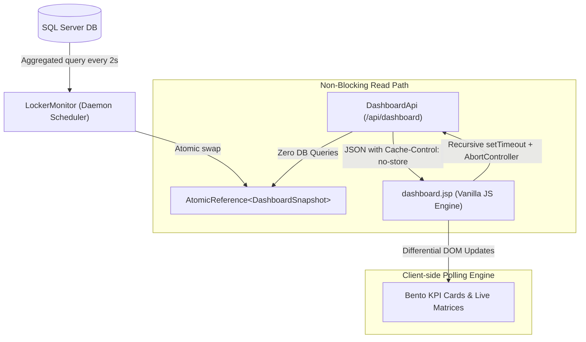
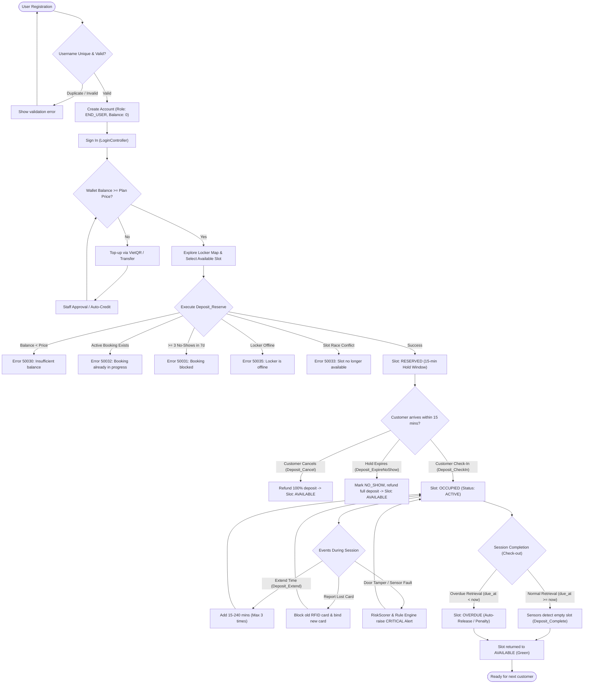
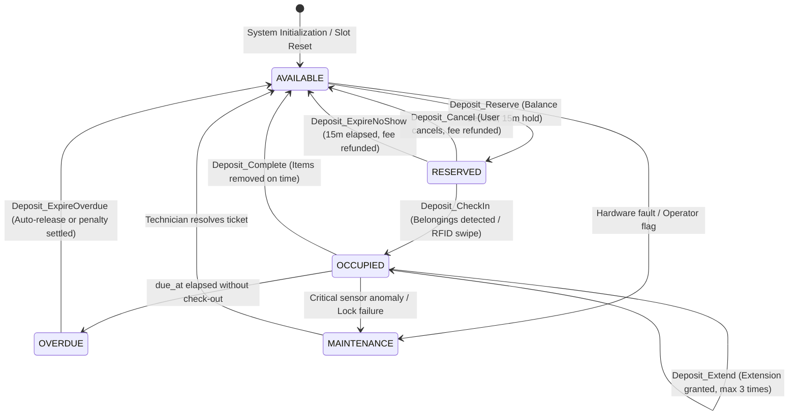

# SmartLocker System Architecture & Business Flows

This document details the core data pipelines and business lifecycles of the **SmartLocker** IoT Management System, covering both the Real-Time Telemetry Pipeline and the End-to-End User Booking Lifecycle.

---

## Part 1: Real-Time IoT Dashboard Pipeline

### 1.1 High-Concurrency Architecture

To support high-frequency client polling without degrading database throughput, the system employs an **In-Memory Snapshot Cache** managed by a dedicated daemon thread.

### 1.2 Pipeline Components
1. **`LockerMonitor` (Daemon Background Scheduler):**
   - Refreshes a `DashboardSnapshot` object every 2 seconds.
   - Evaluates slot status counts in a single query via `SUM(CASE WHEN...)` on `v_LockerSlotMap`.
   - Checks the cryptographic integrity of the audit hash chain (`AuditVerifier`).
   - Keeps active demo bank controllers alive with periodic keep-alive pings.
2. **`DashboardApi` (`/api/dashboard`):**
   - High-performance, read-only endpoint.
   - Fetches the snapshot reference directly from memory in $< 1\text{ ms}$.
   - Serializes payload using `Gson` with null safety.
3. **`dashboard.jsp` (Client Real-Time Engine):**
   - **Server-Side Rendering (SSR):** Initial state rendered server-side to prevent UI flicker (`—`).
   - **Non-overlapping Polling:** Recursive `setTimeout` guarantees that a new request is dispatched only after the previous request settles.
   - **Stray Service Worker Immunity:** Automatically unregisters stale localhost workers that intercept network requests.
   - **Differential DOM Updates:** Only DOM nodes whose values changed trigger reflow and animations.

---

## Part 2: End-to-End Locker Lifecycle & Scenario Matrix

### 2.1 Complete Flowchart (Registration to Return)

---

### 2.2 Scenario Handling Matrix

| Scenario Code | Trigger Condition | System Action | Resulting State |
| :--- | :--- | :--- | :--- |
| **Case 2.1: Happy Reserve** | Balance $\ge$ Plan price, slot is `AVAILABLE`, controller `ACTIVE`. | Atomically debits balance, sets slot to `RESERVED`, sets 15-minute hold. | `Deposit.RESERVED`, `Slot.RESERVED` |
| **Case 2.2: Insufficient Funds** | Balance $<$ Plan price. | Aborts transaction, rolls back, returns user-friendly error message. | No state change |
| **Case 2.3: Single Active Limit** | User already has an active or reserved booking. | Prevents double-booking via check on `Deposit(status IN ('RESERVED','ACTIVE'))`. | No state change |
| **Case 2.4: No-Show Ban** | User incurred $\ge 3$ No-Show events within the past 7 days. | Temporarily suspends booking privileges to prevent slot hoarding. | Request rejected |
| **Case 2.5: Hardware Offline** | Device heartbeats stopped ($> 24\text{ h}$). | Flags all child slots as `OFFLINE`; booking disallowed until back online. | Slot disabled |
| **Case 3.1: Active Check-In** | User scans card or places belongings in locker within 15 minutes. | Transition session to `ACTIVE`, start duration countdown (`due_at = now + plan_min`). | `Deposit.ACTIVE`, `Slot.OCCUPIED` |
| **Case 3.2: User Cancellation** | User clicks Cancel before check-in. | Refunds full fee to balance, releases slot lock immediately. | `Deposit.CANCELLED`, `Slot.AVAILABLE` |
| **Case 3.3: Hold Expiry (No-Show)**| 15 minutes elapse without sensor or RFID activity. | `LockerMonitor` executes `Deposit_ExpireNoShow`: releases slot, refunds balance, logs audit. | `Deposit.NO_SHOW`, `Slot.AVAILABLE` |
| **Case 4.1: Online Extension** | User requests more time before expiration. | Adds 15 to 240 minutes to `due_at` (allowed at most 3 times per booking). | `Deposit.ACTIVE` (`extend_count += 1`) |
| **Case 4.2: Lost Card Security** | User reports RFID badge lost or compromised. | Marks card `BLOCKED`; pushes blocked UID to device heartbeat blacklist; re-binds booking to replacement card. | Card blacklisted |
| **Case 4.3: Tamper Detection** | Door opened without RFID authorization or weight anomaly detected. | Weka ML `RiskScorer` flags anomaly ($Risk \ge 0.70$); triggers `CRITICAL` alert on dashboard. | Alert created, Technician notified |
| **Case 5.1: Normal Return** | User removes belongings, sensors record weight $\approx 0\text{ g}$, door closes. | Heartbeat executes `Deposit_Complete`: ends session, frees slot. | `Deposit.COMPLETED`, `Slot.AVAILABLE` |
| **Case 5.2: Overdue Auto-Release** | `due_at` has elapsed without locker retrieval. | Slot displays `OVERDUE` (orange/red); `Deposit_ExpireOverdue` releases slot to prevent deadlocks. | `Deposit.COMPLETED`, `Slot.AVAILABLE` |

---

### 2.3 State Machine Diagram

