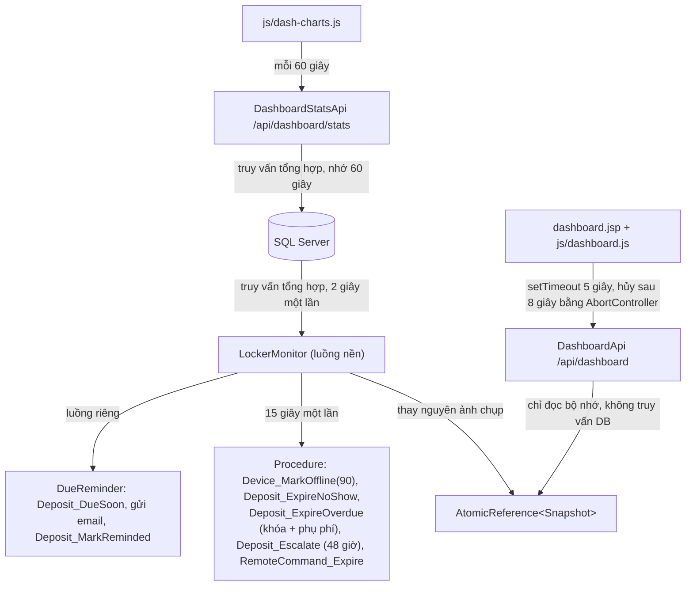
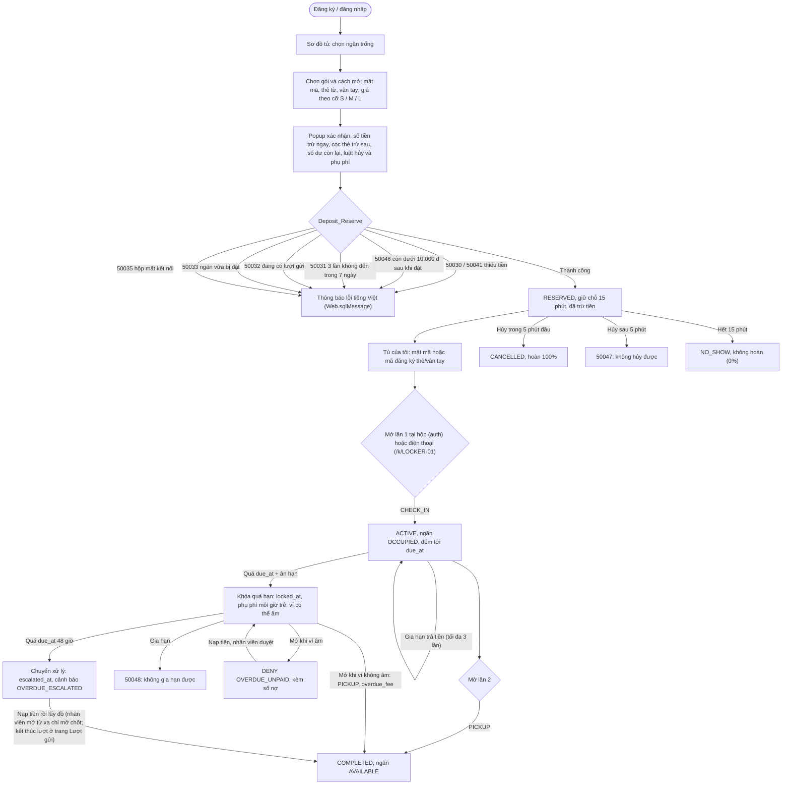
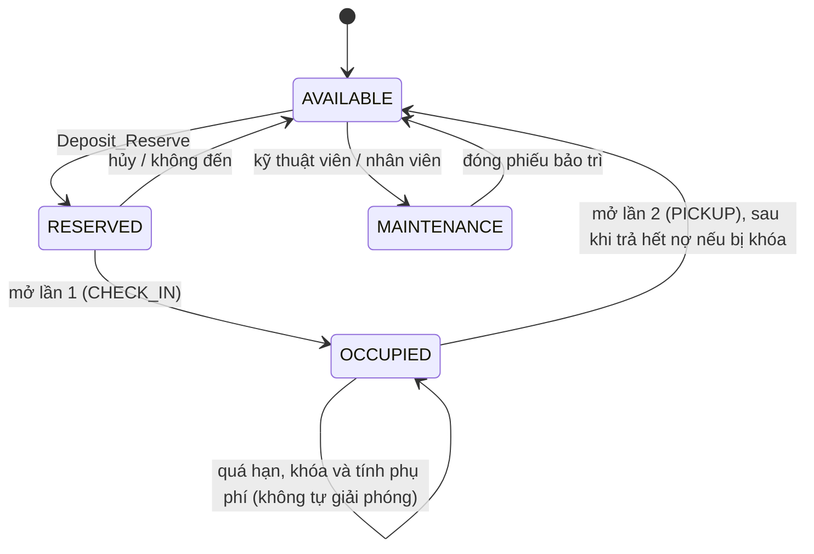

# SmartLocker: luồng hệ thống và nghiệp vụ

Tài liệu mô tả đường đi của dữ liệu và vòng đời một lượt gửi đồ, đúng với code hiện tại (v3).
Hợp đồng API chi tiết của thiết bị nằm ở [spec/smart-locker-v2.md](spec/smart-locker-v2.md) mục 4; phần thay đổi của v3
(giá theo cỡ, hủy 5 phút, không đến mất toàn bộ, khóa quá hạn và nợ, chuyển xử lý) ở [spec/smart-locker-v3.md](spec/smart-locker-v3.md).
Mọi con số (15 phút giữ chỗ, 5 phút hủy, 0% hoàn khi không đến, đệm 10.000 đ, phụ phí 150%, 48 giờ) nằm trong bảng `AppConfig`.

---

## Phần 1: Dashboard và tiến trình nền

### 1.1 Đường đi dữ liệu



### 1.2 Các thành phần
1. **`LockerMonitor`** (`ServletContextListener`, một luồng nền):
   - Mỗi 2 giây dựng `Snapshot` (KPI, số ngăn theo trạng thái, cảnh báo mới, tình trạng hộp, lượt mở gần đây) và kết quả kiểm tra chuỗi băm audit (`AuditVerifier`).
   - Mỗi 15 giây chạy các procedure hết hạn. Hộp im lặng quá 90 giây chuyển `OFFLINE`.
   - Hộp minh họa (`"demo":true` trong `OperatingProfile`) được giả heartbeat; hộp thật `LOCKER-01` thì không.
   - `DueReminder` gửi email nhắc 15 phút trước `due_at` cho chủ lượt đã xác nhận email; gửi lỗi thì thử lại ở chu kỳ sau.
     Không có `config/mail.local.properties` thì việc này tắt.
2. **`DashboardApi`**: trả JSON từ ảnh chụp; trả 503 nếu ảnh chụp chưa có (vài giây đầu sau khi deploy).
   `?device=ID` là truy vấn riêng cho biểu đồ của một hộp.
3. **`dashboard.jsp`**: lần vẽ đầu do server render; sau đó `dashboard.js` hỏi lại theo chu kỳ người dùng chọn,
   không gửi yêu cầu mới khi yêu cầu cũ chưa xong, và chỉ cập nhật ô có giá trị thay đổi.

---

## Phần 2: Vòng đời một lượt gửi

### 2.1 Đặt và dùng tủ



Ngăn không bao giờ tự giải phóng khi quá hạn (bỏ `AUTO_RELEASE_OVERDUE` của v1/v2): đồ của người dùng vẫn ở trong ngăn.
Lượt bị khóa vẫn là `ACTIVE` (trạng thái "khóa" là `locked_at IS NOT NULL`), nên ngăn vẫn `OCCUPIED` và không ai đặt được.

### 2.2 Mở tủ tại hộp (`POST /api/device/auth`)

```mermaid
sequenceDiagram
    participant Box as Hộp ESP32
    participant Api as DeviceAuthApi
    participant Db as Device_Authorize
    Box->>Api: X-API-Key + {"method":"PIN","pin":"..."}
    Api->>Api: kiểm tra định dạng (400 nếu sai)
    Api->>Db: device_id lấy từ khóa, không lấy từ body
    Db-->>Api: UNLOCK (CHECK_IN / PICKUP) hoặc DENY + reason
    Api-->>Box: message ASCII cho màn OLED, open_sec, attempts_left, retry_after_sec
```

- Lý do từ chối thường gặp: `WRONG_CODE`, `UNKNOWN_CARD`, `UNKNOWN_FINGER`, `CARD_BLOCKED`, `METHOD_MISMATCH`, `LOCKED_OUT`,
  `OVERDUE_UNPAID` (v3: lượt bị khóa quá hạn và ví đang âm; trả thêm `debt` và `overdue_fee`).
- Với lượt `ACTIVE`, `Device_Authorize` gọi `Deposit_ChargeOverdue` cho lượt đó trước khi quyết định, nên phụ phí luôn tính tới
  lúc mở, không phải chờ `LockerMonitor`. Chạy lại không thu trùng. `PICKUP` thành công trả `overdue_fee` (0 nếu đúng hạn).
- Chỉ các lần đoán sai mới tính vào bộ đếm (`OVERDUE_UNPAID` không tính). Sai 5 lần thì hộp tạm khóa 120 giây. Điện thoại có bộ đếm riêng.
- Điện thoại (`/api/kiosk/unlock`) không mở trực tiếp: máy chủ xếp lệnh `UNLOCK`, hộp nhận lệnh ở heartbeat kế tiếp,
  và lúc đó lượt gửi mới chuyển CHECK_IN hoặc PICKUP. Hộp không thấy heartbeat trong 10 giây thì trả `DEVICE_OFFLINE`.

### 2.3 Thẻ từ và vân tay
- Đặt bằng thẻ lần đầu: cần đủ tiền cho giá gói và cọc 30.000 đ; cọc chỉ bị trừ khi đăng ký thẻ xong (`enroll/finish`).
- Đăng ký tại hộp: bấm B/C, nhập mã đăng ký 6 số (hết hạn sau 10 phút, lấy mã mới ở "Tủ của tôi").
- Báo mất thẻ: thẻ chuyển `LOST`, UID nằm trong `blocked_cards` của heartbeat; dùng lại sẽ bị `CARD_BLOCKED`.
- Xóa vân tay: máy chủ xếp lệnh `DELETE_FP` cho hộp; nếu đang có lượt gửi bằng vân tay trên hộp đó, lượt đó nhận mã đăng ký mới.

### 2.4 Bảng tình huống

| Tình huống | Điều kiện | Hệ thống làm gì | Kết quả |
|---|---|---|---|
| Đặt thành công | Đủ tiền, ngăn trống, hộp hoạt động | Trừ giá theo cỡ, giữ chỗ 15 phút, ghi audit `RESERVE` | Lượt `RESERVED`, ngăn `RESERVED` |
| Thiếu tiền | Số dư nhỏ hơn giá (và cọc thẻ nếu có) | `THROW 50030` / `50041`, không đổi gì | Báo lỗi |
| Dưới mức đệm | Đủ giá nhưng sau khi đặt còn dưới 10.000 đ | `THROW 50046`, không đổi gì | Báo lỗi |
| Đang có lượt gửi | Đã có lượt `RESERVED` hoặc `ACTIVE` | `THROW 50032` | Báo lỗi |
| Hay không đến | 3 lần `NO_SHOW` trong 7 ngày | `THROW 50031` | Tạm cấm đặt |
| Hộp mất kết nối | Hộp `OFFLINE` | `THROW 50035` | Báo lỗi |
| Không đến | Hết 15 phút giữ chỗ | `Deposit_ExpireNoShow`: không hoàn (0%), audit `NO_SHOW` ghi số hoàn 0 | Lượt `NO_SHOW`, ngăn trống |
| Hủy | Người dùng hủy trong 5 phút đầu, chưa mở lần đầu | Hoàn đủ số đã trả | Lượt `CANCELLED`, ngăn trống |
| Hủy muộn | Đã quá 5 phút kể từ lúc đặt | `THROW 50047`; nút hủy đã ẩn trên web | Lượt vẫn `RESERVED` |
| Gia hạn | Lượt `ACTIVE`, chưa khóa, dưới 3 lần | Trừ giá một giờ của cỡ × số giờ bắt đầu thêm; thiếu tiền `50049` | `due_at` lùi, audit `EXTEND` |
| Quá hạn | `due_at` + ân hạn đã qua | `Deposit_ChargeOverdue`: đặt `locked_at`, trừ phụ phí mỗi giờ trễ (cho phép âm), audit `OVERDUE_LOCK`, `OVERDUE_FEE` | Lượt vẫn `ACTIVE`, ngăn vẫn `OCCUPIED`, hiện ổ khóa |
| Mở khi đang nợ | Lượt bị khóa, ví âm | `DENY OVERDUE_UNPAID` kèm `debt` (không tính lần sai) | Tủ không mở |
| Gia hạn lượt bị khóa | `locked_at` có giá trị | `THROW 50048` | Báo lỗi, phải nạp tiền rồi lấy đồ |
| Chuyển xử lý | Quá `due_at` 48 giờ | `Deposit_Escalate`: `escalated_at`, cảnh báo `OVERDUE_ESCALATED` kèm bằng chứng, audit `OVERDUE_ESCALATE` (một transaction) | Nhân viên OPERATOR/ADMIN xử lý |
| Mở từ xa | Nhân viên gửi lệnh có lý do | `RemoteCommand` chờ hộp nhận ở heartbeat; hết hạn nếu không ai nhận | Hộp mở, luật ghi nhận `STAFF_OPEN` |
| Mở giả | Lượt mở `REMOTE`/`PHONE` không có lệnh hợp lệ | `RuleEngine` | Cảnh báo `SUSPECTED_SPOOF` |
| Cảm biến hỏng | Số đo ngoài khoảng, đồng hồ lệch, hết hạn hiệu chuẩn | `RuleEngine` | Cảnh báo `SENSOR_FAULT`, phiếu bảo trì |

### 2.5 Trạng thái ngăn tủ



Trên sơ đồ tủ còn có các trạng thái hiển thị `OVERDUE`, `ALERT`, `OFFLINE`: chúng được tính từ lượt gửi, cảnh báo đang mở
và trạng thái hộp, không lưu trong cột `LockerSlot.status`. v3 thêm `locked` (lượt bị khóa quá hạn, ai cũng thấy ổ khóa)
và `escalated` (đã chuyển xử lý, chỉ nhân viên thấy) trong `v_LockerSlotMap`.
